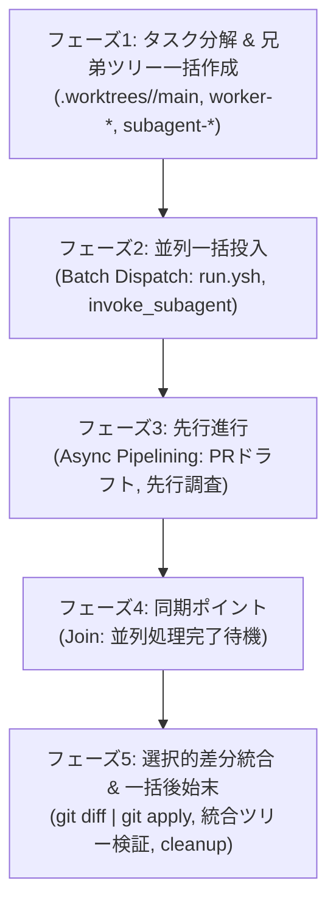

# 並列オーケストレーション・パイプライン仕様（親オーケストレーター専用）

親オーケストレーター（Antigravity Main）専用の行動規範，行動境界，委譲原則，並列オーケストレーション，非同期パイプライン，兄弟ワークツリー管理，および選択的差分統合手順の SSOT（Single Source of Truth）．呼び出される側の子エージェント（コーディングワーカーやサブエージェント）自身は本スキルを参照しない．

親セッションは全体のオーケストレーターとして振る舞い，要件定義，アーキテクチャ設計，並列タスク分解，兄弟ワークツリー管理，差分統合，PR 作成，およびユーザー対話に専念する．

---

## 1. 親オーケストレーターの行動境界と委譲原則

親オーケストレーターは自らコードの直接編集を行わず，タスクの性質に応じて適切に委譲する．

- **コード実装・修正のワーカー委譲**:
  - 親オーケストレーターは，Nix 式，設定ファイル，スクリプト等のコード作成・編集に `replace_file_content` や `write_to_file` を直接使用しない．
  - 実装，リファクタリング，および技術レビュー（改善差分作成・読み取り専用）はすべてコーディングワーカー（`pi`, `dsh`）に委譲する（仕様・実行方法は `coding-worker` スキル参照）．
- **コメント精査（hush 規約）のサブエージェント委譲**:
  - 親オーケストレーターはコード内コメントの直接編集を行わない．自明な解説コメントの排除は，Antigravity サブエージェント（`invoke_subagent`）を起動し，`hush` スキル（`~/.agents/skills/hush/`）に沿って精査・削除させる．
- **自然言語・ドキュメント改善のサブエージェント委譲**:
  - 日本語ドキュメントやスキルの文体・表現改善，トーン，および SSOT 整合性の確認・修正は，外部ワーカーを介さず Antigravity サブエージェントが直接編集して改善する．

---

## 2. 子エージェントのコンテキスト最小化原則 (Context Minimization)

子エージェント（ワーカーやサブエージェント）のトークン消費と認知的負荷を極小化するため，親オーケストレーターは情報提供のスコープを厳格に制限する．

- **オーケストレーション仕様の遮断**:
  - 子エージェントには，本スキル（`orchestration` スキル）や親専用の運用手順を読ませない・渡さない．
- **プロンプトへの最小コンテキスト注入**:
  - 子を起動する際は，タスクの遂行に不可欠な最小限の情報（作業ディレクトリ，排他的な担当ファイルパス，具体的作業指示，必要規約）のみをプロンプトで直接渡す．
- **単一責務の徹底**:
  - 子エージェントには子プロセスの再帰起動を行わせず，与えられた単一スコープの作業を完了して差分を残す・または親へ報告することに集中させる．

---

## 3. 並列第一（Concurrency-First）の原則

- **並列分割の判断基準**:
  - 変更・調査対象が2つ以上のファイル，スクリプト，モジュール，ドキュメントにまたがる場合，または独立した検証・設計タスクが存在する場合は，単一の処理に直列化せず原則として並列分割（Fan-out）する．
- **ワーカー・エージェントプールの同時フル稼働**:
  - ワーカー種別（`pi`, `dsh`）やサブエージェントを制約なくプールとして活用する．
  - コード編集は兄弟ワークツリーごとに複数のワーカーを同時にバックグラウンド起動し，ドキュメント改修は `invoke_subagent` の `Subagents` 配列に複数指定して一斉起動する．

---

## 4. 非同期パイプライン化と先行進行（Pipelining & Preemptive Execution）

- **直列化ブレーキの排除**:
  - ワーカーやサブエージェントをバックグラウンド起動した直後に，完了待ちのためにツールの呼び出しを停止してはならない（直列化の排除）．
- **先行作業の推進**:
  - バックグラウンドタスク投入後は，完了を待たずに親自身ができる作業（次工程の準備，別ワークツリーでの別タスク起動，PR 本文ドラフト作成，関連ファイル・依存関係の先行調査など）を非同期に先先と進める．
- **同期ポイント（Join Point）の限定**:
  - ツールの呼び出しを停止して完了待機を行うのは，「これ以上先行して進められるタスクがなく，並列タスクの完了結果をマージ・検証・適用する段階（合流ポイント）」に到達した時のみに限定する．

---

## 5. 初動での必須スキル読み込み

親オーケストレーターは作業着手時に，以下の必須スキルを真っ先に確認する:
- **並列オーケストレーション手順**: `orchestration` スキル（本スキル）
- **役割分担・実装委譲**: `coding-worker` スキル
- **変更・適用・検証手順**: `dev-workflow` スキル
（タスク内容に応じて `editing-guide` などの関連スキルも着手前に確認する）

---

## 6. ライフサイクルモデル

並列第一および非同期パイプライン化に基づき，以下の5フェーズでタスクを進行する．



### フェーズ1: タスク分解と複数兄弟ツリーの一括作成

1. **並列分割と排他スコープ割り当て**:
   - 変更・調査対象が2つ以上のファイル，スクリプト，モジュール，ドキュメントにまたがる場合，直列化せず原則として並列分割する．
   - 各作業者（ワーカーまたはサブエージェント）に**排他的ファイルスコープ**を割り当て，作業境界を分離する．
2. **兄弟ワークツリー構造の展開**:
   - メインツリー（`~/nix-config`）を保護するため，同一タスク名前空間配下にフラットな兄弟ワークツリーを一括作成する．
   - `.worktrees/<topic>/main` を起点および統合用ツリーとし，ワーカーやサブエージェントごとに独立した作業ツリーを並列作成する．

```bash
git fetch origin main

# 起点・統合用ワークツリー
git worktree add -b feat/<topic> .worktrees/<topic>/main origin/main

# 実装ワーカー用兄弟ワークツリー
git worktree add -b feat/<topic>-worker-a .worktrees/<topic>/worker-a origin/main
git worktree add -b feat/<topic>-worker-b .worktrees/<topic>/worker-b origin/main

# サブエージェント用兄弟ワークツリー（ドキュメント改修等）
git worktree add -b docs/<topic>-subagent-c .worktrees/<topic>/subagent-c origin/main
```

### フェーズ2: 並列一括投入（バッチディスパッチ）

直列待機を行わず，単一ターンまたは連続して全ワーカー・サブエージェントを一括起動する．

- **コーディングワーカーの一括起動**:
  - 各兄弟ツリーを作業ディレクトリ（`Cwd`）に指定し，`coding-worker` スキル（`scripts/run.ysh`）をバックグラウンド（`run_command`）で連続起動する．
- **サブエージェントの一括起動**:
  - `invoke_subagent` の `Subagents: [...]` 配列を活用して1回のツール呼び出しで一斉起動する．
- **子エージェントのコンテキスト最小化**:
  - 子エージェントには，本スキルや `GEMINI.md`，オーケストレーション全体の規約を読ませず，達成すべき具体的ゴール，排他的担当ファイル，最小制約のみをプロンプトで直接渡す．

### フェーズ3: 先行進行（非同期パイプライン化）

ワーカーやサブエージェントをバックグラウンド投入した直後に，完了待ちのためにツールの呼び出しを停止してはならない（直列化ブレーキの排除）．

バックグラウンド処理が走っている間に，親自身が進められる作業を非同期に先先と進める:
- **PR タイトル・本文ドラフトの準備**:
  - 変更理由，アーキテクチャ背景，検証項目をまとめた PR 本文（`/tmp/pr-body.md`）を先行作成する．
- **先行調査と依存関係確認**:
  - 次工程で必要となる設定ファイル，Flake 依存関係，テスト構成の先行調査を行う．
- **別ツリーでの追加タスク起動**:
  - パイプライン上で独立して開始できる別モジュール作業や補助スクリプトの準備を進める．

### フェーズ4: 同期ポイント（Join）

先行して進められる作業がなくなり，「並列タスクの完了結果をマージ・検証・適用する段階」に達したときのみ同期ポイントとする．

- **完了待機**:
  - ツールの呼び出しを停止し，バックグラウンドタスクの完了通知，またはサブエージェントからの `send_message` を待機する．
- **小刻みなタイマー監視の禁止**:
  - `schedule` タイマーによるポーリングは行わない．バックグラウンド通知によって自動的に起床する．

### フェーズ5: 選択的差分統合と一括後始末

各兄弟ツリーで生成された未コミット差分を抽出し，統合用ワークツリー（`.worktrees/<topic>/main`）へ選択的に取り込む．

1. **差分精査と選択的適用**:
   ```bash
   # 各兄弟ツリーの差分精査
   git -C .worktrees/<topic>/worker-a diff
   git -C .worktrees/<topic>/subagent-c diff

   # 統合用ツリーへパッチ抽出・適用（インデックス・作業ツリーへ反映）
   git -C .worktrees/<topic>/worker-a diff | git -C .worktrees/<topic>/main apply
   git -C .worktrees/<topic>/subagent-c diff | git -C .worktrees/<topic>/main apply

   # 未追跡ファイルがある場合の同期
   rsync -av --exclude='.git' .worktrees/<topic>/worker-a/<new_dir>/ .worktrees/<topic>/main/<new_dir>/
   ```
2. **統合ツリーでの検証**:
   - `dev-workflow` スキルの検証思考原則に従い，統合ツリー内で必要な検証（`flake check`, `nix build` など）を実施する．
3. **コミット・PR 作成**:
   - 統合用ツリーからコミット，Push，および PR 作成（`gh pr create`）を実行する．
4. **一括後始末（Cleanup）**:
   - PR マージ後（または作業完了後），兄弟ツリー群を一括削除する．

```bash
# 兄弟ワークツリーの一括削除
for wt in .worktrees/<topic>/*; do
  if [ "$wt" != ".worktrees/<topic>/main" ]; then
    git worktree remove --force "$wt" 2>/dev/null || true
  fi
done

# 統合用ワークツリーの削除とディレクトリクリーンアップ
git worktree remove --force .worktrees/<topic>/main 2>/dev/null || true
rmdir .worktrees/<topic> 2>/dev/null || true

# 一時ブランチの削除
git branch -D feat/<topic>-worker-a feat/<topic>-worker-b docs/<topic>-subagent-c 2>/dev/null || true
```

---

## 7. 複数ワーカー並行ディスパッチプロトコル

親オーケストレーターは，外部コーディングワーカー（`pi`, `dsh`）を制約なくプールとして活用し，複数兄弟ツリーへ並列投入する．

### 状態の完全分離
- **Git 状態の分離**: 兄弟ツリーごとに独立した Git インデックスを持つため，複数ワーカーが同時実行されてもロック競合やステージング干渉が起きない．
- **セッション状態の分離**: `.agents/skills/coding-worker/.state/` はツリーごとに独立保持されるため，セッション ID やログが衝突しない．

### ワーカー種別の柔軟な並行利用（Worker Diversity）
- **`pi` 同士の並列運用**:
  進捗ストリーミング（stderr）と構造化出力（stdout）をツリーごとに個別に監視可能．
- **`dsh` 同士の並列運用**:
  大容量スクリプト生成や広範なリファクタリングを分散処理．
- **`pi` と `dsh` の組み合わせ並行運用**:
  バックエンドを分散し，同時レート制限を回避しながらタスク特性に応じた最適化を行う．
  - 例: モジュール A の実装（`WORKER=pi`）とモジュール B の実装（`WORKER=dsh`）を同時並行で走らせる．
  - 例: 実装（`WORKER=pi`）と先行完了分の技術レビュー（`WORKER=dsh`）をパイプライン上で重ねて実行する．

### コマンド投入例
各兄弟ツリーを作業ディレクトリ（`Cwd`）として `run_command` で投入する:

```bash
# ワーカー 1 投入 (Cwd: .worktrees/<topic>/worker-dns)
.agents/skills/coding-worker/scripts/run.ysh "Task: Implement DNS module..."

# ワーカー 2 投入 (Cwd: .worktrees/<topic>/worker-dhcp)
WORKER=dsh .agents/skills/coding-worker/scripts/run.ysh "Task: Implement DHCP module..."
```

---

## 8. サブエージェント Fan-out 手順

ドキュメントの新規作成・改修，対訳の同期（`README.md` と `README.ja.md`），またはコード内コメントの `hush` 精査など，自然言語・テキスト主体のタスクでは `invoke_subagent` の `Subagents` 配列を用いて複数サブエージェントを一括起動（Fan-out）する．

### 分割単位
1. **ディレクトリ・領域単位**:
   - 例: サブエージェント A（`docs/operations/`），サブエージェント B（`docs/hardware/`），サブエージェント C（`AGENTS.md`, `GEMINI.md`）
2. **ファイル単位**:
   - 例: `README.md` と `README.ja.md` の対訳同期，特定モジュールの設計書とリファレンスの同時更新．
3. **独立セクション単位**:
   - 大規模ファイル内で編集範囲が完全に分離している場合（競合回避のため，原則としてファイル単位での分離を推奨）．

### 一括起動の呼び出し例
親オーケストレーターは1回の `invoke_subagent` 呼び出しで複数エージェントをディスパッチする:

```json
{
  "Subagents": [
    {
      "Role": "Ops Docs Specialist",
      "TypeName": "self",
      "Prompt": "作業ディレクトリ: /home/t3u/nix-config/.worktrees/<topic>/subagent-ops\n担当ファイル: docs/operations/...\n要件: ...（文体: 常体，句読点: `，．`，SSOT遵守）"
    },
    {
      "Role": "Hardware Docs Specialist",
      "TypeName": "self",
      "Prompt": "作業ディレクトリ: /home/t3u/nix-config/.worktrees/<topic>/subagent-hw\n担当ファイル: docs/hardware/...\n要件: ...（文体: 常体，句読点: `，．`，SSOT遵守）"
    }
  ]
}
```

### 完了報告と統合
各サブエージェントは作業完了後，`send_message` で親へ報告する．親は同期ポイントで報告を受信後，該当ツリーから差分を抽出して統合ツリーへ取り込む．
