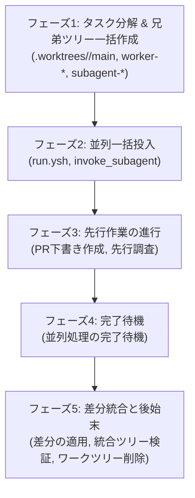

# 並列オーケストレーション・パイプライン仕様（親オーケストレーター専用）

親オーケストレーター専用の行動規範，行動境界，委譲原則，並列オーケストレーション，非同期パイプライン，兄弟ワークツリー管理，および差分統合手順をまとめた仕様書である．呼び出される側の子エージェント（コーディングワーカーやサブエージェント）自身は本スキルを参照しない．

親セッションは全体のオーケストレーターとして振る舞い，要件定義，アーキテクチャ設計，並列タスク分解，兄弟ワークツリー管理，差分統合，PR 作成，およびユーザー対話に専念する．

---

## 1. 親オーケストレーターの行動境界と委譲の原則

親オーケストレーターは自らコードの直接編集を行わず，タスクの性質に応じて適切に委譲する．

- **コード実装・修正**:
  - 親オーケストレーターは，Nix 式，設定ファイル，スクリプト等のコード作成・編集に `replace_file_content` や `write_to_file` を直接使用しない．
  - 実装，リファクタリング，および技術レビュー（改善差分の直接作成，または読み取り専用）はすべてコーディングワーカー（`pi`, `dsh`）に委譲する（仕様・実行方法は `coding-worker` スキル参照）．
- **コメント精査（hush 規約）**:
  - 親オーケストレーターはコード内コメントの直接編集を行わない．自明な解説コメントの削除は，Antigravity サブエージェント（`invoke_subagent`）を起動し，`hush` スキル（`~/.agents/skills/hush/`）に沿って精査・削除させる．
- **ドキュメント・文章の改善**:
  - 日本語ドキュメントやスキルの文体・表現改善，トーン調整，および他ドキュメントとの整合性の確認・修正は，外部ワーカーを介さず Antigravity サブエージェントが直接編集して改善する．

---

## 2. 子エージェントのコンテキスト最小化

子エージェント（ワーカーやサブエージェント）のトークン消費を抑え，タスクに集中させるため，親オーケストレーターは提供する情報の範囲を厳格に制限する．

- **管理手順を渡さない**:
  - 子エージェントには，本スキル（`orchestration` スキル）や親専用の運用手順を読ませない・渡さない．
- **必要な情報のみをプロンプトで指定**:
  - 子を起動する際は，タスクの遂行に不可欠な最小限の情報（作業ディレクトリ，排他的な担当ファイル，具体的な作業指示，必要な規約）のみをプロンプトで直接渡す．
- **単一責務の徹底**:
  - 子エージェントにはプロセスの再帰起動を行わせず，割り当てられた作業を完了して差分を残す，または親へ報告することに集中させる．

---

## 3. 並列優先の原則

- **並列分割の判断基準**:
  - 変更・調査対象が2つ以上のファイル，スクリプト，モジュール，ドキュメントにまたがる場合，または独立した検証・設計タスクが存在する場合は，単一の処理に直列化せず原則として並列に分割する．
- **ワーカーやサブエージェントの同時稼働**:
  - タスクの性質に応じてワーカー（`pi`, `dsh`）やサブエージェントを自由に組み合わせ，同時に稼働させる．
  - コード編集は兄弟ワークツリーごとに複数のワーカーを同時にバックグラウンド起動し，ドキュメント改修は `invoke_subagent` の `Subagents` 配列に複数指定して一斉起動する．

---

## 4. 非同期パイプライン化と先行作業の進行

- **完了を順番に待たない**:
  - ワーカーやサブエージェントをバックグラウンド起動した直後に，完了待ちのためにツールの呼び出しを停止しない．
- **先行する作業の推進**:
  - バックグラウンドタスク投入後は，完了を待たずに親自身ができる作業（次工程の準備，別ワークツリーでのタスク起動，PR 本文の下書き作成，依存関係の先行調査など）を次々と進める．
- **待機（同期ポイント）の限定**:
  - ツールの呼び出しを停止して完了待機を行うのは，先行して進められる作業がなくなり，並列タスクの結果を統合・検証・適用する段階に達したときのみとする．

---

## 5. 作業開始時の必須スキル確認

親オーケストレーターは作業開始時に，以下の必須スキルを真っ先に確認する:
- **並列オーケストレーション手順**: `orchestration` スキル（本スキル）
- **役割分担・実装委譲**: `coding-worker` スキル
- **変更・適用・検証手順**: `dev-workflow` スキル
（タスク内容に応じて `editing-guide` などの関連スキルも着手前に確認する）

---

## 6. ライフサイクルモデル

並列優先と非同期パイプライン化に基づき，以下の5フェーズでタスクを進行する．



### フェーズ1: タスク分解と兄弟ワークツリーの一括作成

1. **並列手順への分割と担当ファイルの割り当て**:
   - 変更・調査対象が2つ以上のファイル，スクリプト，モジュール，ドキュメントにまたがる場合，原則として並列手順へと分割する．
   - 各作業者（ワーカーまたはサブエージェント）に担当ファイルを排他的に割り当て，編集範囲が重複しないようにする．
2. **兄弟ワークツリーの一括作成**:
   - メインツリー（`~/nix-config`）の手元作業を保護するため，同一タスクの配下にフラットな兄弟ワークツリーを一括作成する．
   - `.worktrees/<topic>/main` を起点・統合用ツリーとし，ワーカーやサブエージェントごとに独立した作業ツリーを並列作成する．

```bash
git fetch origin main

# 起点・統合用ワークツリー
git worktree add -b feat/<topic> .worktrees/<topic>/main origin/main

# 実装ワーカー用兄弟ワークツリー
git worktree add -b feat/<topic>-worker-a .worktrees/<topic>/worker-a origin/main
git worktree add -b feat/<topic>-worker-b .worktrees/<topic>/worker-b origin/main

# サブエージェント用兄弟ワークツリー（ドキュメント改修等）
git worktree add -b docs/<topic>-subagent-c .worktrees/<topic>/subagent-c origin/main
```

### フェーズ2: 並列一括投入

順番に待機せず，全ワーカーやサブエージェントを連続して起動する．

- **コーディングワーカーの起動**:
  - 各兄弟ツリーを作業ディレクトリ（`Cwd`）に指定し，`coding-worker` スキル（`scripts/run.ysh`）をバックグラウンド（`run_command`）で連続起動する．
- **サブエージェントの起動**:
  - `invoke_subagent` の `Subagents` 配列を活用して1回のツール呼び出しで一斉起動する．
- **子エージェントのコンテキスト最小化**:
  - 子エージェントには，本スキルや運用全体の詳細ルールを読ませず，達成すべき目標，担当ファイル，必要な制約のみをプロンプトで直接渡す．

### フェーズ3: 先行作業の進行

ワーカーやサブエージェントをバックグラウンド投入した直後に，完了待ちのためにツールの呼び出しを停止しない．バックグラウンド処理の実行中も，親自身が進められる作業を先行して進める:

- **PR 本文の下書き準備**:
  - 変更理由，設計の背景，検証項目をまとめた PR 本文（`/tmp/pr-body.md`）を先行作成する．
- **先行調査と依存関係の確認**:
  - 次の工程で必要となる設定ファイル，Flake の依存関係，テスト構成の先行調査を行う．
- **別ツリーでの追加作業**:
  - 独立して開始できる別モジュールの作業や補助スクリプトの準備を進める．

### フェーズ4: 完了の待機（同期ポイント）

先行して進められる作業がなくなり，並列タスクの結果を統合・検証する段階に達したときのみ待機に入る．

- **待機の実行**:
  - ツールの呼び出しを停止し，バックグラウンドタスクの完了通知，またはサブエージェントからのメッセージ（`send_message`）を待つ．
- **小刻みなタイマー監視の禁止**:
  - `schedule` タイマーによるポーリングは行わない．バックグラウンド通知によって自動的に処理が再開される．

### フェーズ5: 差分の統合と後始末

各兄弟ツリーで生成された差分を抽出し，統合用ワークツリー（`.worktrees/<topic>/main`）へ選択的に取り込む．

1. **差分の確認と適用**:
   ```bash
   # 各兄弟ツリーの差分確認
   git -C .worktrees/<topic>/worker-a diff
   git -C .worktrees/<topic>/subagent-c diff

   # 統合用ツリーへパッチ抽出・適用（インデックス・作業ツリーへ反映）
   git -C .worktrees/<topic>/worker-a diff | git -C .worktrees/<topic>/main apply
   git -C .worktrees/<topic>/subagent-c diff | git -C .worktrees/<topic>/main apply

   # 未追跡ファイルがある場合の同期
   rsync -av --exclude='.git' .worktrees/<topic>/worker-a/<new_dir>/ .worktrees/<topic>/main/<new_dir>/
   ```
2. **統合ツリーでの検証**:
   - `dev-workflow` スキルの基準に従い，統合ツリー内で必要な検証（`flake check`, `nix build` など）を実施する．
3. **コミットと PR 作成**:
   - 統合用ツリーからコミット，push，および PR 作成（`gh pr create`）を実行する．
4. **ワークツリーの後始末**:
   - PR マージ後（または作業完了後），兄弟ツリー群を一括削除する．

```bash
# 兄弟ワークツリーの一括削除
for wt in .worktrees/<topic>/*; do
  if [ "$wt" != ".worktrees/<topic>/main" ]; then
    git worktree remove --force "$wt" 2>/dev/null || true
  fi
done

# 統合用ワークツリーの削除とディレクトリクリーンアップ
git worktree remove --force .worktrees/<topic>/main 2>/dev/null || true
rmdir .worktrees/<topic> 2>/dev/null || true

# 一時ブランチの削除
git branch -D feat/<topic>-worker-a feat/<topic>-worker-b docs/<topic>-subagent-c 2>/dev/null || true
```

---

## 7. 複数ワーカーの並列実行手順

親オーケストレーターは，外部コーディングワーカー（`pi`, `dsh`）をタスクに応じて活用し，複数兄弟ツリーへ並列投入する．

### 状態の完全分離
- **Git 状態の分離**: 兄弟ツリーごとに独立した Git インデックスを持つため，複数ワーカーが同時実行されてもロック競合やステージングの干渉が起きない．
- **セッション状態の分離**: `.agents/skills/coding-worker/.state/` はツリーごとに独立保持されるため，セッション ID やログが衝突しない．

### ワーカー種別の柔軟な使い分け
- **`pi` 同士の並列運用**:
  進捗（stderr）と実行結果（stdout）をツリーごとに個別に確認できる．
- **`dsh` 同士の並列運用**:
  大規模なスクリプト生成や広範なリファクタリングを分散処理する．
- **`pi` と `dsh` の組み合わせ運用**:
  バックエンドを分散し，API のレート制限を回避しながらタスクの特性に応じて使い分ける．
  - 例: モジュール A の実装（`WORKER=pi`）とモジュール B の実装（`WORKER=dsh`）を同時に走らせる．
  - 例: 実装（`WORKER=pi`）と先行完了分の技術レビュー（`WORKER=dsh`）を並行して実行する．

### コマンド投入例
各兄弟ツリーを作業ディレクトリ（`Cwd`）として `run_command` で投入する:

```bash
# ワーカー 1 投入 (Cwd: .worktrees/<topic>/worker-dns)
.agents/skills/coding-worker/scripts/run.ysh "Task: Implement DNS module..."

# ワーカー 2 投入 (Cwd: .worktrees/<topic>/worker-dhcp)
WORKER=dsh .agents/skills/coding-worker/scripts/run.ysh "Task: Implement DHCP module..."
```

---

## 8. サブエージェントの並列展開手順

ドキュメントの新規作成・改修，対訳の同期（`README.md` と `README.ja.md`），またはコード内コメントの `hush` 精査など，自然言語・テキスト主体のタスクでは `invoke_subagent` の `Subagents` 配列を用いて複数のサブエージェントを一括起動する．

### 分割単位
1. **ディレクトリ・領域単位**:
   - 例: サブエージェント A（`docs/operations/`），サブエージェント B（`docs/hardware/`），サブエージェント C（`AGENTS.md`, `GEMINI.md`）
2. **ファイル単位**:
   - 例: `README.md` と `README.ja.md` の対訳同期，特定モジュールの設計書とリファレンスの同時更新．
3. **独立セクション単位**:
   - 大規模ファイル内で編集範囲が完全に分離している場合（競合回避のため，原則としてファイル単位での分離を推奨）．

### 一括起動の呼び出し例
親オーケストレーターは1回の `invoke_subagent` 呼び出しで複数のエージェントを起動する:

```json
{
  "Subagents": [
    {
      "Role": "Ops Docs Specialist",
      "TypeName": "self",
      "Prompt": "作業ディレクトリ: /home/t3u/nix-config/.worktrees/<topic>/subagent-ops\n担当ファイル: docs/operations/...\n要件: ...（文体: 常体，句読点: `，．`，規約遵守）"
    },
    {
      "Role": "Hardware Docs Specialist",
      "TypeName": "self",
      "Prompt": "作業ディレクトリ: /home/t3u/nix-config/.worktrees/<topic>/subagent-hw\n担当ファイル: docs/hardware/...\n要件: ...（文体: 常体，句読点: `，．`，規約遵守）"
    }
  ]
}
```

### 完了報告と統合
各サブエージェントは作業完了後，`send_message` で親へ報告する．親は同期ポイントで報告を受信後，該当ツリーから差分を抽出して統合ツリーへ取り込む．
