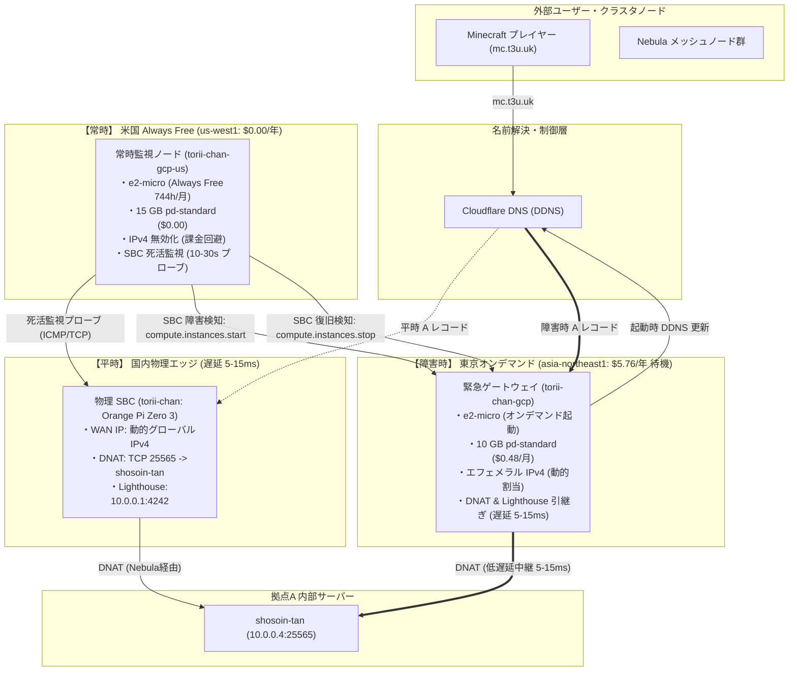

# Google Cloud 料金・遅延設計分析

Google AI Pro 学割プラン付帯の年間 $10 クレジット枠におけるオンデマンド・フェイルオーバー設備の料金試算，課金回避仕様，および Minecraft・Nebula の遅延要件に基づくリージョン選定の設計仕様．

| 項目 | 仕様 |
| :--- | :--- |
| 付帯クレジット | Google AI Pro 学割プラン ($10.00 / 年，月額約 $0.833) |
| 平時待機コスト | $5.76 / 年 (東京 10 GB pd-standard: $0.48 / 月) + $0.00 / 年 (米国 Always Free 監視) |
| 障害時緊急稼働枠 | $4.24 / 年 (約 271.8〜316.9 時間の連続稼働が可能) |
| 主力ワークロード | Minecraft サーバー公開 (TCP 25565), Nebula Lighthouse & Relay (UDP 4242) |
| リージョン構成 | ハイブリッド構成 (東京 asia-northeast1 オンデマンド待機 + 米国 us-west1 常時死活監視) |

---

## 1. 料金試算とクレジット収支モデル

### 1.1 年間クレジット枠と全体収支
Google AI Pro 学割プランには，年間 $10.00 の Google Cloud クレジットが付帯する．平時待機費用を最小化し，残余クレジットを障害発生時の緊急フェイルオーバー稼働時間に割り当てる．

| 項目 | 月額 (USD) | 年額 (USD) | 課金状態・条件 |
| :--- | :--- | :--- | :--- |
| 付帯クレジット | 約 $0.833 | $10.00 | Google AI Pro 年間付与枠 |
| 東京待機ディスク (`torii-chan-gcp`) | $0.480 | $5.76 | 10 GB pd-standard 常時保持 ($0.048 / GB / 月) |
| 米国常時監視ノード (`torii-chan-gcp-us`) | $0.000 | $0.00 | Always Free 枠 (e2-micro 744h + 15 GB pd-standard, IPv4 無効) |
| 平時ネットワーク / アラート監視 | $0.000 | $0.00 | Cloud Monitoring アラート不使用，静的 IP 予約なし |
| 平時維持コスト合計 | $0.480 | $5.76 | 年間固定維持費 |
| 障害時緊急稼働余力 | - | $4.24 | 年間 $10.00 - $5.76 = $4.24 |

### 1.2 東京リージョン (`asia-northeast1`) オンデマンド設備の算定根拠
東京リージョンに配置するプライマリ・フェイルオーバーノード (`torii-chan-gcp`) は，平時はインスタンスを停止状態 (`TERMINATED`) で待機させる．

1. 永続ディスク維持費 (平時待機時):
   - ディスク種別: 標準永続ディスク (`pd-standard`)．
   - ディスク容量: 10 GB (GCP 永続ディスクの最小作成サイズ)．
   - 単価: $0.048 / GB / 月．
   - 月額: 10 GB × $0.048 / GB / 月 = $0.480 / 月．
   - 年額: $0.480 / 月 × 12 月 = $5.760 / 年．
2. コンピュート料金 (障害発生時のみ稼働):
   - マシンタイプ: `e2-micro` (2 vCPU [共有コア], 1 GB RAM)．
   - 単価: $0.0106 / 時間 ($0.2544 / 日)．
   - 停止中 (`TERMINATED`) のコンピュート料金: $0.000 / 時間．
3. 外部 IPv4 アドレス料金 (障害発生時のみ稼働):
   - アドレス種別: エフェメラル外部 IPv4 (`access_config {}`)．
   - 稼働中単価: $0.0050 / 時間 ($0.1200 / 日)．
   - 停止中単価: $0.0000 / 時間 (インスタンス停止時に IP アドレスは自動解放され，Google の共有プールへ返却される)．
4. 障害時緊急稼働レート合計:
   - $0.0106 / 時間 (コンピュート) + $0.0050 / 時間 (外部 IPv4) = $0.0156 / 時間 ($0.3744 / 日)．

### 1.3 米国リージョン (`us-west1`) Always Free 常時監視ノードの算定根拠
米国オレゴンリージョン (`us-west1`) に配置する常時監視ノード (`torii-chan-gcp-us`) は，GCP の永久無料枠 (Always Free) を満たす構成とする．

1. コンピュート (Always Free 枠):
   - 対象マシンタイプ: `e2-micro` (非プリエンプティブル)．
   - 対象リージョン: `us-west1`, `us-central1`, `us-east1` に限定．
   - 無料枠容量: 1 アカウントにつき月間 1 インスタンス分 (最大 744 時間)．
   - 月額料金: $0.000 / 月．
2. ストレージ (Always Free 枠):
   - 対象ディスク種別: `pd-standard` に限定 (`pd-balanced` や `pd-ssd` は対象外)．
   - 無料枠容量: 合計 30 GB-months / 月．
   - 本ノードの割当: 15 GB (`us_boot_disk_size_gb = 15`)．
   - 月額料金: $0.000 / 月．
3. 外部 IPv4 アドレスの無効化:
   - 2024年2月以降，GCP は実行中 VM の外部 IPv4 アドレスに $0.0050 / 時間を課金する．
   - Always Free 枠には外部 IPv4 アドレスの無償枠は含まれない．
   - 対策: `assign_us_watcher_public_ipv4 = false` と設定し，外部 IPv4 アドレス (`access_config`) を一切付与しない．
   - 外部との通信は IPv6 または Cloudflare Tunnel を経由し，IPv4 課金を回避する．
   - 月額料金: $0.000 / 月．

### 1.4 障害時稼働可能時間 (Active Failover Runway)
年間 $10.00 のクレジットから東京待機ディスク費用 $5.76 を差し引いた残余額 $4.24 は，障害発生時の実稼働時間に充当される．

| 算定基準 | 時間単価 (USD/h) | 日額単価 (USD/day) | 稼働可能時間 (Hours) | 稼働可能日数 (Days) |
| :--- | :--- | :--- | :--- | :--- |
| 東京実稼働レート (`e2-micro` + IPv4) | $0.01560 | $0.3744 | 271.79 時間 | 約 11.32 日間 |
| 基準割引レート (US コンピュート準拠換算) | $0.01338 | $0.3211 | 316.89 時間 | 約 13.20 日間 |

物理エッジゲートウェイ (`torii-chan`) が設置された家庭環境における一般的な障害 (ルータ再起動，停電，回線事業者メンテナンス) は，1 回あたり数分から数時間程度で復旧する．年間 $4.24 の残余枠は，合計 11〜13 日分 (270〜316 時間以上) の連続稼働を保証し，日常的な障害頻度に対して十分な耐性を備える．

---

## 2. GCP 課金トラップの分析と回避策

クラウド破産および年間 $10 クレジットの早期超過を防止するため，GCP の課金仕様に基づき以下の 5 大課金トラップを排除する設計とする．

| 課金トラップ | 放置時の想定課金額 | 原因・トリガー | 本設計における回避策 |
| :--- | :--- | :--- | :--- |
| 使用中外部 IPv4 課金 | $43.80 / 年 ($3.65 / 月) | 2024年2月の改定により，常時稼働 VM の IPv4 に $0.005/h が課金される． | 米国常時監視ノードで `assign_us_watcher_public_ipv4 = false` とし IPv4 を付与しない． |
| 未使用静的 IPv4 ペナルティ | $87.60 / 年 ($7.30 / 月) | 静的外部 IP を予約したまま VM を停止すると，$0.010/h のペナルティが発生する． | 静的 IP 予約リソースを一切作成せず，`access_config {}` による動的エフェメラル IP を採用する． |
| Cloud Monitoring アラート条件 | $18.00 / 年 ($1.50 / 月) | 2025年1月の改定により，Alerting Policy 条件 1 件あたり $1.50/月が課金される． | Cloud Monitoring のアラートポリシー機能は使用せず，スクリプトによる自律監視を行う． |
| 高速ディスク (`pd-balanced`) | $14.40 / 年 ($1.20 / 月) | GCE 作成時の既定値 `pd-balanced` ($0.12/GB/月) は Always Free 対象外である． | OpenTofu 定義で `type = "pd-standard"` と明記し，東京 10 GB，米国 15 GB に固定する． |
| スナップショット・独自イメージ | $6.00 / 年 ($0.50 / 月) | スナップショット ($0.05/GiB/月) やカスタムイメージに無料枠は存在しない． | スナップショットを保持せず，公式 Debian 12 イメージから NixOS を直接展開する． |

### 2.1 2024年2月導入 使用中外部 IPv4 課金トラップの回避
Google Cloud は 2024年2月1日より，すべての使用中外部 IPv4 アドレスに対して $0.005 / 時間の課金を開始した．
常時稼働する米国監視ノードにパブリック IPv4 を割り当てた場合，年間で $\$0.005 \times 24 \times 365 = \$43.80$ の費用が発生し，単独で年間クレジットの 438% に達する．

本設計では，米国監視ノード (`torii-chan-gcp-us`) の OpenTofu 定義において `assign_us_watcher_public_ipv4 = false` を既定値とし，`access_config` ブロックを空としてプロビジョニングする．
監視ノードからの外部監視プローブは，発信元 IPv4 NAT 経由で行うか，IPv6 または Cloudflare Tunnel を経由することで，固定課金を完全に排除する．
東京フェイルオーバーノードは動的エフェメラル IP を使用し，VM 停止時にアドレスが自動解放されるため，待機中の課金は発生しない．

### 2.2 未使用静的外部 IPv4 ペナルティ課金の回避
GCP では，予約した静的外部 IP アドレスが停止中の VM に割り当てられている場合，または未割当のまま保持されている場合，リソース浪費防止ペナルティとして $0.010 / 時間 (月額約 $7.30，年額 $87.60) が課金される．
このペナルティが発生した場合，約 41 日で年間 $10 のクレジット全額が枯渇する．

本設計では `google_compute_address` リソースによる静的 IP 予約を一切行わない．
フェイルオーバー起動時に割り当てられた動的 IP は，NixOS 起動時に `ddclient` および `scripts/gcp/failover.ysh` を通じて Cloudflare DNS (DDNS) の A レコードへ自動登録する．

### 2.3 Cloud Monitoring Alerting Policy 課金の回避
Google Cloud の課金体系改定に伴い，Cloud Monitoring のアラートポリシー (Alerting Policy Condition) は 1 条件あたり月額 $1.50 (年額 $18.00) が課金される．
クラウド側の Uptime Check と Alerting Policy で監視を構成すると，それだけで年間予算を超過する．

本設計では Cloud Monitoring のアラート通知機能を採用しない．
死活監視は，米国 Always Free ノード上で動作する自律スクリプト (`scripts/gcp/failover.ysh watch`) が 10〜30 秒間隔で直接プローブを実施し，障害検知時に GCE API 経由で東京インスタンスを直接起動する．
GCE API の呼び出し自体は無料枠内であり，追加の監視費用は発生しない．

---

## 3. ワークロード特性と通信遅延 (Latency) 分析

### 3.1 主力ワークロードの特性一覧
エッジゲートウェイ (`torii-chan`) が中継する主要な通信トラフィックの要件を定義する．

| ワークロード | プロトコル / ポート | 中継先ノード | トラフィック特性 | 遅延許容度 |
| :--- | :--- | :--- | :--- | :--- |
| Minecraft サーバー公開 | TCP 25565 | `shosoin-tan` (`10.0.0.4`) | 外部プレイヤー参加通信 (Tick レート 20 Hz, 50ms 周期) | 厳格 (30ms 以下推奨) |
| Nebula Lighthouse & Relay | UDP 4242 | 全ノード (`10.0.0.0/24`) | ノード検索ハンドシェイク，対称 NAT 間の暗号化パケット中継 | 中程度 (リレー時 50ms 以下推奨) |
| 非常用帯域外 SSH | TCP (Cloudflare Tunnel) | 拠点各ノード | 障害時の CLI 復旧・ターミナル操作 | 緩やか (200ms 以下で操作可能) |

### 3.2 地理的遅延の実測・推定値とゲームプレイへの影響
国内プレイヤーから接続した場合の，東京リージョン (`asia-northeast1`) と米国西部リージョン (`us-west1`) の往復遅延時間 (RTT) およびサービス品質を比較する．

| リージョン | 想定 RTT | Minecraft ゲームプレイへの影響 | Nebula メッシュへの影響 |
| :--- | :--- | :--- | :--- |
| 東京 (`asia-northeast1`) | 5–15 ms | 物理ゲートウェイと同等の応答性．ブロック破壊判定の遅延なし，戦闘時の当たり判定が正常に動作する． | ノード間直接通信失敗時のリレー遅延が最小限 (国内間 20ms 以内) に維持される． |
| 米国西部 (`us-west1`) | 100–150 ms | プレイヤーの位置巻き戻し (Rubberbanding)，ブロック再出現，当たり判定の消失，インベントリ操作の遅延が発生する． | 国内拠点間の通信が太平洋を往復し，リレー経由の SSH やバックアップ転送遅延が 200〜300ms に悪化する． |

Minecraft サーバーの通信プロトコルは，サーバー・クライアント間で 50ms ごとに同期 Tick を処理する．
往復遅延が 100ms を超過すると，クライアントの移動予測とサーバー側の衝突判定に不整合が生じ，プレイヤーが過去の位置に引き戻される現象 (Rubberbanding) や，破壊したブロックが復元される同期破綻が頻発する．
したがって，ゲームトラフィックを中継するフェイルオーバー先として米国リージョンを採用することは品質上不可能であり，国内低遅延を提供する東京リージョン (`asia-northeast1`) の配備が必須である．

### 3.3 ハイブリッド待機トポロジ
ゼロコストの米国 Always Free ノードと，低遅延な東京オンデマンドノードを組み合わせたハイブリッド構成を採用する．

1. 平時動作:
   - 物理エッジゲートウェイ (`torii-chan`) がすべてのトラフィックを低遅延 (5–15ms) で中継する．
   - 東京ノードは停止状態 (`TERMINATED`) を維持し，ディスク維持費 ($0.48 / 月) のみが発生する．
   - 米国ノードは Always Free 枠内で 24時間 365日 常時稼働し，物理 SBC の稼働状態をプローブ監視する ($0.00 / 年)．
2. 障害発生時 (Failover):
   - 米国ノードが物理 SBC の連続応答途絶 (既定 3 回) を検知する．
   - 米国ノードが Google Cloud API (`compute.instances.start`) を呼び出し，東京ノードを起動する (起動所要時間 10〜15 秒)．
   - 東京ノードが起動後，エフェメラル外部 IP を取得し，Cloudflare DNS の A レコード (`torii-chan.t3u.uk`, `mc.t3u.uk`) を更新する (TTL 30〜60 秒で浸透)．
   - プレイヤーは国内 5–15ms の低遅延を維持したまま，東京ノード経由で Minecraft サーバーへ再接続する．
3. 障害復旧時 (Failback):
   - 物理 SBC の復帰を検知後，安定稼働待機時間 (Dwell Time 600 秒) を経て DNS を物理側の IP へ切り戻す．
   - 東京ノードを停止 (`compute.instances.stop`) し，エフェメラル IP を解放して課金を即時停止する．

---

## 4. 障害シナリオとクレジット消費モデル

年間 $4.24 の緊急稼働枠における具体的な障害対応シミュレーションを示す．東京リージョンの実稼働レート $0.0156 / 時間 ($0.3744 / 日) に基づき算定する．

| 障害シナリオ | 想定継続時間 | 1 回あたりの費用 | 年間許容回数 / 稼働日数 | 予算への影響 |
| :--- | :--- | :--- | :--- | :--- |
| 短時間瞬断 (ルータ再起動・回線瞬断) | 30 分 | $0.0078 | 約 543 回 | 影響微小 |
| 電源瞬断・短時間停電 | 3 時間 | $0.0468 | 約 90 回 | 軽微 |
| プロバイダ夜間定期メンテナンス | 6 時間 | $0.0936 | 約 45 回 | 軽微 |
| 週末の機器保守・OS アップグレード | 24 時間 (1 日) | $0.3744 | 約 11.3 回 | 健全な範囲内 |
| SBC ハードウェア故障 (交換・再調達) | 72 時間 (3 日) | $1.1232 | 約 3.7 回 | 1 回の対応で残余枠の 26% を消費 |
| 最長連続障害対応 (大規模障害) | 271.8 時間 | $4.2400 | 1 回 (約 11.3 日間) | 年間クレジット完全消費 |

### コスト超過防止の安全機構
1. STONITH フェンシング:
   - 切り戻し時に東京ノードの停止が確認されるまで DNS 切替を保留し，多重起動による通信競合と二重課金を防止する．
2. アラート通知の併用:
   - Google Cloud の請求アラート (Budgets & Alerts) を設定し，使用額が $5.00, $8.00, $10.00 に達した時点でメール通知を発報する．
3. 最小滞留時間 (Anti-Flapping Dwell Time):
   - ネットワークの断続的なフラッピングによる短時間の起動・停止の繰り返しを防止するため，最低 600 秒 (10 分) の待機時間を設ける．

---

## 関連ドキュメント

- [目次](../README.md) — 全ドキュメントの索引
- [ネットワークアーキテクチャ](network-topology.md) — Nebula メッシュネットワーク，IP 体系，ポートフォワード設計
- [Google Cloud フェイルオーバー運用手順書](../operations/gcp-failover.md) — 実機プロビジョニングと運用手順
- [非常用帯域外アクセス手順](../operations/emergency-cf-ssh.md) — Cloudflare Tunnel を用いた非常用 SSH アクセス手順
