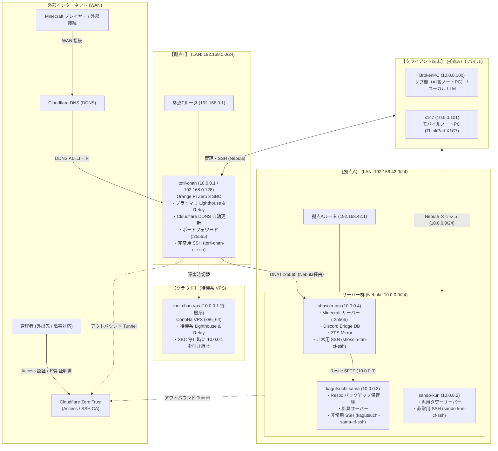

# ネットワークアーキテクチャ

拠点間（拠点T・拠点A・クラウド）の物理・論理トポロジ，Nebula メッシュ VPN，WAN/LAN 接続経路，ポートフォワーディング，およびセキュリティ境界の設計仕様．

## 1. マルチサイト・ネットワーク全体トポロジ

拠点T（エッジゲートウェイ・Lighthouse），拠点A（サーバークラスタ・端末群），およびクラウド（待機系 VPS）を Nebula メッシュ VPN（`10.0.0.0/24`, MTU 1320）で相互接続する．クライアント端末（BrokenPC, x1c7）は拠点A LAN 内および公衆網（モバイル）から Nebula を経由してクラスタへ参加する．

---

## 2. Nebula IP アロケーション台帳

全ノードは `10.0.0.0/24` のプライベートアドレス空間に配置する（定義元: [`scripts/nebula-lib.ysh`](../../scripts/nebula-lib.ysh) の `FLEET` 定義）．

| ホスト名 | Nebula IP | 物理拠点 / 内部 LAN | ロール / グループ | 役割・用途 |
| :--- | :--- | :--- | :--- | :--- |
| `torii-chan` | `10.0.0.1` | 拠点T (`192.168.0.128`) | `mgmt` | プライマリ Lighthouse & Relay，エッジゲートウェイ |
| `sando-kun` | `10.0.0.2` | 拠点A (`192.168.42.x`) | `mgmt` | 汎用タワーサーバー（レガシー BIOS） |
| `kagutsuchi-sama` | `10.0.0.3` | 拠点A (`192.168.42.x`) | `mgmt` | 計算サーバー，Restic リモートバックアップ保管庫 |
| `shosoin-tan` | `10.0.0.4` | 拠点A (`192.168.42.x`) | `mgmt,app` | Minecraft サーバー，Discord Bridge，ZFS ストレージ |
| `BrokenPC` | `10.0.0.100` | 拠点A / モバイル | `mgmt,app` | サブ機（可搬ノートPC），ローカル LLM 推論 |
| `x1c7` | `10.0.0.101` | 拠点A / モバイル | `mgmt,app` | モバイルノートPC（ThinkPad X1C7） |
| `torii-chan-vps` | `10.0.0.1` (待機系) | クラウド (ConoHa VPS) | `mgmt` | 待機系 Lighthouse & Relay（SBC 停止時に 10.0.0.1 を引き継ぐ） |

---

## 3. 主要なネットワーク機構

### 3.1 メッシュネットワークの適用範囲と通信構造
- 管理下の全ノード（`10.0.0.0/24`）間でメッシュを構成し，外部インターネットや未登録端末とは論理的に分離する．
- 同一 LAN（拠点A 内など）にあるノード間は直接通信し，拠点間など直接到達できない場合は Lighthouse / Relay（`torii-chan`）を経由して接続する．
- プライマリ Lighthouse（`torii-chan`）障害時は，クラウド上の待機系 VPS（`torii-chan-vps`）へ切り替えて接続性を維持する（詳細は [`../operations/vps-failover.md`](../operations/vps-failover.md) 参照）．

### 3.2 外部公開とポートフォワーディング
- 拠点Tの `torii-chan` 上で稼働する Cloudflare DDNS サービスが，動的グローバル IPv4 アドレスを検知して A レコード（`torii-chan.t3u.uk`，`mc.t3u.uk`，`*.mc.t3u.uk` 等）を自動更新する．
- 外部から届いた Minecraft トラフィック（TCP 25565）は，`torii-chan` の NixOS 標準ファイアウォール（iptables バックエンド，`networking.nat`）により Nebula トンネルを経由して拠点Aの `shosoin-tan`（`10.0.0.4:25565`）へ DNAT 転送する．

### 3.3 同一 LAN 内での直接接続と名前解決
- 拠点Tの LAN 内から外部公開ドメイン（`torii-chan.t3u.uk`）へアクセスする際，ルータのヘアピン NAT（NAT Loopback）対応状況や IPv6 優先挙動によって通信障害が発生する場合がある．
- 回避策として，[`nixos/networking/local-network.nix`](../../nixos/networking/local-network.nix) の `my.networking.local-network` を有効化し，`networking.hosts` で `torii-chan.t3u.uk` を `192.168.0.128` へ直接解決する（詳細は [`../troubleshooting/network-recovery.md`](../troubleshooting/network-recovery.md#3-同一ルータ同居時の名前解決障害と-nat-loopback-回避) 参照）．

### 3.4 非常用帯域外アクセス（Cloudflare Tunnel）
- Nebula メッシュ VPN や物理 LAN の疎通状態に依存しない独立した帯域外管理系統（Out-of-Band Management）として，各サーバー（`torii-chan`，`sando-kun`，`kagutsuchi-sama`，`shosoin-tan`）上で `cloudflared` が常時稼働する．
- 各ノードから Cloudflare エッジへのアウトバウンド常時接続（HTTPS / QUIC）のみでトンネルを確立し，NAT やローカルファイアウォールを越えて外部から直接到達できる．
- Nebula 不通時や Lighthouse ダウン時でも，管理者は `<hostname>-cf-ssh.t3u.uk` を通じて PC CLI（ProxyCommand）または Web ブラウザ（xterm.js ターミナル）経由で各サーバーへアクセスし，緊急復旧作業を実施できる（詳細は [`../operations/emergency-cf-ssh.md`](../operations/emergency-cf-ssh.md) 参照）．

---

## 4. セキュリティ境界（Security Boundary）

### SSH の Nebula 限定リッスン
拠点Aのサーバー群（`shosoin-tan`, `kagutsuchi-sama`, `sando-kun`）の SSH ポート 22 は，物理 LAN や外部 WAN からは遮断し，`nebula0` インターフェース（`10.0.0.0/24`）経由の接続のみ許可する．

### グループによるゾーン分離
- `mgmt`: 全ノードに付与する基本管理グループ．
- `app`: アプリケーション通信（Minecraft，Discord Bridge，デスクトップ作業）を許可するグループ．

### 証明書の有効期限管理
Nebula ルート CA およびノード証明書は有効期間 10 年で発行する（更新手順は [`../operations/secret-management.md`](../operations/secret-management.md) 参照）．

### 帯域外アクセスの多層防御
Cloudflare Tunnel 経由の接続は以下の 3 層で保護する:
- エッジでの Cloudflare Zero Trust (Access) 認証（メール OTP または SSO）
- Cloudflare SSH CA による有効期限 3 分の短期証明書検証（Web ターミナル接続時）
- OS 側の ED25519 ユーザー公開鍵認証（PC CLI 接続時）

アウトバウンドトンネル方式により，外部からの直接走査や総当たり試行から隔離される．

---

## 関連ドキュメント
- [目次（設計・運用ドキュメント）](../README.md)
- [非常用 SSH アクセス運用マニュアル（Cloudflare Tunnel）](../operations/emergency-cf-ssh.md)
- [リポジトリ全体アーキテクチャ](overview.md)
- [シークレット & 鍵ライフサイクル管理](../operations/secret-management.md)
- [ConoHa VPS プロビジョニング & フェイルオーバー手順](../operations/vps-failover.md)
- [ネットワーク障害トラブルシューティング](../troubleshooting/network-recovery.md)
