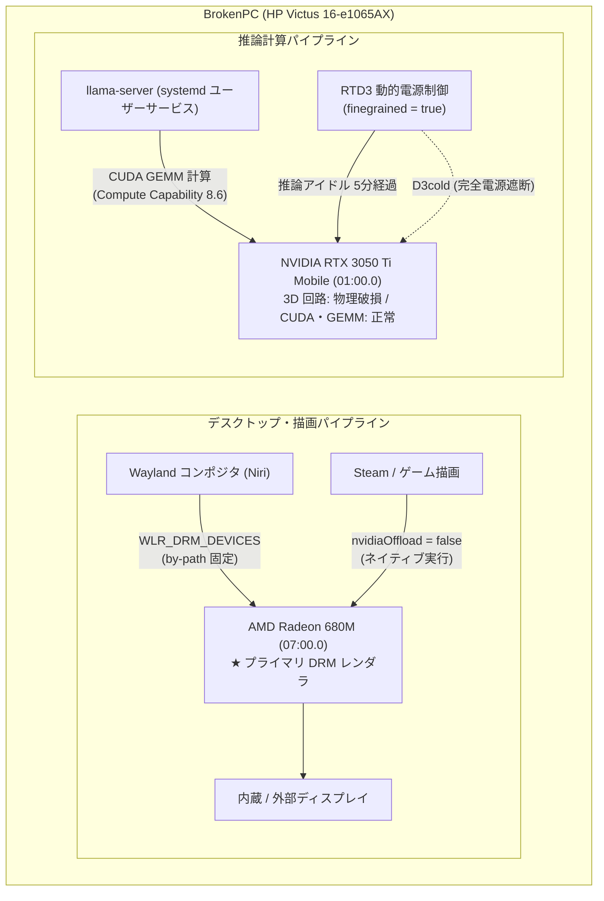

# AMD + NVIDIA ハイブリッド GPU 分離設計ガイド

AMD Ryzen 7 6800H (内蔵 GPU: Radeon 680M) と 3D 回路障害を抱える NVIDIA GeForce RTX 3050 Ti Laptop GPU を搭載したホスト (`BrokenPC` / HP Victus 16-e1065AX) における，Wayland 描画隔離と CUDA 推論専用オフロードの分離設計仕様．



---

## 1. システム構成と障害の切り分け

### ハードウェア構成

| 項目 | 諸元・仕様 |
| :--- | :--- |
| 対象ホスト | `BrokenPC` (HP Victus 16-e1065AX): サブ機 (可搬ノートPC) |
| CPU | AMD Ryzen 7 6800H (Zen 3+, 8コア / 16スレッド，基本 3.2 GHz / 最大 4.7 GHz) |
| iGPU | AMD Radeon 680M (Rembrandt, RDNA2, 12 CU / 768 シェーダー，PCI `07:00.0`) |
| dGPU | NVIDIA GeForce RTX 3050 Ti Mobile (GA107, Ampere, 4 GB GDDR6, PCI `01:00.0`，物理障害あり) |
| RAM | 16 GB DDR5-4800 |
| ストレージ | 512 GB NVMe (OS / Boot), 1 TB NVMe (`/data`) |

### 障害の症状と切り分け

Minecraft などの高負荷 3D レンダリングを実行すると，OpenGL 環境では `libnvidia-glcore.so` 内で `SIGSEGV` が発生し，Vulkan 環境では GPU ハング (画面フリーズおよびドライバのリセットタイムアウト) が発生する．

原因調査のため実施した切り分け実験では，以下の結果が得られた．

- `glmark2` ベンチマークは完走する．
- VRAM の 90% 以上を確保するメモリストレステストはエラーなく通過する．

この結果から，dGPU 内部の 3D レンダリングパイプラインおよびテクスチャアップロード回路の物理的破損が原因であると判明した．なお，AMD Radeon 680M iGPU は 3D アプリケーションを安定して実行できる．

---

## 2. デスクトップ・描画パイプラインの隔離設計

物理破損を抱える dGPU が描画パイプラインに関与するとデスクトップ環境やアプリケーションがクラッシュするため，表示・描画から dGPU を排除し，AMD iGPU のみで完結させる．

### Wayland (Niri) レンダラの iGPU 固定 (`WLR_DRM_DEVICES`)

Niri (wlroots ベースの Wayland コンポジタ) において，プライマリ DRM デバイスを AMD iGPU に固定する．

```ini
# ~/.config/systemd/user/niri.service.d/wlr-drm-devices.conf
[Service]
Environment="WLR_DRM_DEVICES=/dev/dri/by-path/pci-0000:07:00.0-card,/dev/dri/by-path/pci-0000:01:00.0-card"
```

#### 設定の要点と設計判断

##### `/dev/dri/by-path` の採用
`/dev/dri/card0` や `card1` などの動的デバイス名は，カーネルのモジュール初期化順序によってブートごとに番号が入れ替わるリスクがある．PCI バスアドレスに基づくシンボリックリンク (AMD iGPU: `07:00.0`, NVIDIA dGPU: `01:00.0`) を明示することで，常に AMD iGPU がプライマリレンダラとして選択されることを保証する．

##### Home Manager ドロップインによる定義
NixOS システムモジュール側で `systemd.user.services.niri` を定義すると，niri パッケージが提供する既定の Unit 定義が丸ごと上書きされ，`ExecStart` 行が欠落する．`/etc/systemd/user` は Nix store へのシンボリックリンクであり `environment.etc` によるインプレース追記ができないため，[hosts/BrokenPC/default.nix](../../hosts/BrokenPC/default.nix) 内の Home Manager 設定経由で `xdg.configFile."systemd/user/niri.service.d/wlr-drm-devices.conf"` を配置している．

### ゲーム描画における dGPU オフロード無効化

Steam や各種ゲームは Radeon 680M 上でネイティブ描画する (`nvidia-offload` による PRIME オフロード描画は 3D 回路破損によりクラッシュするため)．設定では `my.services.desktop.gaming.nvidiaOffload.enable = false` (既定値の無効状態) を維持し，dGPU の 3D 描画呼び出しによるクラッシュを防止する．

### 省電力制御 (RTD3 & finegrained)

描画から除外された dGPU を常時通電させておくと電力消費と発熱が生じ，バッテリー駆動時間を損なう．NVIDIA オープンカーネルモジュールと RTD3 (Runtime D3) を併用し，アイドル時に dGPU の電源を遮断する．

```nix
# hosts/BrokenPC/default.nix
my.hardware.nvidia = {
  enable = true;
  open = true; # オープンカーネルモジュールを使用
  powerManagement = {
    enable = true;
    finegrained = true; # RTD3 動的電源管理を有効化
  };
  prime = {
    enable = true;
    offload.enable = true;
    sync.enable = false; # ディスプレイ同期出力は無効
    nvidiaBusId = "PCI:1:0:0";
    amdgpuBusId = "PCI:7:0:0";
  };
};
```

これにより，CUDA 計算タスクが実行されていない平常時は自動的に省電力スリープ (電源遮断状態) を維持する．

#### dGPU 電源状態の確認手順

dGPU のサスペンド (D3cold) 状態確認コマンド:

```bash
# dGPU の Runtime PM 状態を確認 (suspended であれば電源切断中)
cat /sys/bus/pci/devices/0000:01:00.0/power/runtime_status
# 期待される出力: suspended

# サスペンド状態の累積時間 (ミリ秒) を確認
cat /sys/bus/pci/devices/0000:01:00.0/power/runtime_suspended_time
```

> [!WARNING]
> `nvidia-smi` コマンドを実行すると，ドライバが dGPU を D0 (稼働状態) へ復帰させてしまう．アイドリング状態の確認には `nvidia-smi` ではなく上記の sysfs を参照すること．

---

## 3. CUDA / llama.cpp 推論専用オフロード

行列積演算 (GEMM) およびテンソル並列計算パイプライン (CUDA コア / Tensor コア) は正常に機能する．この特性を利用し，LLM 推論アクセラレータとして dGPU を使用する．

### ビルドアーキテクチャの指定

GA107 コア (Ampere アーキテクチャ) 向けコード生成指定 ([hosts/BrokenPC/default.nix](../../hosts/BrokenPC/default.nix)):

```nix
# hosts/BrokenPC/default.nix
nixpkgs.config.cudaCapabilities = [ "8.6" ];
```

これにより不要なバイナリ肥大化を避け，RTX 3050 Ti (Compute Capability 8.6) 向けに特化した CUDA カーネルをビルドする．

### llama.cpp サービス構成とメモリチューニング

推論バックエンドとして [hosts/BrokenPC/services/llama.nix](../../hosts/BrokenPC/services/llama.nix) にて `llama-server` を運用している．

```nix
home-manager.users.${config.my.user.name} = {
  my.home.programs.llama = {
    enable = true;
    enableCuda = true;
    modelsDir = "/data/llama/models";
    modelsMax = 1;
    sleepIdleSeconds = 300; # アイドル 5 分でモデル解放・GPU 電源オフ
    presets = {
      # 3B/4B: VRAM に完全オフロード
      "G9v3-3B-Q4_K_M" = {
        ngl = 99;
        ncmoe = 0;
        ctxSize = 32768;
      };
      "Qwen3.5-4B-Q4_K_M" = {
        ngl = 99;
        ncmoe = 0;
        ctxSize = 16384;
      };
      # 9B: 一部層のみ GPU オフロード (VRAM 4GB 制限)
      "Qwen3.5-9B-Q4_K_M" = {
        ngl = 12;
        ncmoe = 0;
        ctxSize = 32768;
      };
      "Ornith-1.5-9B-Q4_K_M" = {
        ngl = 12;
        ncmoe = 0;
        ctxSize = 32768;
      };
      # MoE / 小型モデル: --fit による自動フィッティングに委ねる
      "Ling-3.0-tiny-Q4_K_M" = { };
      "Ling-3.0-tiny-Uncensored-Abliterated.Q8_0" = { };
      "LFM2.5-8B-A1B-Q4_0" = { };
    };
  };
};
```

#### 4 GB VRAM 環境におけるチューニング要点

| モデル区分 | 該当モデル例 | GPU層 (`ngl`) | MoE (`ncmoe`) | コンテキスト長 (`ctxSize`) | オフロード戦略 |
| :--- | :--- | :--- | :--- | :--- | :--- |
| 3B / 4B クラス | `G9v3-3B`, `Qwen3.5-4B` | `99` (全層) | `0` | 16,384 〜 32,768 | 4 GB VRAM 内へ全レイヤを格納して推論 |
| 9B クラス | `Qwen3.5-9B`, `Ornith-1.5-9B` | `12` (先頭12層) | `0` | 32,768 | VRAM を超えるため先頭層のみ GPU，残りは CPU+RAM |
| 小型 MoE | `Ling-3.0-tiny`, `LFM2.5-8B` | *未指定* | *未指定* | *未指定* | `--fit` フラグに委ね，VRAM 枠に応じた動的最適配分 |

##### `--fit` オプションによる動的 MoE オフロード
`presets` 内で設定値を空集合 `{}` としたモデルは，設定 INI ファイルからキーが省略される．これにより，`llama-server` の `--fit` フラグが有効化され，4 GB の VRAM 枠に収まるよう自動的にレイヤ数，コンテキスト長，MoE エキスパート数が最適配分される (`ngl` や `ncmoe` を手動指定すると `--fit` が無効化される)．

##### アイドル時の電源遮断 (`sleepIdleSeconds = 300`)
推論リクエストが途絶えて 300 秒 (5 分) 経過するとモデルをメモリから解放する．これに連動して dGPU への CUDA コンテキストが破棄され，前述の RTD3 機構により dGPU が自動的に電源遮断 (`suspended`) 状態に戻る．

---

## 関連ドキュメント

- [BrokenPC ホスト概要](../../hosts/BrokenPC/README.md) — BrokenPC (HP Victus 16) の概要と運用方針
- [BrokenPC ホスト定義](../../hosts/BrokenPC/default.nix) — BrokenPC 固有のモジュールインポートと設定
- [BrokenPC ハードウェア構成](../../hosts/BrokenPC/hardware.nix) — ハードウェアスキャン定義とファイルシステム設定
- [推論サービス定義](../../hosts/BrokenPC/services/llama.nix) — llama.cpp 推論サーバーおよびモデルプリセット定義
