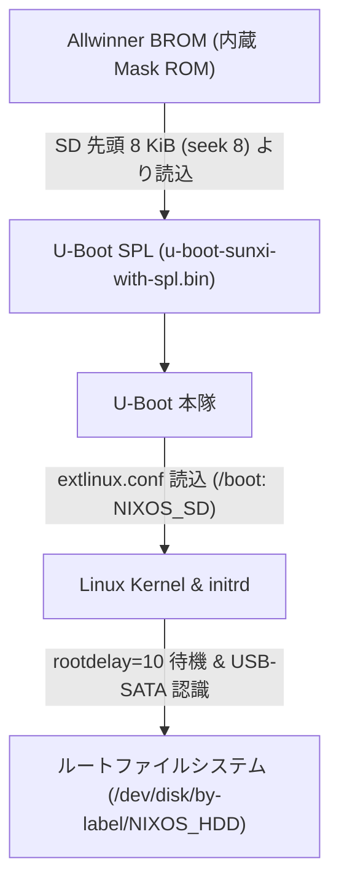

# Orange Pi Zero3 (Allwinner H618) ハードウェア・SBC ガイド

Allwinner H618 搭載シングルボードコンピュータ `torii-chan` の U-Boot ブートチェーン，SD / HDD 分離ストレージ構成，インストーライメージビルド，および 1 GB RAM 環境下でのリソース制約回避の技術仕様．

---

## 1. ハードウェア仕様とクラスタ内での役割

### 1.1 基本諸元

| 項目 | 諸元・仕様 |
| :--- | :--- |
| 対象ホスト | `torii-chan` (SBC モード) |
| SoC | Allwinner H618 (Quad-core ARM Cortex-A53 @ 1.5 GHz) |
| GPU | ARM Mali-G31 MP2 (OpenGL ES 3.2, Vulkan 1.1) |
| RAM | 1 GB LPDDR4 (オンボード実装) |
| 有線 LAN | ギガビット Ethernet (`end0`, Realtek RTL8211F PHY) |
| ストレージ | microSD スロット (ブート用) + USB 2.0 接続 2.5インチ SATA HDD (ルート用) |
| 電源 | USB Type-C (5V / 3A 推奨) |

### 1.2 クラスタ内での役割

| 項目 | 内容・設定 |
| :--- | :--- |
| 設置場所 | 拠点T (LAN: `192.168.0.0/24`，固定 IP: `192.168.0.128`) |
| Nebula Gateway / Lighthouse | メッシュネットワーク `10.0.0.0/24` の固定灯台ノード (`10.0.0.1:4242`) およびリレーとして常時稼働 |
| ポートフォワーディング | 外部からの Minecraft 接続 (TCP 25565) を受け，Nebula オーバーレイ経由で拠点Aの `shosoin-tan` (`10.0.0.4`) へ透過的に NAT 転送 |
| Cloudflare DDNS | 拠点Tの動的グローバル IP アドレスの変化を検知し，`torii-chan.t3u.uk`, `mc.t3u.uk`，および `*.mc.t3u.uk` の A レコードを自動更新 |
| VPS フェイルオーバー設計 | SBC のハードウェア障害時は，同一ホスト名と暗号化シークレットを共有する ConoHa VPS (`torii-chan-vps`) へ役割を移譲可能 (詳細は [docs/operations/vps-failover.md](../operations/vps-failover.md) を参照) |

---

## 2. ブートチェーンと SD / HDD 分離ストレージ構成

### 2.1 Allwinner H618 ブートシーケンスと U-Boot

Allwinner 製 SoC は，起動時に BROM (内蔵 Mask ROM) が SD カードの特定セクタから U-Boot SPL を読み込むアーキテクチャを持つ．



### 2.2 U-Boot の注入と extlinux ブートローダ

SD カードイメージ生成時に，Flake オーバーレイでビルドされた `ubootOrangePiZero3` の SPL バイナリをオフセット 8 KiB (ブロックサイズ 1024, seek 8) の位置へ直接書き込む ([hosts/torii-chan/sd-installer.nix](../../hosts/torii-chan/sd-installer.nix))．

```nix
sdImage.postBuildCommands = ''
  echo "Writing U-Boot to image..."
  dd if=${pkgs.ubootOrangePiZero3}/u-boot-sunxi-with-spl.bin of=$img bs=1024 seek=8 conv=notrunc
'';
```

ブートローダには U-Boot の標準仕様に準拠した extlinux 互換ローダを使用する ([hosts/torii-chan/sbc.nix](../../hosts/torii-chan/sbc.nix))．

```nix
boot.loader = {
  generic-extlinux-compatible.enable = true;
  grub.enable = false;
};
```

`/boot/extlinux/extlinux.conf` に世代別ブートエントリが自動生成され，カーネル更新と世代ロールバックが可能になる．

### 2.3 SD / HDD 分離アーキテクチャ (`torii-chan-hdd`)

SD カードはランダム書き込み耐性が低く，24時間稼働のエッジゲートウェイ用途でログや Nix store 更新を行うとフラッシュメモリの早期摩耗死 (クラッシュ) を招く．本番の HDD 運用構成 (`torii-chan-hdd`) ではブート部とルートファイルシステムを物理的に分離する (SD 単体運用構成 `torii-chan-sd` の場合は [hosts/torii-chan/fs-sd.nix](../../hosts/torii-chan/fs-sd.nix) を使用)．

| 領域 | デバイス | ラベル / マウント先 | ファイルシステム | 定義モジュール |
| :--- | :--- | :--- | :--- | :--- |
| ブート | microSD カード | `NIXOS_SD` (`/boot`) | `ext4` | [hosts/torii-chan/fs-hdd.nix](../../hosts/torii-chan/fs-hdd.nix) |
| ルート | 外付け USB HDD | `NIXOS_HDD` (`/`) | `ext4` (`noatime`) | [hosts/torii-chan/fs-hdd.nix](../../hosts/torii-chan/fs-hdd.nix) |

### 2.4 USB HDD の安定化設定

USB 接続された 2.5 インチ HDD をルートドライブとして安定動作させるため，[hosts/torii-chan/fs-hdd.nix](../../hosts/torii-chan/fs-hdd.nix) で次の設定を与える．

| 対策 | 設定 | 背景 |
| :--- | :--- | :--- |
| UAS (USB Attached SCSI) の無効化 | `boot.kernelParams = [ "usb-storage.quirks=152d:0583:u" ]` | JMicron JMS583 USB-SATA ブリッジ (`152d:0583`) は UAS 動作時にタイムアウトや I/O エラーを起こしやすいため，USB Mass Storage ドライバで駆動する |
| ルートドライブ認識待ちの延長 | `boot.kernelParams = [ "rootdelay=10" ]` | USB デバイスはバスのリセットおよびスピンアップに時間を要するため，initrd 内でのマウントタイムアウトを回避する |
| 過剰なヘッド退避の抑止 | `systemd.services.hdd-apm` が `hdparm -B 255 /dev/disk/by-label/NIXOS_HDD` を実行 | WD Scorpio Blue などの 2.5 インチ HDD は APM の既定値でアイドル数十秒ごとにヘッドを退避し，`Load_Cycle_Count` が急増して短寿命化する |
| SMART 監視のピンポイント指定 | `services.smartd.autodetect = false` と `options = "-d sat ..."` | USB ブリッジ越しの自動プローブは異常動作を招く恐れがあるため，監視対象を明示する |

---

## 3. SD カードインストーライメージのビルド

### 3.1 イメージ生成手順

[hosts/torii-chan/build-sd-image.ysh](../../hosts/torii-chan/build-sd-image.ysh) が一時パスワードの発行からイメージビルドまでを実行する．

```bash
./hosts/torii-chan/build-sd-image.ysh
```

スクリプトの処理順:

1. ランダムな一時パスワード (16進数 16文字) を自動生成し，平文を `result-sd-temp-password.txt` (パーミッション `0600`) に出力する．
2. `openssl passwd -6` で SHA-512 crypt ハッシュを算出する．
3. 環境変数 `TORII_INSTALLER_TEMP_PASSWORD_HASH` を介して `--impure` ビルドを実行し，インストーラ構成 ([hosts/torii-chan/sd-installer.nix](../../hosts/torii-chan/sd-installer.nix)) へハッシュを注入する．
4. ビルド成果物 (`result-sd-image/sd-image/*.img`) は `compressImage = false` (非圧縮) であり，高速に SD カードへ書き込める．

### 3.2 aarch64 ネイティブビルド環境

インストーライメージは aarch64 ネイティブビルドで構成される．x86_64 ホスト (`BrokenPC` 等) では，[nixos/base/nix.nix](../../nixos/base/nix.nix) の QEMU binfmt エミュレーション (`boot.binfmt.emulatedSystems = [ "aarch64-linux" ]`) を通じてビルドされる．

---

## 4. 初期導入・HDD 移行手順

### 4.1 SD カードへの書き込み

```bash
sudo dd if=result-sd-image/sd-image/nixos-image-sd-card-*.img of=/dev/sdX bs=4M status=progress conv=fsync
```

### 4.2 インストーラ起動と SSH 接続

Orange Pi Zero3 に SD カードを挿入して起動すると，[hosts/torii-chan/sbc.nix](../../hosts/torii-chan/sbc.nix) の静的設定により `192.168.0.128` が割り当てられる．インストーラは `PermitRootLogin = "prohibit-password"` で動作するため ([hosts/torii-chan/installer-common.nix](../../hosts/torii-chan/installer-common.nix))，root は SSH 公開鍵認証のみ受け付け，`t3u` は `result-sd-temp-password.txt` の一時パスワードでログインできる．

```bash
ssh t3u@192.168.0.128
```

### 4.3 SSH ホスト公開鍵の取得と登録

ホスト鍵は root のみ読み取り可能なため，`sudo` を付けて取得する．

```bash
sudo cat /etc/ssh/ssh_host_ed25519_key.pub
```

得られた SSH 公開鍵 (`ssh-ed25519 ...`) を [hosts/torii-chan/default.nix](../../hosts/torii-chan/default.nix) の `age.rekey.hostPubkey` へ登録し，`just secret rekey` を実行してコミットする．

### 4.4 本番 SD 構成への切り替え

```bash
nixos-rebuild switch --flake .#torii-chan-sd \
  --target-host t3u@192.168.0.128 \
  --sudo --ask-sudo-password \
  --option sandbox false --option filter-syscalls false
```

### 4.5 HDD へのルート複製

外付け HDD (`/dev/sda`) をフォーマットし，稼働中の SD カードルートを rsync で同期する．スワップファイルは移行先で再生成されるため除外する．

```bash
sudo mkfs.ext4 -L NIXOS_HDD /dev/sda1
sudo mkdir -p /mnt/hdd
sudo mount /dev/sda1 /mnt/hdd
sudo rsync -aAXHx --exclude='/proc/*' --exclude='/sys/*' --exclude='/dev/*' \
  --exclude='/run/*' --exclude='/tmp/*' --exclude='/mnt/*' --exclude='/lost+found' \
  --exclude='/boot/*' --exclude='/var/lib/swapfile' / /mnt/hdd/
sudo sync
```

### 4.6 本番 HDD 構成の適用と再起動

```bash
nixos-rebuild switch --flake .#torii-chan-hdd \
  --target-host t3u@10.0.0.1 \
  --sudo --ask-sudo-password \
  --option sandbox false --option filter-syscalls false
sudo reboot
```

---

## 5. 低スペック制約 (1 GB RAM) とカーネル制約への対応

### 5.1 制約事項と対策一覧

[nixos/profiles/sbc/default.nix](../../nixos/profiles/sbc/default.nix) が適用する制約緩和の一覧:

| 項目 | 制約要因・技術的背景 | 適用対策 | 運用上の注意点 |
| :--- | :--- | :--- | :--- |
| サンドボックス / システムコール | Allwinner 向けカーネルにおける `user_namespaces` / `seccomp BPF` の不完全性 | `sandbox = false;`<br>`filter-syscalls = false;` | デプロイ時にも `--option sandbox false --option filter-syscalls false` の付与が必須 |
| メモリ枯渇 (OOM) | 1 GB 物理 RAM に対する Nix 評価や並列タスクの負荷 | 4 GB スワップファイル確保 (`/var/lib/swapfile`) | 大規模評価やビルドは作業機からのリモートビルド (`--build-host localhost`) を推奨 |
| スワップスラッシング | 低速ストレージへの過剰なスワップ I/O によるシステム停止 | `vm.swappiness = 10` | 物理 RAM 限界までスワップ書き込みを遅延させ応答性を維持 |

### 5.2 サンドボックスと seccomp BPF の無効化

Allwinner 向け Linux カーネルでは，`user_namespaces` や `seccomp BPF` のサポートが不完全である．この状態で Nix の標準ビルドを実行すると，サンドボックス環境の作成やシステムコールフィルタでエラーが発生する．

```nix
# nixos/profiles/sbc/default.nix
nix.settings = {
  sandbox = false;
  filter-syscalls = false;
};
```

リモートデプロイ時にも，実機上でのビルドエラーを防ぐため同一フラグを付与する (4.4 および 4.6 の `nixos-rebuild` コマンドを参照)．

### 5.3 スワップファイルとメモリ枯渇 (OOM) 対策

1 GB の物理メモリでは，Nix のプロファイル評価やカーネルモジュール展開，複数プロセスの同時稼働によって OOM Killer が発動しやすい．4 GB のスワップファイルを確保し，急激なメモリ消費に備える．

```nix
# nixos/profiles/sbc/default.nix
swapDevices = [
  {
    device = "/var/lib/swapfile";
    size = 4096;
  }
];
```

SD カードや USB HDD への過剰なスワップ I/O はシステム全体をスラッシングさせるため，`vm.swappiness = 10` を設定して物理 RAM を使い切るまでディスクスワップへの書き出しを遅延させる．

### 5.4 状態検証コマンド

実機ログイン後の状態確認コマンド:

```bash
# ストレージラベルとマウント状況の確認
lsblk -o NAME,SIZE,FSTYPE,LABEL,MOUNTPOINT

# APM スピンダウン抑止の確認 (255 または disabled)
sudo hdparm -I /dev/disk/by-label/NIXOS_HDD | grep -i "Advanced power management"

# スワップ認識と swappiness の確認
swapon --show
sysctl vm.swappiness
```

---

## 関連ドキュメント

- [torii-chan ホスト概要](../../hosts/torii-chan/README.md) — torii-chan (Orange Pi Zero 3) の概要と運用方針
- [SBC プラットフォーム定義](../../hosts/torii-chan/sbc.nix) — Allwinner H618 向けブートローダおよびハードウェア設定
- [HDD ルートファイルシステム定義](../../hosts/torii-chan/fs-hdd.nix) — SD/HDD 分離運用のマウント定義
- [SD ルートファイルシステム定義](../../hosts/torii-chan/fs-sd.nix) — SD 単体運用のファイルシステム定義
- [SD インストーラ定義](../../hosts/torii-chan/sd-installer.nix) — インストーラ SD イメージのビルド定義
- [SBC 共通プロファイル](../../nixos/profiles/sbc/default.nix) — 低メモリ SBC 向け制約緩和設定
- [ConoHa VPS プロビジョニング & フェイルオーバー手順](../operations/vps-failover.md) — VPS 待機系への切り替えと切り戻し手順
