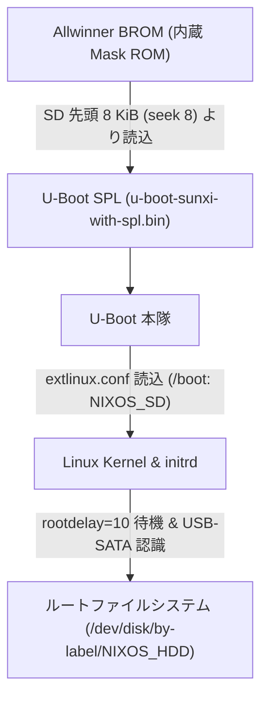

# Orange Pi Zero3 (Allwinner H618) ハードウェア・SBC ガイド

Allwinner H618 搭載シングルボードコンピュータ `torii-chan` の U-Boot ブートチェーン，SD / HDD 分離ストレージ構成，インストーライメージビルド，および 1 GB RAM 環境下でのリソース制約回避の技術仕様．

---

## 1. ハードウェア仕様とクラスタ内での役割

### 基本諸元

| 項目 | 諸元・仕様 |
| :--- | :--- |
| **対象ホスト** | `torii-chan`（SBC モード） |
| **SoC** | Allwinner H618（Quad-core ARM Cortex-A53 @ 1.5 GHz） |
| **GPU** | ARM Mali-G31 MP2（OpenGL ES 3.2，Vulkan 1.1） |
| **RAM** | 1 GB LPDDR4（オンボード実装） |
| **有線 LAN** | ギガビット Ethernet（`end0`，Realtek RTL8211F PHY） |
| **ストレージ** | microSD スロット（ブート用）+ USB 2.0 接続 2.5インチ SATA HDD（ルート用） |
| **電源** | USB Type-C（5V / 3A 推奨） |

### クラスタ内での役割

- **設置場所**: **拠点T**（拠点T LAN: `192.168.0.0/24`，固定 IP: `192.168.0.128`）．
- **Nebula Gateway / Lighthouse**: メッシュネットワーク `10.0.0.0/24` の固定灯台ノード（`10.0.0.1:4242`）およびリレーとして拠点Tから常時稼働．
- **ポートフォワーディング**: 外部からの Minecraft 接続（TCP 25565）を受け，Nebula オーバーレイ経由で拠点Aの `shosoin-tan`（`10.0.0.4`）へ透過的に NAT 転送．
- **Cloudflare DDNS**: 拠点Tの動的グローバル IP アドレスの変化を検知し，`torii-chan.t3u.uk`，`mc.t3u.uk`，および `*.mc.t3u.uk` の A レコードを自動更新．
- **VPS フェイルオーバー設計**: SBC のハードウェア障害時は，同一のホスト名と暗号化シークレットを共有する ConoHa VPS（`torii-chan-vps`）へ役割を移譲できる（詳細は [`docs/operations/vps-failover.md`](../operations/vps-failover.md) を参照）．

---

## 2. ブートチェーンと SD / HDD 分離ストレージ構成

### Allwinner H618 ブートシーケンスと U-Boot

Allwinner 製 SoC は，起動時に BROM（内蔵 Mask ROM）が SD カードの特定セクタから U-Boot SPL を読み込むアーキテクチャを持つ．



#### U-Boot の注入 (`hosts/torii-chan/sd-installer.nix`)

SD カードイメージ生成時に，Flake オーバーレイでビルドされた `ubootOrangePiZero3` の SPL バイナリをオフセット 8 KiB（ブロックサイズ 1024，seek 8）の位置へ直接書き込む．

```nix
sdImage.postBuildCommands = ''
  echo "Writing U-Boot to image..."
  dd if=${pkgs.ubootOrangePiZero3}/u-boot-sunxi-with-spl.bin of=$img bs=1024 seek=8 conv=notrunc
'';
```

#### extlinux ブートローダの採用 (`hosts/torii-chan/sbc.nix`)

U-Boot の標準仕様に準拠した extlinux 互換ローダを使用する．

```nix
boot.loader = {
  generic-extlinux-compatible.enable = true;
  grub.enable = false;
};
```

これにより `/boot/extlinux/extlinux.conf` に世代別ブートエントリが自動生成され，カーネル更新や世代ロールバックを行える．

### SD / HDD 分離アーキテクチャ (`torii-chan-hdd`)

SD カードはランダム書き込み耐性が低く，24時間稼働のエッジゲートウェイ用途でログや Nix store 更新を行うとフラッシュメモリの早期摩耗死（クラッシュ）を招く．本番の HDD 運用構成（`torii-chan-hdd`）では **ブート部とルートファイルシステムを物理的に分離** する（SD 単体運用構成 `torii-chan-sd` の場合は [`hosts/torii-chan/fs-sd.nix`](../../hosts/torii-chan/fs-sd.nix) を使用）．

| 領域 | デバイス | ラベル / マウント先 | ファイルシステム | 定義モジュール |
| :--- | :--- | :--- | :--- | :--- |
| **ブート** | microSD カード | `NIXOS_SD` (`/boot`) | `ext4` | [`hosts/torii-chan/fs-hdd.nix`](../../hosts/torii-chan/fs-hdd.nix) |
| **ルート** | 外付け USB HDD | `NIXOS_HDD` (`/`) | `ext4` (`noatime`) | [`hosts/torii-chan/fs-hdd.nix`](../../hosts/torii-chan/fs-hdd.nix) |

#### USB HDD の安定化とハードウェア quirk

USB 接続された 2.5 インチ HDD をルートドライブとして安定動作させるための対策:

1. **UAS (USB Attached SCSI) の無効化**:
   本機で使用している JMicron JMS583 USB-SATA ブリッジ（`152d:0583`）は UAS 動作時にタイムアウトや I/O エラーを起こしやすい．カーネルパラメータ `usb-storage.quirks=152d:0583:u` を指定し，USB Mass Storage ドライバで駆動する．
2. **ルートドライブ認識待ちの延長 (`rootdelay=10`)**:
   USB デバイスはバスのリセットおよびスピンアップに時間を要するため，`rootdelay=10` を付与して initrd 内でのマウントタイムアウトを回避する．
3. **過剰なヘッド退避の抑止 (`hdd-apm.service`)**:
   WD Scorpio Blue などの 2.5 インチ HDD は，初期の APM（Advanced Power Management）設定によりアイドル数十秒でヘッドを退避し，`Load_Cycle_Count` が急増して短寿命化する．`hdparm -B 255 /dev/disk/by-label/NIXOS_HDD` を systemd サービスで実行し，APM によるスピンダウンを無効化する．
4. **SMART 監視のピンポイント指定 (`smartd`)**:
   USB ブリッジ越しの自動プローブは異常動作を招く恐れがあるため，`autodetect = false` とした上で `-d sat` オプションを指定し，明示的に監視対象を定義する．

---

## 3. SD カードインストーライメージと初期プロビジョニング

### イメージ生成手順 (`hosts/torii-chan/build-sd-image.ysh`)

新規セットアップ時のインストーラ SD イメージ作成手順:

```bash
./hosts/torii-chan/build-sd-image.ysh
```

#### スクリプトの動作機構

1. ランダムな一時パスワード（16進数 16文字）を自動生成し，平文を `result-sd-temp-password.txt`（パーミッション `0600`）に出力する．
2. `openssl passwd -6` で SHA-512 crypt ハッシュを算出する．
3. 環境変数 `TORII_INSTALLER_TEMP_PASSWORD_HASH` を介して `--impure` ビルドを実行し，インストーラ構成（[`hosts/torii-chan/sd-installer.nix`](../../hosts/torii-chan/sd-installer.nix)）へハッシュを注入する．
4. ビルド成果物（`result-sd-image/sd-image/*.img`）は `compressImage = false`（非圧縮）であり，高速に SD カードへ書き込める．

### aarch64 ネイティブビルド環境

インストーライメージは **aarch64 ネイティブビルド** で構成される．x86_64 ホスト（`BrokenPC` 等）では，`nixos/base/nix.nix` の QEMU binfmt エミュレーション（`boot.binfmt.emulatedSystems = [ "aarch64-linux" ]`）を通じてビルドされる．

### 初期導入・HDD 移行手順

1. **SD カードへの書き込み**:
   ```bash
   sudo dd if=result-sd-image/sd-image/nixos-image-sd-card-*.img of=/dev/sdX bs=4M status=progress conv=fsync
   ```
2. **インストーラ起動と SSH 接続**:
   Orange Pi Zero3 に SD を挿入して起動．静的 LAN IP（`192.168.0.128`）が割り当てられるため，`result-sd-temp-password.txt` の一時パスワードで SSH ログインする．
3. **SSH ホスト鍵から age 鍵を導出**:
   ```bash
   ssh-to-age -i /etc/ssh/ssh_host_ed25519_key.pub
   ```
   得られた公開鍵をリポジトリの `.sops.yaml`（`&torii_chan`）へ登録し，`sops updatekeys secrets/hosts/torii-chan.yaml` を実行してコミットする．
4. **本番 SD 構成への切り替え**:
   ```bash
   nixos-rebuild switch --flake .#torii-chan-sd \
     --target-host root@192.168.0.128 \
     --option sandbox false --option filter-syscalls false
   ```
5. **HDD へのルート複製と移行**:
   外付け HDD（`/dev/sda`）をフォーマットし，稼働中の SD カードルートを rsync で同期する:
   ```bash
   sudo mkfs.ext4 -L NIXOS_HDD /dev/sda1
   sudo mkdir -p /mnt/hdd
   sudo mount /dev/sda1 /mnt/hdd
   sudo rsync -aAXHx --exclude='/proc/*' --exclude='/sys/*' --exclude='/dev/*' \
     --exclude='/run/*' --exclude='/tmp/*' --exclude='/mnt/*' --exclude='/lost+found' \
     --exclude='/boot/*' --exclude='/swapfile' / /mnt/hdd/
   sudo sync
   ```
6. **本番 HDD 構成の適用と再起動**:
   ```bash
   nixos-rebuild switch --flake .#torii-chan-hdd \
     --target-host t3u@10.0.0.1 \
     --sudo --ask-sudo-password \
     --option sandbox false --option filter-syscalls false
   sudo reboot
   ```

---

## 4. 低スペック制約 (1 GB RAM) とカーネル制約への対応

メモリ容量 1 GB およびカーネル機能制限への対応策（[`nixos/profiles/sbc/default.nix`](../../nixos/profiles/sbc/default.nix)）:

### 制約事項と対策一覧

| 項目 | 制約要因・技術的背景 | 適用対策 | 運用上の留意事項 |
| :--- | :--- | :--- | :--- |
| **沙箱 / システムコール** | Allwinner 向けカーネルにおける `user_namespaces` / `seccomp BPF` の不完全性 | `sandbox = false;`<br>`filter-syscalls = false;` | デプロイ時にも `--option sandbox false --option filter-syscalls false` の付与が必須 |
| **メモリ枯渇 (OOM)** | 1 GB 物理 RAM に対する Nix 評価や並列タスクの負荷 | 4 GB スワップファイル確保 (`/var/lib/swapfile`) | 大規模評価やビルドは作業機からのリモートビルド（`--build-host localhost`）を推奨 |
| **スワップスラッシング** | 低速ストレージへの過剰なスワップ I/O によるシステム停止 | `vm.swappiness = 10` | 物理 RAM 限界までスワップ書き込みを遅延させ応答性を維持 |

### サンドボックスと seccomp BPF の無効化

Allwinner 向け Linux カーネルでは，`user_namespaces` や `seccomp BPF` のサポートが不完全である．この状態で Nix の標準ビルドを実行すると，サンドボックス環境の作成やシステムコールフィルタでエラーが発生する．

```nix
# nixos/profiles/sbc/default.nix
nix.settings = {
  sandbox = false;
  filter-syscalls = false;
};
```

リモートデプロイ時にも，実機上でのビルドエラーを防ぐため同一フラグを付与する:

```bash
nixos-rebuild switch --flake .#torii-chan-hdd \
  --target-host t3u@10.0.0.1 \
  --sudo --ask-sudo-password \
  --option sandbox false --option filter-syscalls false
```

### スワップファイルの必須化とメモリ枯渇 (OOM) 対策

1 GB の物理メモリでは，Nix のプロファイル評価やカーネルモジュール展開，複数プロセスの同時稼働によって容易に OOM Killer が発動する．

- **4 GB スワップファイルの確保**:
  ```nix
  # nixos/profiles/sbc/default.nix
  swapDevices = [
    {
      device = "/var/lib/swapfile";
      size = 4096;
    }
  ];
  ```
- **swappiness の引き下げ (`vm.swappiness = 10`)**:
  SD カードや USB HDD への過剰なスワップ I/O はシステム全体を著しくフリーズ（スラッシング）させる．`swappiness = 10` を設定し，物理 RAM を使い切るまでディスクスワップへの書き出しを遅延させる．

#### 状態検証コマンド

実機ログイン後の状態確認コマンド:

```bash
# ストレージラベルとマウント状況の確認
lsblk -o NAME,SIZE,FSTYPE,LABEL,MOUNTPOINT

# APM スピンダウン抑止の確認 (255 または disabled)
sudo hdparm -I /dev/disk/by-label/NIXOS_HDD | grep -i "Advanced power management"

# スワップ認識と swappiness の確認
swapon --show
sysctl vm.swappiness
```

---

## 関連ドキュメント

- [ホスト概要: `hosts/torii-chan/README.md`](../../hosts/torii-chan/README.md)
- [SBC プラットフォーム定義: `hosts/torii-chan/sbc.nix`](../../hosts/torii-chan/sbc.nix)
- [HDD ルートファイルシステム定義: `hosts/torii-chan/fs-hdd.nix`](../../hosts/torii-chan/fs-hdd.nix)
- [SD ルートファイルシステム定義: `hosts/torii-chan/fs-sd.nix`](../../hosts/torii-chan/fs-sd.nix)
- [SD インストーラ定義: `hosts/torii-chan/sd-installer.nix`](../../hosts/torii-chan/sd-installer.nix)
- [SBC 共通プロファイル: `nixos/profiles/sbc/default.nix`](../../nixos/profiles/sbc/default.nix)
- [VPS フェイルオーバー運用手順: `docs/operations/vps-failover.md`](../operations/vps-failover.md)
