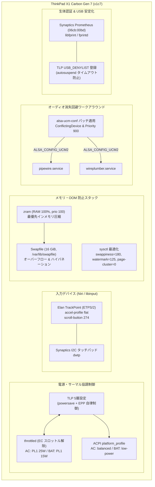

# ThinkPad X1 Carbon Gen 7 ハードウェア構成と最適化ガイド

Lenovo ThinkPad X1 Carbon Gen 7 (`x1c7`) におけるハードウェア仕様，電源・サーマル管理，入力デバイス調整，ログイン認証，スリープ動作，およびオーディオ消失回避ワークアラウンドの技術仕様と設計要点．

| 項目 | 構成内容 |
| :--- | :--- |
| 対象ホスト | `x1c7` (Lenovo ThinkPad X1 Carbon Gen 7) |
| CPU | Intel Core i7-8565U (Whiskey Lake-U, 4コア / 8スレッド，1.80 GHz - 4.60 GHz) |
| GPU | Intel UHD Graphics 620 (Gen 9.5) |
| RAM | 16 GB LPDDR3-2133 (オンボード実装，増設不可) |
| ストレージ | Samsung PM981 256 GB NVMe SSD (`MZVLB256HBHQ-000L7`) |
| ディスプレイ | 14インチ FHD (1920x1080) IPS BOE NE140FHM-N61 (`eDP-1`) |
| ネットワーク | Intel Wireless-AC 9560 (CNVi, `iwlwifi`) / Bluetooth 5.0 (`8087:0aaa`) |
| Thunderbolt 3 | Intel JHL6540 (Alpine Ridge，カーネルネイティブ管理) |
| オーディオ | Intel HDA with Sound Open Firmware (SOF DSP) |
| 入力 / センサー | Elan TrackPoint (`ETPS/2 Elantech TrackPoint`) & Synaptics I2C タッチパッド，Synaptics Prometheus 指紋センサー (`06cb:00bd`) |
| セキュリティ | STMicroelectronics TPM 2.0 (LUKS 移行準備用) |



---

## 1. カーネル・メモリ最適化

### 1.1 カーネル選定とハードウェアモジュール

カーネルには [pkgs.linuxPackages_xanmod](../../hosts/x1c7/default.nix) を採用し，デスクトップの対話的応答性とタスクスケジューリングを低レイテンシ化している．[nixos-hardware.nixosModules.lenovo-thinkpad-x1-7th-gen](../../hosts/x1c7/default.nix) をインポートし，Intel マイクロコード，VA-API，およびラップトップ・SSD 共通モジュールを導入している．このモジュールが有効化する `hardware.trackpoint` は本機の TrackPoint に適用されない ([3. 入力デバイス](#3-入力デバイス-trackpoint--タッチパッド) を参照)．

### 1.2 メモリ・スワップチューニング (OOM 回避)

16 GB 物理メモリ環境で `rustc`, `nix`, `zig` などの並列ビルド (最大 8 スレッド) を実行すると単一プロセスが約 10 GB の無名メモリを消費し，OOM Killer が頻発する．[hosts/x1c7/hardware.nix](../../hosts/x1c7/hardware.nix) で次のチューニングを設定する．

| 項目 | 設定値 | 目的・動作 |
| :--- | :--- | :--- |
| zram | `memoryPercent = 100`<br>`priority = 100` | メモリ内圧縮スワップを最優先で使用し，実効メモリ容量を拡張する |
| Swapfile | 16 GiB (`/var/lib/swapfile`) | RAM 全体を退避可能なサイズを確保．カーネルが割り当てる負の優先度により，通常時は zram 枯渇後のオーバーフロー領域として機能する |
| `vm.swappiness` | `180` | 積極的な無名ページの圧縮スワップアウトを促す |
| `vm.watermark_scale_factor` | `125` | ページ回収の開始水準を引き上げ，突発的なメモリ確保時の OOM を防ぐ (NixOS 既定値の `10` は回収開始が遅すぎる) |
| `vm.watermark_boost_factor` | `0` | ウォーターマーク急上昇に伴う不要な I/O スラッシングを抑止する |
| `vm.page-cluster` | `0` | zram 向けに単一ページ単位での読み出し・書き出しを強制する |

### 1.3 ハイバネーション設計

スワップはルートパーティション直下のファイル (`/var/lib/swapfile`) として配置されている．`boot.resumeDevice` にルートパーティションを指定するとカーネルコマンドラインに `resume=<partition>` が付与され，logind が「有効なスワップデバイスではない」としてハイバネーションを拒否する．UEFI + systemd initrd 環境では，`systemd-sleep` がスワップファイルを特定して `HibernateLocation` EFI 変数へ記録し，次回起動時に `systemd-hibernate-resume` が自動的にオフセットを読み出して復元する．本設定では `boot.resumeDevice` を指定しない．

バッテリー枯渇時の保護として [services.upower.criticalPowerAction = "Hibernate"](../../hosts/x1c7/services/power.nix) を設定し，電源断の直前にハイバネーションを実行して作業セッションを退避する．

---

## 2. 電源・サーマル管理 (TLP & throttled)

ThinkPad の電源・サーマル制御は，次の 3 層構造で連携している．設定は [hosts/x1c7/services/power.nix](../../hosts/x1c7/services/power.nix) に集約されている．

| 制御層 | 対象・インターフェース | 役割 |
| :--- | :--- | :--- |
| Platform Profile (ACPI DYTC) | `/sys/firmware/acpi/platform_profile` | Lenovo の Embedded Controller (EC) にファンカーブとサーマルテーブルを指示 |
| Energy Performance Preference (Intel HWP EPP) | `/sys/devices/system/cpu/cpu*/cpufreq/energy_performance_preference` | CPU の自律的周波数スケーリング方針を制御 |
| Scaling Governor (intel_pstate) | `/sys/devices/system/cpu/cpu*/cpufreq/scaling_governor` | カーネルドライバの動作モード |

### 2.1 バッテリー充電閾値

`START_CHARGE_THRESH_BAT0 = 75` および `STOP_CHARGE_THRESH_BAT0 = 80` を設定している．AC 常時接続環境におけるバッテリーセルの劣化を抑える．TLP は起動時に閾値を `charge_control_start_threshold` / `charge_control_stop_threshold` へ書き込み，値は EC が保持する．

S3 中も EC は給電されるため閾値は維持される．Lenovo 機の `tlp resume` は，スリープ中に AC 給電状態が変化した場合と EC をリセットする機種に限り閾値を書き戻すため，通常の S3 復帰では値が変化しない．一時的に解除した状態も同じ扱いとなり，次回起動時の `tlp.service` または `sudo tlp setcharge` で設定値へ戻る．

| コマンド | 動作 | 設定値への復帰 |
| :--- | :--- | :--- |
| `sudo tlp fullcharge` | ベンダー既定値 (96/100) を一時適用し 100% まで充電する | 次回起動時または `sudo tlp setcharge` |
| `sudo tlp chargeonce` | 開始閾値を停止閾値の直前 (79%) へ一時的に引き上げ，設定済みの停止閾値 (80%) まで充電する．充電残量が 79% を超えている場合はエラー終了する | 次回起動時または `sudo tlp setcharge` |
| `sudo tlp recalibrate` | AC 接続のまま満放電してから 100% まで再充電し，容量計を再調整する | 次回起動時または `sudo tlp setcharge` |

`recalibrate` は数時間かかるため，完了まで AC を接続したままにする．

### 2.2 バッテリー劣化時の挙動と BMS 計測特性

本機搭載のバッテリー (型番 `5B10W13930`，設計容量 51 Wh) において，経年劣化に伴い次の計測・放電挙動が発生する．

| 項目 | 正常値・設計値 | 実測値 (経年劣化時，445 サイクル) | 影響と動作特性 |
| :--- | :--- | :--- | :--- |
| 実効容量 (充放電エネルギー) | 51 Wh | 約 10.3 Wh - 12.9 Wh | 公称設計値の約 20% - 25% まで低下 |
| 内部抵抗 (IR) | 約 100 - 150 mΩ | 約 708 mΩ | 通常の約 5 - 7 倍に増大 |
| `energy_full` 報告値 | 劣化に応じて減少 | 50.99 Wh (99.98% 固定) | 長期の 75-80% 閾値運用により BMS の学習サイクルが未完のまま固定 |

高内部抵抗と容量抜けが存在する状態では，次の挙動を示す．

1. 高負荷サグによる残量急落 (72% → 6% 等):
   内部抵抗が高いため，並列ビルド (`nix-daemon`) 等で消費電力が急増 (10 W → 22.8 W 等) すると端子電圧が瞬時に降下する (電圧サグ)．端子電圧が BMS の放電下限判定電圧 (EDV2: 約 13.18 V) を下回ると，残パーセンテージが即座に 6% へ強制ラッチされ，保護シャットダウンに至る．突発的なセル故障ではなく，高内部抵抗に起因する物理的電圧降下が真因である．
2. 充電時の残量急増 (36% → 100% 等):
   高内部抵抗により充電電流下で端子電圧が早期に上限 (約 17.35 V) へ到達する．定電圧充電 (CV) への移行とテーパー電流下限 (約 0.16 A) への到達が早まるため，短時間で満充電 (Full Charge: FC) 判定が下される．

### 2.3 D-Bus 連携 (tlp.pd)

`services.tlp.pd.enable = true` により `net.hadess.PowerProfiles` D-Bus インターフェースを提供し，Noctalia デスクトップの `power_profile` バーウィジェットからプロファイルを切り替えられる．

### 2.4 XanMod と intel_pstate の競合解消

XanMod カーネルは `CONFIG_CPU_FREQ_DEFAULT_GOV_PERFORMANCE=y` でビルドされる．`intel_pstate` のアクティブモード下で governor を `performance` にすると，EPP が 0 (performance) に固定され，EPP の書き換えが `EBUSY` で拒否されてアイドル時にクロックが下がらなくなる．AC・バッテリー双方で governor を `powersave` に強制し，EPP (AC: `balance_performance`, BAT: `balance_power`) が正しく自律動作するように制御している．

### 2.5 動的ブーストと省電力

- `CPU_HWP_DYN_BOOST_ON_AC = 1`: AC 駆動時の急激な負荷スパイクに対し動的ブーストを適用し UI 応答性を維持する．
- `PLATFORM_PROFILE_ON_AC = "balanced"`: AC 駆動では静音性を優先し，高負荷時は Noctalia ウィジェットから性能モードへ引き上げられる．
- `PLATFORM_PROFILE_ON_BAT = "low-power"`: バッテリー駆動では EC の低消費電力サーマルテーブルを選択し，ファンカーブと電力上限を引き下げてバッテリー持続時間を延ばす．
- `PLATFORM_PROFILE_ON_SAV = "low-power"`: Noctalia の power-saver プロファイル選択時も同じサーマルテーブルを使用する．
- `PCIE_ASPM_ON_BAT = "powersave"`: バッテリー駆動時に PCIe リンク (NVMe, Wi-Fi, Thunderbolt) を低電力ステートへ移行させる．

### 2.6 USB 自動サスペンドの除外

Synaptics 指紋リーダー (`06cb:00bd`) は USB autosuspend 状態からの復帰時にタイムアウトを起こしやすいため，TLP の `USB_DENYLIST` (`USB_DENYLIST = "06cb:00bd"`) に追加して常時通電を維持する．

### 2.7 throttled (Lenovo サーマルバグ対策)

Lenovo の EC ファームウェアによる過剰な早期スロットリングを回避するため，[throttled](https://github.com/erpalma/throttled) を運用する．

薄型軽量筐体の冷却限界 (シングルファン・デュアルヒートパイプ) を踏まえ，CPU 仕様 (Intel Core i7-8565U) に適合した制限値へ調律している．

| モード | パラメータ | 設定値 | 設計意図 |
| :--- | :--- | :--- | :--- |
| AC 駆動 | `PL1_Tdp_W` | 25 W (28秒) | Configurable TDP-up 上限．重いビルド時にも全コア ~3.0 GHz を維持． |
| | `PL2_Tdp_W` | 35 W (0.002秒) | 短時間のバースト負荷をヒートパイプの熱容量で吸収． |
| | `Trip_Temp_C` | 90 ℃ | TjMax (100 ℃) 手前で PL2 バーストを許容しつつ筐体温度を制御． |
| バッテリー | `PL1_Tdp_W` | 15 W (28秒) | 公称 TDP に抑え，膝上使用時の温度と消費電力を両立． |
| | `PL2_Tdp_W` | 25 W (0.002秒) | UI 応答性を損なわない瞬間バースト枠． |
| | `Trip_Temp_C` | 85 ℃ | 低温での安全マージンを確保． |

Whiskey Lake 世代では BIOS ファームウェアにより MSR 0x150 への書き込みがロックされているため，電圧オフセット調整の指定は除外している．

Nix store 内の設定ファイルは更新時も mtime が変化しないため，throttled の Autoreload 機能は発火しない．設定変更後は必ず手動で再起動する:

```bash
sudo systemctl restart throttled
```

### 2.8 ファン制御を thinkfan に委ねない理由

`/sys/firmware/acpi/platform_profile` の値は ACPI DYTC を経由して EC に渡り，EC が保持するサーマルテーブル (ファンカーブと PL1/PL2 の上限) を切り替える．ファン回転数はこのテーブルに従って EC が決定する．

thinkfan は hwmon の `pwm1_enable` を手動制御へ切り替え，ユーザー空間から PWM 値を書き込む．手動制御中は EC のファンカーブが無効になり，throttled が許可する PL2 バースト (AC 35 W) に対してファン回転が追従しない区間が生じる．この区間で発熱が蓄積するとサーマルトリップや筐体温度の上昇を招くため，本ホストでは thinkfan を導入せず，ファン制御は EC (platform_profile) に，CPU 側の上限は throttled の PL1/PL2 に分離する．

---

## 3. 入力デバイス (TrackPoint & タッチパッド)

### 3.1 ハードウェアの判別

本機の TrackPoint は Elan 製 (`ETPS/2 Elantech TrackPoint`) であり，Synaptics 製の TrackPoint を前提とする設定は適用されない．代表例が nixos-hardware の `hardware.trackpoint` である．このモジュールは udev ルールで `hardware.trackpoint.device` (既定値 `TPPS/2 IBM TrackPoint`) の serio 属性 (`sensitivity`, `speed`, `press_to_select` 等) を書き換え，`hardware.trackpoint.emulateWheel` を X11 の `inputClassSections` で実装する．Elan TrackPoint はこれらの serio 属性を公開せず，デバイス名も既定値と一致せず，Niri は X11 の設定を読まないため，このモジュールの設定は反映されない．TrackPoint とタッチパッドの調整は [Niri の入力設定](../../home/desktop/niri/config.kdl) で行う．

### 3.2 libinput 設定

| デバイス | 設定 | 効果 |
| :--- | :--- | :--- |
| TrackPoint | `accel-profile "flat"` | 加速度補正を無効化し，スティックの押し込み量とカーソル移動量を比例させる |
| TrackPoint | `scroll-method "on-button-down"` + `scroll-button 274` | センターボタン (`BTN_MIDDLE` = 274) を押している間，スティック操作をスクロールへ変換する |
| タッチパッド | `dwtp` | トラックポイント操作中のタッチパッド入力を無効化し，パームタッチによる誤入力を防ぐ |

```kdl
input {
    trackpoint {
        accel-profile "flat"
        scroll-method "on-button-down"
        scroll-button 274
    }
    touchpad {
        dwtp
    }
}
```

既存の `tap`, `dwt`, `natural-scroll` 等のタッチパッド設定と併記する．デバイス名と割り当てられた設定は次で確認する．

```bash
libinput list-devices | grep -A4 -E "TrackPoint|Touchpad"
```

---

## 4. ディスプレイ・ログイン認証 (Noctalia Greeter & 指紋認証)

### 4.1 Noctalia Greeter

デスクトップログイン環境には Greetd ベースの [noctalia-greeter](../../nixos/services/desktop/greetd.nix) を採用している．

内蔵ディスプレイにグリーターを表示するため，`my.services.desktop.greetd.greeterOutput.name = "eDP-1"` を指定している．グリーターは非特権ユーザー (`greeter`) で動作し，ユーザーホーム (権限 `0700`) 内の壁紙ファイルを直接読み取れない．そのため `systemd.services.noctalia-greeter-wallpaper` を通じて `/var/lib/noctalia-greeter/wallpaper.jpg` へ安全にコピーし，アクセス権限の問題を解決している．

### 4.2 指紋認証 (fprintd)

内蔵指紋リーダーは Synaptics Prometheus (`06cb:00bd`) であり，標準の `libfprint` ドライバで認識される．照合は match-on-chip (MoC) で，テンプレートはデバイス内に保存される．本ホストでは [services.fprintd.enable = true](../../hosts/x1c7/default.nix) により有効化している．

### 4.3 fprintd のライフサイクル

`fprintd.service` は `Type=dbus` / `BusName=net.reactivated.Fprint` で動作し，未使用のまま 30 秒経過すると `Deactivated successfully` で終了する (`src/fprintd.h` の `#define TIMEOUT 30`)．必要時に systemd が D-Bus 経由で自動起動するため，`systemctl status fprintd` が常時 `inactive` でも異常ではない．サスペンド復帰側の個別サービスは不要だが，停止側には `systemd.services.fprintd-pre-sleep` (`Type=oneshot`, `before` / `wantedBy` = `sleep.target`) を置き，`sleep.target` の前に `fprintd.service` を停止する．

### 4.4 PAM 統合と評価順序の調整

NixOS の既定スタックでは `pam_fprintd` (order 11400) が `pam_unix` (11700) より先に評価されるため，指を置かない場合にパスワード入力が最大 30 秒間ブロックされる．本ホストではサービスごとに評価順序とオプションを個別に最適化している ([hosts/x1c7/default.nix](../../hosts/x1c7/default.nix), [greetd.nix](../../nixos/services/desktop/greetd.nix))．

- `sudo` / `polkit-1`: 既定の評価順序 (`pam_fprintd` 11400 → `pam_unix` 11700) を維持したまま `max-tries = 3`, `timeout = 5` に短縮する．5 秒のタイムアウトまたは 3 回の照合失敗で直ちにパスワード入力へフォールバックする．単一 PAM スタックの逐次性に関する詳細は[並行待ち受け調査](../research/parallel-auth-architecture.md) を参照する．
- `greetd`: `enableGnomeKeyring` が挿入する `unix-early` が `PAM_AUTHTOK` を供給するため，`pam_unix` に `use_first_pass = true` を設定し，空または不一致のパスワード送信時に再プロンプトなしで指紋認証へ移行する．グリーター側は `auth.allow_empty_password = true` を前提とする．
- `login`: Noctalia のロック画面は D-Bus 経由で `net.reactivated.Fprint` を直接利用し，成功時は PAM を介さず解錠するため，ロック画面が使用する `login` サービスからは `fprintd` を除外してパスワード入力時の重複要求を防止している (TTY コンソールログインでも指紋は無効化される)．

Noctalia シェルの `shell.polkit_agent` は無効化している (`polkit_agent = false;`)．`niri-flake` が `polkit-kde-agent-1` を起動するため，二重登録による D-Bus 警告と認証ダイアログの重複を避けている．

### 4.5 Noctalia ロック画面の Claim 挙動

ロック画面はパスワードを `login` PAM で，指紋を `net.reactivated.Fprint` D-Bus 経由の直接呼び出しで扱うデュアルチャネル構成である．指紋検証はロック中に常時アームされ，`claimed` と `released` を必ず対で出力する．パスワード送信時は `stopFingerprint()` でセンサを解放してから PAM 認証を子プロセスへ委譲するため，2 つの検証が同時に進行することはない．

`Device was already claimed` は他の認証 (pkexec 等) と重なった場合にのみ発生し，単一の認証では起きない．`Verification was in progress, stopping it` は `fprint_device_release()` が進行中の verify を正常にキャンセルしたことを示す警告であり，解放漏れではない．

### 4.6 USB 電源管理とエラーログの扱い

udev ルールは `ATTR{power/control}="on"` と `ATTR{power/persist}="0"` を明示し，TLP の `USB_DENYLIST = "06cb:00bd"` と併せて autosuspend を二重に防止している．persist を 0 に強制するのは，persist=1 を保持した既存セッションが復帰後もその値を維持する経路を塞ぐためである．libfprint (`fp-device.c` / `fp-context.c` / `fpi-device.c`) は resume 時の reset / replug を unplug として扱い，デバイスを再生成するため，persist を 1 に固定すると古い USB ハンドルが残る ([トリアージ記録 第 2.2 節](../research/fprintd-triage-notes.md))．

サスペンド直前に画面ロックが走ると，Noctalia がサスペンドをまたいで fprintd の Claim / VerifyStart を保持する．この状態で USB 1-9 が再列挙されると fprintd は `AlreadyInUse` や `No such device [-4]` を返して応答しなくなる．`systemd.services.fprintd-pre-sleep` は `sleep.target` の前に `fprintd.service` を停止するため，Claim / VerifyStart がサスペンドと USB 再列挙をまたがない．復帰後に Noctalia が発行する ClaimDevice は再試行と再取得を行うため，fprintd は D-Bus 経由で自動起動して新しいハンドルで Claim する．`AlreadyInUse` は Noctalia が再試行しないため，停止を先に済ませる構成とする．停止処理は `systemd.services.fprintd.serviceConfig.TimeoutStopSec = "5s"` で 5 秒に制限し，`ExecStartPre` の `udevadm settle --timeout=5` で復帰時の USB 再列挙完了を待ってから D-Bus activation のデバイス探索を始める ([hosts/x1c7/default.nix](../../hosts/x1c7/default.nix))．サスペンド復帰時には `xhci_hcd ... xHC error in resume, USBSTS 0x401` が記録されることがあるが，上記の再取得で実害はない．

照合失敗時のログ `Failed to match fingerprint` は，未登録の指や置き方による `verify-no-match` の正常通知であり，テンプレート破損を示すものではない．デバイス初期化後の初回 probe で SENSOR_CMD_GET_VERSION の応答 status が 789 (0x0315) となり `Device responded with error` の warning が出ることがあるが，Synaptics ドライバは 1 回だけ即時リトライして成功するため，照合結果には影響しない．

### 4.7 指紋登録手順

センサーはタッチ式である．

```bash
fprintd-enroll                        # 現在のユーザーの右手人差し指を登録
fprintd-enroll -f left-index-finger   # 特定の指を指定して登録
fprintd-verify                        # 読み取り検証
fprintd-list "$USER"                  # 登録済み指紋の一覧
```

---

## 5. サスペンド動作と S3 Deep Sleep

### 5.1 S3 vs s2idle のトレードオフ

BIOS 設定の `Config -> Power -> Sleep State` は Linux (S3) に設定している．

| 方式 | 動作概要 | メリット | デメリット・注意点 |
| :--- | :--- | :--- | :--- |
| S3 (Deep Sleep) | RAM 以外の給電を遮断 | スリープ中の電力消費を最小化 | 復帰に 1〜2 秒要する |
| s2idle (Modern Standby) | SoC の低電力アイドル状態 | 復帰が高速 | スリープ中のバッテリー消費が大きい |

本ホストではバッテリー持続時間を最優先して S3 を選択している．S3 deep への固定は，カーネルパラメータ (`mem_sleep_default=deep` など) ではなく，BIOS 設定の `Config -> Power -> Sleep State` を Linux (S3) に設定して ACPI レベルで行う ([hosts/x1c7/default.nix](../../hosts/x1c7/default.nix) に `boot.kernelParams` は定義していない)．

### 5.2 運用上の注意点

Bluetooth デバイス接続状態でサスペンドすると即座に復帰する現象が確認されているため，サスペンド前に接続機器を切断することを推奨する．AC 給電時のディスプレイ開閉動作は [services.logind.settings.Login.HandleLidSwitchExternalPower = "lock"](../../hosts/x1c7/default.nix) により画面ロックのみにとどめ，外部モニタ運用やビルドの中断を防いでいる．

---

## 6. オーディオ消失回避ワークアラウンド (ALSA UCM & PipeWire)

### 6.1 障害の技術的背景

ThinkPad X1C7 の Intel SOF HDA DSP 環境では，外部ディスプレイ (HDMI) を接続した際に ALSA UCM (Use Case Manager) の判定ロジックにより次の競合が発生する．

1. HDMI 接続を検出すると，ALSA UCM 上で Headphones (アナログヘッドホン) プロファイルが誤って「利用可能」状態へ遷移する．
2. Headphones の `PlaybackPriority` が内蔵 Speaker (200) よりも高い値に設定されているため，PipeWire および WirePlumber が内蔵スピーカーのオーディオシンクを「不要な代替デバイス」と判定して破棄・非表示にする．
3. 結果として，HDMI を接続している間は内蔵スピーカーから音が出せなくなる．

### 6.2 適用したワークアラウンド

[hosts/x1c7/services/audio.nix](../../hosts/x1c7/services/audio.nix) において，`alsa-ucm-conf` パッケージにパッチを適用し，PipeWire / WirePlumber に注入している．

```nix
let
  alsaUcmConf = pkgs.alsa-ucm-conf.overrideAttrs (old: {
    postInstall = (old.postInstall or "") + ''
      ucm="$out/share/alsa/ucm2"

      # 1. HDMI と Headphones を排他化
      substituteInPlace "$ucm/codecs/hda/hdmi.conf" \
        --replace-fail \
          'Comment "HDMI / DisplayPort ''${var:__Number} Output"' \
          'Comment "HDMI / DisplayPort ''${var:__Number} Output"
			ConflictingDevice [ "Headphones" ]'

      # 2. ポートごとの優先度調整
      sed -i \
        -e '/Number 1/,/Priority/s/Priority 500/Priority 700/' \
        -e '/Number 2/,/Priority/s/Priority 600/Priority 100/' \
        -e '/Number 3/,/Priority/s/Priority 700/Priority 50/' \
        "$ucm/Intel/sof-hda-dsp/Hdmi.conf"

      # 3. 内蔵スピーカーの優先度を 900 に引き上げ
      substituteInPlace "$ucm/HDA/HiFi-analog.conf" \
        --replace-fail 'PlaybackPriority 200' 'PlaybackPriority 900'
    '';
  });
in
{
  # PipeWire と WirePlumber の双方に環境変数を設定
  systemd.user.services.pipewire.environment.ALSA_CONFIG_UCM2 = "${alsaUcmConf}/share/alsa/ucm2";
  systemd.user.services.wireplumber.environment.ALSA_CONFIG_UCM2 = "${alsaUcmConf}/share/alsa/ucm2";
}
```

### 6.3 ワークアラウンド適用の理由と要点

- HDMI 出力と Headphones デバイスに `ConflictingDevice` を指定して排他化し，HDMI 接続時に Headphones プロファイルが誤って有効化されるのを防止する．
- 内蔵スピーカーの `PlaybackPriority` を `200` から `900` に引き上げ，常に選択可能なプライマリシンクとして維持する．
- PipeWire と WirePlumber の双方が ALSA カードを直接開いて UCM 設定を参照するため，両方の systemd ユーザーサービスに環境変数 `ALSA_CONFIG_UCM2` を渡す (片方のみに設定すると未パッチの UCM が読み込まれ，スピーカーが再び消失する)．

### 6.4 ミュート LED の同期

スピーカーのミュート LED は `/sys/class/leds/platform::mute`，マイクのミュート LED は `/sys/class/leds/platform::micmute` として公開される．HDA コーデックドライバが提供する LED トリガ `audio-mute` / `audio-micmute` をこれらの LED に割り当てると，ALSA ミキサーの該当スイッチの状態が LED に反映される．PipeWire のミュート操作も ALSA ミキサーを経由するため，LED 同期用のデーモンや udev ルールを追加せずに追従する．

```bash
grep -H . /sys/class/leds/platform::mute/trigger /sys/class/leds/platform::micmute/trigger
wpctl set-mute @DEFAULT_AUDIO_SINK@ toggle   # LED が消灯・点灯することを確認
```

出力の `[...]` が現在のトリガであり，`[audio-mute]` / `[audio-micmute]` であれば有効である．

---

## 7. ファームウェア・BIOS 注意事項

### 7.1 カスタム Secure Boot 鍵の登録リスク (文鎮化警告)

Lenovo ThinkPad X1 Carbon Gen 7 において，BIOS の Setup Mode を用いてカスタム Secure Boot 鍵 (PK/KEK/db) を登録すると，マザーボードが POST に失敗して永久に起動不能 (文鎮化) になるリスクが報告されている (Arch Linux Wiki 警告)．本機ではカスタム Secure Boot 鍵の自己登録を行わない．

### 7.2 Thunderbolt BIOS Assist Mode の運用方針

BIOS の `Config -> Thunderbolt 3 -> Thunderbolt BIOS Assist Mode` は，Linux カーネル 4.13 以降で Thunderbolt のネイティブ管理がサポートされているため，無効のまま運用する．これを有効化すると過去の特定ファームウェアにおける不具合や電力管理の競合，起動障害を引き起こす恐れがあるため，ネイティブ Linux 管理を維持する．

---

## 関連ドキュメント

- [x1c7 ホスト概要](../../hosts/x1c7/README.md) — x1c7 (ThinkPad X1 Carbon Gen 7) の概要と運用方針
- [x1c7 システム構成](../../hosts/x1c7/default.nix) — x1c7 固有のシステムモジュール設定
- [x1c7 ハードウェア定義](../../hosts/x1c7/hardware.nix) — ハードウェア構成とメモリ・スワップ設定
- [電源・サーマル設定](../../hosts/x1c7/services/power.nix) — TLP および throttled の省電力・発熱制御設定
- [Niri 入力設定](../../home/desktop/niri/config.kdl) — TrackPoint とタッチパッドの libinput 設定
- [オーディオパッチ](../../hosts/x1c7/services/audio.nix) — ALSA UCM / PipeWire スピーカー消失対策パッチ
- [デスクトップログイン設計](../../nixos/services/desktop/greetd.nix) — Noctalia Greeter および PAM 認証スタック設定
- [並行待ち受けアーキテクチャ調査](../research/parallel-auth-architecture.md) — PAM 逐次性と並行待ち受けの設計調査
- [fprintd トリアージ記録](../research/fprintd-triage-notes.md) — 指紋認証ドライバの動作検証とログ分析
