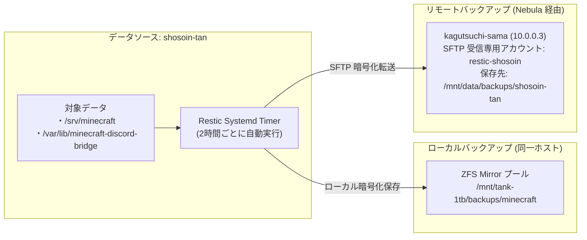

# バックアップ運用 & ディザスタリカバリ (DR)

Restic および ZFS によるサーバーデータの多重バックアップ構成，保守運用，および障害復旧手順．

## 1. バックアップアーキテクチャ

永続データ (Minecraft ワールド，Discord Bridge DB) は，同一ホスト内のローカルストレージと同一拠点内の別マシン (`kagutsuchi-sama`) へ二重バックアップする．両ホストは拠点Aに所在するため，この構成はホスト障害には有効だが，拠点全体の被災には別途外部保管が必要である．



### バックアップ仕様
- 実行頻度: 2 時間ごと (`systemd.timers`)
- 暗号化: Restic 固有の暗号化パスワード ([secrets/master/services/backup/password.age](../../secrets/master/services/backup/password.age))
- 保持世代ポリシー:
  - `keep-daily: 7` (直近 7 日分)
  - `keep-weekly: 4` (直近 4 週分)
  - `keep-monthly: 6` (直近 6 ヶ月分)

---

## 2. リポジトリの初期化と検証 (`restic init`)

Restic 設定 ([nixos/services/backup/default.nix](../../nixos/services/backup/default.nix)) で `initialize = true` を指定しているため，初回実行時にリポジトリは自動で初期化される．手動で初期化・検証する場合のコマンド:

```bash
export RESTIC_PASSWORD=$(sudo cat /run/agenix/restic_password)

# ローカルリポジトリの初期化 (手動確認時)
sudo -E restic -r /mnt/tank-1tb/backups/minecraft init

# リモート SFTP リポジトリの初期化 (kagutsuchi-sama 宛て)
sudo -E restic -r sftp:restic-shosoin@10.0.0.3:/mnt/data/backups/shosoin-tan init
```

---

## 3. 日常の確認とスナップショット操作

### バックアップ状況の確認
```bash
# shosoin-tan 上で実行
systemctl status restic-backups-local-backup.service
systemctl status restic-backups-remote-backup.service
```

### スナップショット一覧の表示
```bash
# パスワード環境変数を読み込んでスナップショット一覧を確認
export RESTIC_PASSWORD=$(sudo cat /run/agenix/restic_password)

restic -r /mnt/tank-1tb/backups/minecraft snapshots
```

---

## 4. ディザスタリカバリ (DR) 手順

`shosoin-tan` の全損時に `kagutsuchi-sama` のリモートバックアップから代替マシンへデータを復元する手順:

### Step 1: 代替ホストの準備
[新規ホスト追加手順](adding-a-host.md) に従い，代替ホストに NixOS を導入して Nebula メッシュ (`10.0.0.X`) へ接続する．

### Step 2: バックアップデータのリストア
受信側の `restic-shosoin` は，[secrets/master/services/backup/ssh_key.age](../../secrets/master/services/backup/ssh_key.age) に対応する公開鍵のみを許可する．代替ホストでは同鍵を配置し，`~/.ssh/config` の `Host 10.0.0.3` に `IdentityFile` を設定する (`shosoin-tan` では [hosts/shosoin-tan/services/backup.nix](../../hosts/shosoin-tan/services/backup.nix) の `sshKeyFile` が同等の設定を適用する)．

代替ホスト上でバックアップデータを一時ディレクトリへリストアする:
```bash
export RESTIC_PASSWORD="<バックアップパスワード>"
export RESTIC_REPOSITORY="sftp:restic-shosoin@10.0.0.3:/mnt/data/backups/shosoin-tan"

# 最新スナップショットの ID を確認
restic snapshots

# 指定したディレクトリへデータをリストア
restic restore latest --target /tmp/restore
```

### Step 3: 復元データ配置と所有権設定
復元したデータファイルを所定のディレクトリへ配置し，所有権 (`minecraft:minecraft`) を設定する:

```bash
# Minecraft データの復元
sudo mkdir -p /srv/minecraft
sudo cp -r /tmp/restore/srv/minecraft/* /srv/minecraft/
sudo chown -R minecraft:minecraft /srv/minecraft

# Discord Bridge データの復元 (サービス実行ユーザーは minecraft)
sudo mkdir -p /var/lib/minecraft-discord-bridge
sudo cp -r /tmp/restore/var/lib/minecraft-discord-bridge/* /var/lib/minecraft-discord-bridge/
sudo chown -R minecraft:minecraft /var/lib/minecraft-discord-bridge
```

### Step 4: サービスの起動と稼働確認
各サービスを起動して正常稼働を確認する:

```bash
sudo systemctl restart minecraft-server-lobby.service
sudo systemctl restart minecraft-server-nitac23s.service
sudo systemctl restart minecraft-discord-bridge.service
```

---

## 5. ZFS 保守運用 (`tank-1tb`)

`shosoin-tan` のローカルストレージは ZFS Mirror (`/mnt/tank-1tb`) で構成している．

- 自動実行タイマーは未設定のため，`sudo zpool scrub tank-1tb` で手動スクラブを定期実行する．
- プールの健全性やリビルド状況は `zpool status tank-1tb` で確認する．
- ディスク障害時の交換・リビルド手順は [ZFS & ストレージ保守](../hardware/storage-zfs.md) を参照する．

---

## 関連ドキュメント
- [目次 (設計・運用ドキュメント)](../README.md) — 全体ナビゲーション・目次
- [ネットワークアーキテクチャ](../architecture/network-topology.md) — Nebula メッシュネットワーク，IP 体系，DNS 設計
- [ZFS & ストレージ保守](../hardware/storage-zfs.md) — レガシー BIOS ブート，ZFS Mirror 保守・ディスク交換手順
- [新規ホスト追加手順](adding-a-host.md) — 新規マシンの追加・初期セットアップ手順
