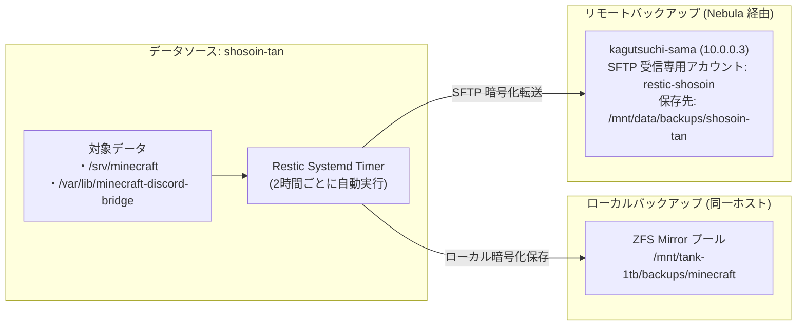

# バックアップ運用 & ディザスタリカバリ (DR)

Restic および ZFS によるサーバーデータの多重バックアップ構成，保守運用，および障害復旧手順．

## 1. 前提条件

| 項目 | 要件・確認事項 |
| :--- | :--- |
| 対象ホスト | `shosoin-tan` (バックアップ元)，`kagutsuchi-sama` (`10.0.0.3`，リモート保管先) |
| 実行権限 | 両ホストの root (`sudo`) |
| 必要ツール | `restic`, `ssh`, `zpool` (ZFS) |

### 1.1 作業前チェックリスト

- [ ] `shosoin-tan` から `kagutsuchi-sama` (`10.0.0.3`) へ Nebula メッシュ経由で疎通できる．
- [ ] `/run/agenix/restic_password` が復号されている．
- [ ] ローカルリポジトリの `/mnt/tank-1tb` がマウントされている (`findmnt /mnt/tank-1tb`)．

---

## 2. バックアップアーキテクチャ

永続データ (Minecraft ワールド，Discord Bridge DB) は，同一ホスト内のローカルストレージと同一拠点内の別マシン (`kagutsuchi-sama`) へ二重バックアップする．両ホストは拠点Aに所在するため，この構成はホスト障害には有効だが，拠点全体の被災には別途外部保管が必要である．



### 2.1 バックアップ仕様

| 項目 | 設定 |
| :--- | :--- |
| 実行頻度 | 2 時間ごと ([nixos/services/backup/default.nix](../../nixos/services/backup/default.nix) の `timerConfig.OnCalendar = "00/2:00:00"`) |
| 暗号化 | Restic 固有の暗号化パスワード ([secrets/master/services/backup/password.age](../../secrets/master/services/backup/password.age)) |
| 保持世代ポリシー | `--keep-daily 7` (直近 7 日分)，`--keep-weekly 4` (直近 4 週分)，`--keep-monthly 6` (直近 6 ヶ月分) |

---

## 3. 作業手順

### Step 1: リポジトリの初期化

Restic 設定 ([nixos/services/backup/default.nix](../../nixos/services/backup/default.nix)) で `initialize = true` を指定しているため，初回実行時にリポジトリは自動で初期化される．手動で初期化・検証する場合のコマンド:

```bash
export RESTIC_PASSWORD=$(sudo cat /run/agenix/restic_password)

# ローカルリポジトリの初期化 (手動確認時)
sudo -E restic -r /mnt/tank-1tb/backups/minecraft init

# リモート SFTP リポジトリの初期化 (kagutsuchi-sama 宛て)
sudo -E restic -r sftp:restic-shosoin@10.0.0.3:/mnt/data/backups/shosoin-tan init
```

### Step 2: バックアップ状況とスナップショットの確認

`shosoin-tan` 上でタイマーの実行結果を確認する．

```bash
systemctl status restic-backups-local-backup.service
systemctl status restic-backups-remote-backup.service
```

スナップショット一覧を表示する．

```bash
export RESTIC_PASSWORD=$(sudo cat /run/agenix/restic_password)

restic -r /mnt/tank-1tb/backups/minecraft snapshots
```

### Step 3: 代替ホストの準備

`shosoin-tan` の全損時に `kagutsuchi-sama` のリモートバックアップから代替マシンへデータを復元する．[新規ホスト追加手順](adding-a-host.md) に従い，代替ホストに NixOS を導入して Nebula メッシュ (`10.0.0.X`) へ接続する．

### Step 4: バックアップデータのリストア

受信側の `restic-shosoin` は，[secrets/master/services/backup/ssh_key.age](../../secrets/master/services/backup/ssh_key.age) に対応する公開鍵のみを許可する．代替ホストでは同鍵を配置し，`~/.ssh/config` の `Host 10.0.0.3` に `IdentityFile` を設定する (`shosoin-tan` では [hosts/shosoin-tan/services/backup.nix](../../hosts/shosoin-tan/services/backup.nix) の `sshKeyFile` が同等の設定を適用する)．

代替ホスト上でバックアップデータを一時ディレクトリへリストアする．

```bash
export RESTIC_PASSWORD="<バックアップパスワード>"
export RESTIC_REPOSITORY="sftp:restic-shosoin@10.0.0.3:/mnt/data/backups/shosoin-tan"

# 最新スナップショットの ID を確認
restic snapshots

# 指定したディレクトリへデータをリストア
restic restore latest --target /tmp/restore
```

### Step 5: 復元データの配置と所有権設定

復元したデータファイルを所定のディレクトリへ配置し，所有権 (`minecraft:minecraft`) を設定する．

```bash
# Minecraft データの復元
sudo mkdir -p /srv/minecraft
sudo cp -r /tmp/restore/srv/minecraft/* /srv/minecraft/
sudo chown -R minecraft:minecraft /srv/minecraft

# Discord Bridge データの復元 (サービス実行ユーザーは minecraft)
sudo mkdir -p /var/lib/minecraft-discord-bridge
sudo cp -r /tmp/restore/var/lib/minecraft-discord-bridge/* /var/lib/minecraft-discord-bridge/
sudo chown -R minecraft:minecraft /var/lib/minecraft-discord-bridge
```

### Step 6: サービスの起動

復元先で各サービスを起動する．

```bash
sudo systemctl restart minecraft-server-lobby.service
sudo systemctl restart minecraft-server-nitac23s.service
sudo systemctl restart minecraft-discord-bridge.service
```

---

## 4. ZFS プールの保守

`shosoin-tan` のローカルストレージは ZFS Mirror (`/mnt/tank-1tb`) で構成している．自動スクラブタイマーは未設定のため，定期スクラブを手動で実行する．スクラブ操作，出力の読み方，プール状態の判別，ディスク交換・リビルド手順は [ZFS & ストレージ保守](../hardware/storage-zfs.md#3-定期スクラブとデータ整合性検証) を参照する．

---

## 5. 事後検証

### 5.1 バックアップタイマーの確認

```bash
systemctl is-enabled restic-backups-local-backup.timer restic-backups-remote-backup.timer
systemctl show -p Result --value restic-backups-local-backup.service
```

期待出力:
```text
enabled
enabled
success
```

### 5.2 リポジトリ整合性の確認

```bash
export RESTIC_PASSWORD=$(sudo cat /run/agenix/restic_password)
restic -r /mnt/tank-1tb/backups/minecraft check
```

期待出力:
```text
no errors were found
```

### 5.3 復元データの稼働確認

```bash
systemctl status minecraft-server-lobby.service minecraft-server-nitac23s.service minecraft-discord-bridge.service
```

期待出力:
```text
Active: active (running)
```

---

## 関連ドキュメント
- [目次 (設計・運用ドキュメント)](../README.md) — 全体ナビゲーション・目次
- [ZFS & ストレージ保守](../hardware/storage-zfs.md) — レガシー BIOS ブート，ZFS Mirror 保守・ディスク交換手順
- [ネットワークアーキテクチャ](../architecture/network-topology.md) — Nebula メッシュネットワーク，IP 体系，DNS 設計
- [新規ホスト追加手順](adding-a-host.md) — 新規マシンの追加・初期セットアップ手順
