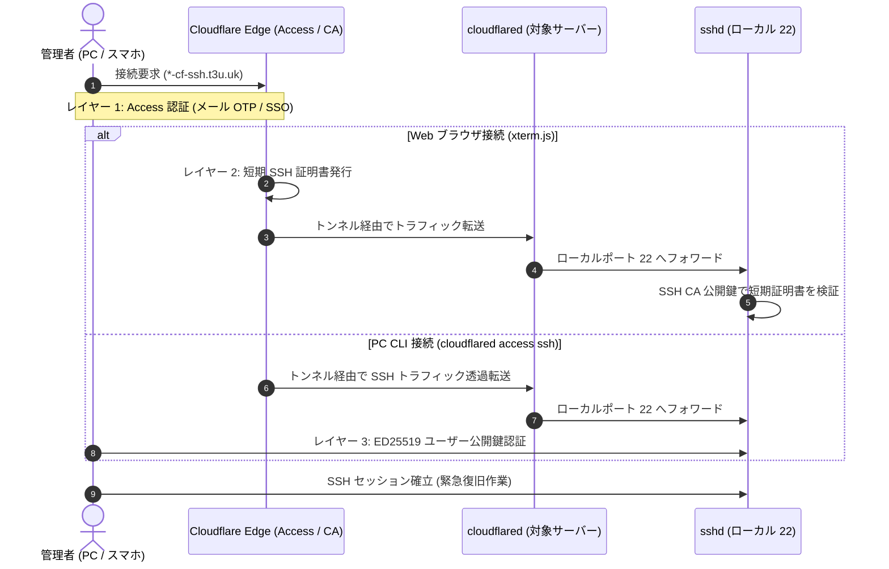

# 非常用 SSH アクセス運用マニュアル (Cloudflare Tunnel)

Nebula メッシュ VPN 障害時や Lighthouse 停止時，物理コンソールとは独立した帯域外管理手段として，Cloudflare Tunnel 経由の SSH アクセス手順を定める．

## 1. 概要とアーキテクチャ

通常時のリモート管理は Nebula メッシュ VPN (`10.0.0.0/24`) を経由するが，デーモン停止，証明書失効，Lighthouse ダウン，NAT loopback 障害等が発生すると通常の SSH 接続経路が遮断される．

各サーバー上で稼働する `cloudflared` が Cloudflare エッジに対して常時アウトバウンド接続 (HTTPS / QUIC) を確立する．このアウトバウンド経路のみで拠点ルータを越え，外部から各ノードへ到達できる帯域外管理プレーンを確保する．



---

## 2. 認証アーキテクチャ (多層防御)

不正アクセス防止のため，以下の 3 層による多層防御を適用する．

| 階層 | 防御機構 | 検証場所 | 役割・セキュリティ特性 |
| :--- | :--- | :--- | :--- |
| レイヤー 1 | Cloudflare Zero Trust (Access) | Cloudflare Edge | インターネット境界でのアクセス制御．ワンタイムパスコード (OTP) または IdP/SSO 認証に合格した管理者のみ通信を許可．未認証通信はエッジで即時遮断される． |
| レイヤー 2 | Cloudflare SSH CA (短期証明書) | ホスト OpenSSH (`sshd`) | 主に Web ターミナル接続時にエッジから発行される短期証明書．`sshd` は `/etc/ssh/cloudflare_ca.pub` およびプリンシパル設定 (`/etc/ssh/auth_principals/t3u`) で検証し，失効リスクを最小化する． |
| レイヤー 3 | ED25519 ユーザー公開鍵認証 | ホスト OpenSSH (`sshd`) | PC CLI 接続時における OS 側ユーザー (`t3u`) の `~/.ssh/authorized_keys` による公開鍵認証．エッジ認証と OS 認証の二重チェックにより，踏み台化を防止する． |

---

## 3. 対象ホストと接続エンドポイント一覧

対象ホストとサブドメイン一覧:

| ホスト名 | 接続ドメイン (FQDN) | マスターシークレット | 役割・配置拠点 |
| :--- | :--- | :--- | :--- |
| `torii-chan` | `torii-chan-cf-ssh.t3u.uk` | `secrets/master/hosts/torii-chan/emergency_ssh_token.age` | エッジゲートウェイ / Lighthouse (拠点T) |
| `sando-kun` | `sando-kun-cf-ssh.t3u.uk` | `secrets/master/hosts/sando-kun/emergency_ssh_token.age` | 汎用タワーサーバー (拠点A) |
| `kagutsuchi-sama` | `kagutsuchi-sama-cf-ssh.t3u.uk` | `secrets/master/hosts/kagutsuchi-sama/emergency_ssh_token.age` | 計算サーバー / バックアップ保管庫 (拠点A) |
| `shosoin-tan` | `shosoin-tan-cf-ssh.t3u.uk` | `secrets/master/hosts/shosoin-tan/emergency_ssh_token.age` | アプリケーションサーバー (拠点A) |

---

## 4. 接続手順

PC CLI および Web ブラウザの 2 系統から接続できる．

### 方法 A: PC CLI からの接続 (`cloudflared access ssh`)

#### 前提条件
接続元端末に `cloudflared` が必要となる (`nix develop` や `network-tools` 有効環境には同梱)．未導入環境では一時シェルで実行する:
```bash
# 外部 Nix 環境の場合
nix shell nixpkgs#cloudflared
```

#### SSH クライアント設定 (`~/.ssh/config`)
Home Manager 設定 ([home/programs/ssh.nix](../../home/programs/ssh.nix)) に以下のエントリおよび短縮エイリアスを定義している:

```ssh-config
# Cloudflare Tunnel 経由 非常用帯域外アクセス
Host torii-chan-cf
    HostName torii-chan-cf-ssh.t3u.uk

Host sando-kun-cf
    HostName sando-kun-cf-ssh.t3u.uk

Host kagutsuchi-sama-cf
    HostName kagutsuchi-sama-cf-ssh.t3u.uk

Host shosoin-tan-cf
    HostName shosoin-tan-cf-ssh.t3u.uk

Host *-cf-ssh.t3u.uk *-cf
    ProxyCommand cloudflared access ssh --hostname %h
    User t3u
    IdentityFile ~/.ssh/id_ed25519
```

#### 接続実行
短縮エイリアスまたは FQDN を指定して SSH コマンドを実行する:
```bash
# 短縮エイリアスで接続する場合
ssh torii-chan-cf

# FQDN で接続する場合
ssh shosoin-tan-cf-ssh.t3u.uk
```

初回接続時またはトークン期限切れ時は，ブラウザが自動的に開き Cloudflare Access の認証ページが表示される．認証完了後，ターミナル側で SSH セッションが確立される．

一時的な接続で `~/.ssh/config` を編集しない場合は，ProxyCommand を直接指定する:
```bash
ssh -o ProxyCommand="cloudflared access ssh --hostname torii-chan-cf-ssh.t3u.uk" t3u@torii-chan-cf-ssh.t3u.uk
```

---

### 方法 B: Web ブラウザからの接続 (スマートフォン・他端末)

1. スマートフォンまたは PC の Web ブラウザで，対象ホストの URL を開く:
   ```text
   https://<hostname>-cf-ssh.t3u.uk
   ```
   (例: `https://torii-chan-cf-ssh.t3u.uk`)
2. Cloudflare Access の認証画面でメールアドレスを入力し，ワンタイムパスコード (OTP) または SSO 認証を通過させる．
3. 認証完了後，ブラウザ画面内に xterm.js ベースの Web ターミナルが描画され，自動的に SSH セッション (ユーザー `t3u`) が起動する．
4. ブラウザ上のターミナルからシェルコマンドを実行し，障害調査やサービス再起動を実施する．

---

## 5. シークレット登録手順

各ホストが Cloudflare Tunnel を確立するための認証トークンは，agenix-rekey により暗号化して管理する．

### Step 1: Cloudflare Tunnel の作成とトークン取得
Cloudflare Zero Trust ダッシュボード (Networks → Tunnels) で各ホスト用の Tunnel を作成し，発行された Tunnel Token (`eyJh...` から始まる Base64 トークン文字列) を取得する．
Public Hostname には `<hostname>-cf-ssh.t3u.uk` を設定し，サービス先として `SSH -> localhost:22` を指定する．

### Step 2: シークレットへの登録
ステージング領域 (`.secrets-staging/`) を用いて平文トークンを取り込み，再暗号化を実行する:

```bash
mkdir -p .secrets-staging/hosts/<hostname>
echo -n "eyJh..." > .secrets-staging/hosts/<hostname>/emergency_ssh_token
just secret-apply-staging
```

`just secret-apply-staging` は平文トークンを Master 鍵で `secrets/master/hosts/<hostname>/emergency_ssh_token.age` へ暗号化して shred 破棄し，全ホスト向けに再暗号化を行う．既存のマスターシークレットを直接更新する場合は `just secret-edit secrets/master/hosts/<hostname>/emergency_ssh_token.age` を実行した後に `just secret-rekey` を行う．

### Step 3: NixOS 設定の有効化と反映
各ホストの設定 (例: `hosts/<hostname>/services/emergency-ssh.nix` または [hosts/torii-chan/default.nix](../../hosts/torii-chan/default.nix)) で本機能を有効化する:

```nix
my.services.emergencySsh.enable = true;
```

設定をデプロイまたは switch し，各ホスト上で cloudflared サービスが正常に稼働したことを確認する:
```bash
sudo systemctl status cloudflared-emergency-ssh.service
```

---

## 6. 非常時トラブルシューティングと運用上の注意

### 短期証明書の有効期限 (3分)
Cloudflare SSH CA から発行されるクライアント証明書の有効期限は 3 分間である．
- SSH 接続ハンドシェイク (セッション確立) の制限時間であり，確立済みの SSH セッションは証明書の有効期限を超えて継続する．
- 長時間の作業中に接続が意図せず切断された場合，再接続時に再度 Access 認証またはトークン更新が実行される．

### Nebula 障害発生時の緊急復旧コマンド例
Cloudflare Tunnel 経由でログイン後，直ちに以下の切り分け・復旧コマンドを実行できる:

```bash
# 1. Nebula サービスの状態確認と再起動
sudo systemctl status nebula@nebula0.service
sudo systemctl restart nebula@nebula0.service

# 2. ファイアウォール誤遮断の一時解除 (LAN SSH を許可)
sudo iptables -I INPUT -p tcp --dport 22 -j ACCEPT

# 3. 直前の健全な世代へのロールバック
sudo nixos-rebuild switch --rollback
```

---

## 関連ドキュメント
- [目次 (設計・運用ドキュメント)](../README.md) — 全体ナビゲーション・目次
- [ネットワークアーキテクチャ](../architecture/network-topology.md) — Nebula メッシュネットワーク，IP 体系，DNS 設計
- [ネットワーク障害トラブルシューティング](../troubleshooting/network-recovery.md) — Nebula メッシュ不通，物理 LAN SSH 遮断，NAT loopback 回避
- [シークレット & 鍵ライフサイクル管理](secret-management.md) — agenix-rekey, age, Bitwarden による鍵・暗号化管理方針
- [ConoHa VPS プロビジョニング & フェイルオーバー手順](vps-failover.md) — VPS フェイルオーバー起動と切り戻し手順
