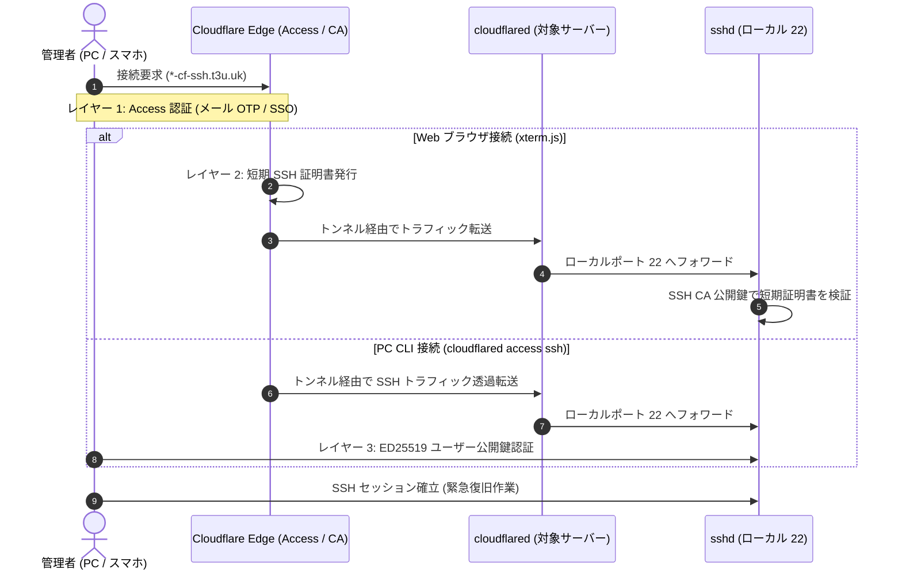

# 非常用 SSH アクセス運用マニュアル (Cloudflare Tunnel)

Nebula メッシュ VPN 障害時や Lighthouse 停止時に，物理コンソールとは独立した帯域外管理手段として Cloudflare Tunnel 経由の SSH アクセスを提供する．

## 1. 前提条件

| 項目 | 要件・確認事項 |
| :--- | :--- |
| 対象ホスト | `torii-chan`, `sando-kun`, `kagutsuchi-sama`, `shosoin-tan` (各ホストで `cloudflared` が常駐する) |
| 実行権限 | 接続: Cloudflare Access を通過した管理者アカウント．設定: 作業機の一般ユーザーと Bitwarden Master 鍵 |
| 必要ツール | `cloudflared`, `ssh`, Web ブラウザ |

### 1.1 作業前チェックリスト

- [ ] Cloudflare Zero Trust の管理者権限を持つ．
- [ ] 対象ホストの Tunnel と Public Hostname (`<hostname>-cf-ssh.t3u.uk`) が作成済みである．
- [ ] 接続元端末の `~/.ssh/config` に `*-cf` エイリアスが定義済みである ([2.3](#23-ssh-クライアント設定-sshconfig))．

---

## 2. 概要とアーキテクチャ

通常時のリモート管理は Nebula メッシュ VPN (`10.0.0.0/24`) を経由する．デーモン停止，証明書失効，Lighthouse ダウン，NAT loopback 障害が発生すると，この経路は遮断される．

各サーバー上で稼働する `cloudflared` が Cloudflare エッジに対して常時アウトバウンド接続 (HTTPS / QUIC) を確立する．このアウトバウンド経路のみで拠点ルータを越え，外部から各ノードへ到達できる帯域外管理プレーンを確保する．



### 2.1 認証アーキテクチャ (多層防御)

不正アクセス防止のため，3 層の多層防御を適用する．

| 階層 | 防御機構 | 検証場所 | 役割・セキュリティ特性 |
| :--- | :--- | :--- | :--- |
| レイヤー 1 | Cloudflare Zero Trust (Access) | Cloudflare Edge | インターネット境界でのアクセス制御．ワンタイムパスコード (OTP) または IdP/SSO 認証に合格した管理者のみ通信を許可し，未認証通信はエッジで即時遮断する． |
| レイヤー 2 | Cloudflare SSH CA (短期証明書) | ホスト OpenSSH (`sshd`) | 主に Web ターミナル接続時にエッジから発行される短期証明書．`sshd` は `/etc/ssh/cloudflare_ca.pub` およびプリンシパル設定 (`/etc/ssh/auth_principals/t3u`) で検証し，失効リスクを最小化する． |
| レイヤー 3 | ED25519 ユーザー公開鍵認証 | ホスト OpenSSH (`sshd`) | PC CLI 接続時における OS 側ユーザー (`t3u`) の `~/.ssh/authorized_keys` による公開鍵認証．エッジ認証と OS 認証の二重チェックにより踏み台化を防止する． |

### 2.2 対象ホストと接続エンドポイント一覧

| ホスト名 | 接続ドメイン (FQDN) | マスターシークレット | 役割・配置拠点 |
| :--- | :--- | :--- | :--- |
| `torii-chan` | `torii-chan-cf-ssh.t3u.uk` | [emergency_ssh_token.age](../../secrets/master/hosts/torii-chan/emergency_ssh_token.age) | エッジゲートウェイ / Lighthouse (拠点T) |
| `sando-kun` | `sando-kun-cf-ssh.t3u.uk` | [emergency_ssh_token.age](../../secrets/master/hosts/sando-kun/emergency_ssh_token.age) | 汎用タワーサーバー (拠点A) |
| `kagutsuchi-sama` | `kagutsuchi-sama-cf-ssh.t3u.uk` | [emergency_ssh_token.age](../../secrets/master/hosts/kagutsuchi-sama/emergency_ssh_token.age) | 計算サーバー / バックアップ保管庫 (拠点A) |
| `shosoin-tan` | `shosoin-tan-cf-ssh.t3u.uk` | [emergency_ssh_token.age](../../secrets/master/hosts/shosoin-tan/emergency_ssh_token.age) | アプリケーションサーバー (拠点A) |

### 2.3 SSH クライアント設定 (`~/.ssh/config`)

Home Manager 設定 ([home/programs/ssh.nix](../../home/programs/ssh.nix)) がエントリと短縮エイリアスを定義している．

```ssh-config
# Cloudflare Tunnel 経由 非常用帯域外アクセス
Host torii-chan-cf
    HostName torii-chan-cf-ssh.t3u.uk

Host sando-kun-cf
    HostName sando-kun-cf-ssh.t3u.uk

Host kagutsuchi-sama-cf
    HostName kagutsuchi-sama-cf-ssh.t3u.uk

Host shosoin-tan-cf
    HostName shosoin-tan-cf-ssh.t3u.uk

Host *-cf-ssh.t3u.uk *-cf
    ProxyCommand cloudflared access ssh --hostname %h
    User t3u
    IdentityFile ~/.ssh/id_ed25519
```

---

## 3. 作業手順

### Step 1: Cloudflare Tunnel の作成とトークン取得

Cloudflare Zero Trust ダッシュボード (Networks → Tunnels) で各ホスト用の Tunnel を作成し，発行された Tunnel Token (`eyJh...` から始まる Base64 トークン文字列) を取得する．Public Hostname には `<hostname>-cf-ssh.t3u.uk` を設定し，サービス先として `SSH -> localhost:22` を指定する．

### Step 2: シークレットへのトークン登録

取得したトークンを `.secrets-staging/hosts/<hostname>/emergency_ssh_token` に一時配置し，[平文ステージングの取り込み](secret-management.md#step-3-平文ステージングの取り込み) の手順で `secrets/master/hosts/<hostname>/emergency_ssh_token.age` へ暗号化して取り込む．

既存のマスターシークレットを直接更新する場合は `just secret edit secrets/master/hosts/<hostname>/emergency_ssh_token.age` を実行した後に `just secret rekey` を実行する．

### Step 3: NixOS 設定の有効化

プロファイル ([nixos/profiles/tower-server/default.nix](../../nixos/profiles/tower-server/default.nix)) は `my.services.emergencySsh.enable` を既定で有効化する．ホスト単位で切り替える場合はホスト設定 ([hosts/torii-chan/default.nix](../../hosts/torii-chan/default.nix)) で指定する．

```nix
my.services.emergencySsh.enable = true;
```

設定の適用は [日常保守 & ライフサイクル管理](maintenance.md#step-6-設定適用と再起動) に従う．

### Step 4: PC CLI からの接続

接続元端末に `cloudflared` が必要となる (`nix develop` や `network-tools` 有効環境には同梱)．未導入環境では一時シェルで実行する．

```bash
nix shell nixpkgs#cloudflared
```

短縮エイリアスまたは FQDN を指定して SSH コマンドを実行する．

```bash
# 短縮エイリアスで接続する場合
ssh torii-chan-cf

# FQDN で接続する場合
ssh shosoin-tan-cf-ssh.t3u.uk
```

初回接続時またはトークン期限切れ時は，ブラウザが自動的に開き Cloudflare Access の認証ページが表示される．認証完了後，ターミナル側で SSH セッションが確立される．

一時的な接続で `~/.ssh/config` を編集しない場合は，ProxyCommand を直接指定する．

```bash
ssh -o ProxyCommand="cloudflared access ssh --hostname torii-chan-cf-ssh.t3u.uk" t3u@torii-chan-cf-ssh.t3u.uk
```

### Step 5: Web ブラウザからの接続

1. スマートフォンまたは PC の Web ブラウザで，対象ホストの URL を開く．
   ```text
   https://<hostname>-cf-ssh.t3u.uk
   ```
   (例: `https://torii-chan-cf-ssh.t3u.uk`)
2. Cloudflare Access の認証画面でメールアドレスを入力し，ワンタイムパスコード (OTP) または SSO 認証を通過させる．
3. 認証完了後，ブラウザ画面内に xterm.js ベースの Web ターミナルが描画され，自動的に SSH セッション (ユーザー `t3u`) が起動する．
4. ブラウザ上のターミナルからシェルコマンドを実行し，障害調査やサービス再起動を実施する．

---

## 4. 事後検証

### 4.1 cloudflared サービスの稼働確認

各ホスト上で `cloudflared` サービスが稼働していることを確認する．

```bash
sudo systemctl status cloudflared-emergency-ssh.service
```

期待出力:
```text
Active: active (running)
```

### 4.2 接続経路の確認

PC CLI から短縮エイリアスで接続し，Cloudflare Tunnel 経由でシェルが起動することを確認する．

```bash
ssh torii-chan-cf
```

期待出力:
```text
t3u@torii-chan:~$
```

接続できない場合は，Tunnel のトークン登録 ([Step 2](#step-2-シークレットへのトークン登録)) と `cloudflared-emergency-ssh.service` のログを確認する．

```bash
journalctl -u cloudflared-emergency-ssh.service -n 50
```

---

## 5. 運用上の注意

### 5.1 短期証明書の有効期限 (3 分)

Cloudflare SSH CA から発行されるクライアント証明書の有効期限は 3 分間である．

- SSH 接続ハンドシェイク (セッション確立) の制限時間であり，確立済みの SSH セッションは証明書の有効期限を超えて継続する．
- 長時間の作業中に接続が意図せず切断された場合，再接続時に再度 Access 認証またはトークン更新が実行される．

### 5.2 Nebula 障害発生時の緊急復旧コマンド

Cloudflare Tunnel 経由でログインした後，次の切り分け・復旧コマンドを実行できる．

```bash
# 1. Nebula サービスの状態確認と再起動
sudo systemctl status nebula@nebula0.service
sudo systemctl restart nebula@nebula0.service

# 2. ファイアウォール誤遮断の一時解除 (LAN SSH を許可)
sudo iptables -I INPUT -p tcp --dport 22 -j ACCEPT

# 3. 直前の健全な世代へのロールバック
sudo nixos-rebuild switch --rollback
```

---

## 関連ドキュメント
- [目次 (設計・運用ドキュメント)](../README.md) — 全体ナビゲーション・目次
- [シークレット & 鍵ライフサイクル管理](secret-management.md) — agenix-rekey, age, Bitwarden による鍵・暗号化管理方針
- [ネットワークアーキテクチャ](../architecture/network-topology.md) — Nebula メッシュネットワーク，IP 体系，DNS 設計
- [ネットワーク障害トラブルシューティング](../troubleshooting/network-recovery.md) — Nebula メッシュ不通，物理 LAN SSH 遮断，NAT loopback 回避
- [ConoHa VPS プロビジョニング & フェイルオーバー手順](vps-failover.md) — VPS フェイルオーバー起動と切り戻し手順
