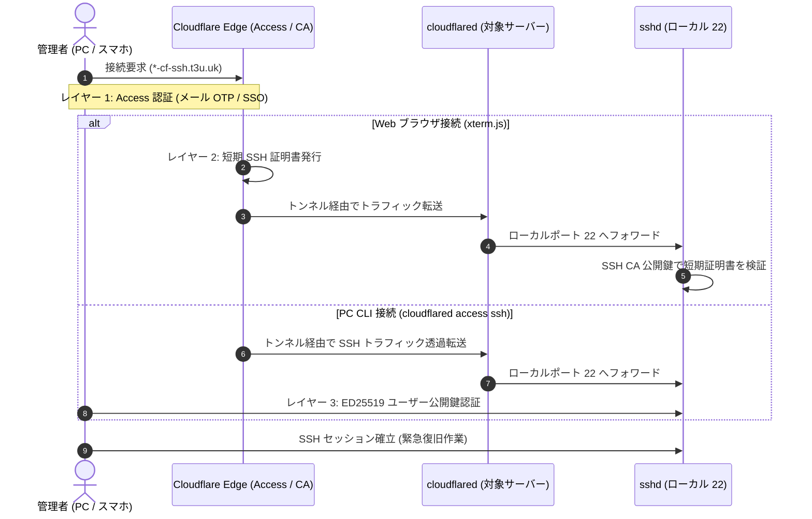

# 非常用 SSH アクセス運用マニュアル（Cloudflare Tunnel）

本ドキュメントは，Nebula メッシュ VPN の障害時，Lighthouse 停止時，またはファイアウォール誤設定時等に，物理ディスプレイやキーボードを接続することなく安全にサーバーへアクセスするための帯域外管理（Out-of-Band Management: OOBM）手段である Cloudflare Tunnel 経由 SSH アクセスの運用・接続手順を記述する．

---

## 1. 概要とアーキテクチャ

通常時のホスト間通信およびリモート管理は Nebula メッシュ VPN（`10.0.0.0/24`）を経由して行われるが，Nebula デーモンの停止，証明書失効，Lighthouse（`torii-chan`）ダウン，ルータの NAT loopback 障害等が発生した場合，通常の SSH 接続経路が遮断される．

本構成では，各サーバー上で稼働する `cloudflared` が Cloudflare エッジに対して常時アウトバウンド接続（HTTPS / QUIC）を確立している．これにより，各拠点のルータでインバウンドポート（ポート 22 等）を開放することなく，外部から安全に各ノードへ到達できる独立した管理プレーンを提供する．



---

## 2. 認証アーキテクチャ（多層防御）

不正アクセスを防止するため，以下の 3 層による厳格な多層防御を適用している．

| 階層 | 防御機構 | 検証場所 | 役割・セキュリティ特性 |
| :--- | :--- | :--- | :--- |
| **レイヤー 1** | **Cloudflare Zero Trust (Access)** | Cloudflare Edge | インターネット境界でのアクセス制御．ワンタイムパスコード（OTP）または IdP/SSO 認証に合格した管理者のみ通信を許可．未認証通信はエッジで即時遮断される． |
| **レイヤー 2** | **Cloudflare SSH CA（短期証明書）** | ホスト OpenSSH (`sshd`) | 主に Web ターミナル接続時にエッジから発行される短期証明書（Short-lived Certificate）．`sshd` は `/etc/ssh/cloudflare_ca.pub` およびプリンシパル設定（`/etc/ssh/auth_principals/t3u`）で検証し，失効リスクを最小化する． |
| **レイヤー 3** | **ED25519 ユーザー公開鍵認証** | ホスト OpenSSH (`sshd`) | PC CLI 接続時における OS 側ユーザー（`t3u`）の `~/.ssh/authorized_keys` による公開鍵認証．エッジ認証と OS 認証の二重チェックにより，踏み台化を防止する． |

---

## 3. 対象ホストと接続エンドポイント一覧

本リポジトリで管理されている主要ホストは，以下の専用サブドメインを通じて個別にアクセス可能である．

| ホスト名 | 接続ドメイン (FQDN) | シークレットキー (`secrets/hosts/<hostname>.yaml`) | 役割・配置拠点 |
| :--- | :--- | :--- | :--- |
| **`torii-chan`** | `torii-chan-cf-ssh.t3u.uk` | `torii_chan_cloudflared_ssh_token` | エッジゲートウェイ / Lighthouse（拠点T） |
| **`sando-kun`** | `sando-kun-cf-ssh.t3u.uk` | `sando_kun_cloudflared_ssh_token` | 汎用タワーサーバー（拠点A） |
| **`kagutsuchi-sama`** | `kagutsuchi-sama-cf-ssh.t3u.uk` | `kagutsuchi_sama_cloudflared_ssh_token` | 計算サーバー / バックアップ保管庫（拠点A） |
| **`shosoin-tan`** | `shosoin-tan-cf-ssh.t3u.uk` | `shosoin_tan_cloudflared_ssh_token` | アプリケーションサーバー（拠点A） |

---

## 4. 接続手順

接続方法には，PC CLI からの接続と，スマートフォンや他端末の Web ブラウザから接続する 2 系統が存在する．

### 4.1 方法 A: PC CLI からの接続 (`cloudflared access ssh`)

日常の作業端末やノート PC（BrokenPC, x1c7）からターミナル経由で接続する標準的な手順である．

#### 前提条件
接続元端末に `cloudflared` が導入されている必要がある．
本リポジトリの開発環境（`nix develop` または direnv）および NixOS クライアント（`network-tools` 有効時）には `cloudflared` が標準で導入されている．未導入の外部環境から接続する場合は，事前にインストールするか一時シェルで実行する:
```bash
# 外部 Nix 環境の場合
nix shell nixpkgs#cloudflared
```

#### SSH クライアント設定 (`~/.ssh/config`)
`~/.ssh/config` に以下のエントリを追加する:

```ssh-config
# Cloudflare Tunnel 経由 非常用帯域外アクセス
Host *-cf-ssh.t3u.uk
    ProxyCommand cloudflared access ssh --hostname %h
    User t3u
    IdentityFile ~/.ssh/id_ed25519
```

#### 接続実行
通常通り SSH コマンドを実行する:
```bash
ssh t3u@shosoin-tan-cf-ssh.t3u.uk
```

- **初回・認証期限切れ時の挙動**: コマンド実行時にブラウザが自動的に開き，Cloudflare Access の認証ページが表示される．認証を完了すると，ターミナル側で透過的に SSH セッションが確立される．
- **ワンライナーでの接続**: `~/.ssh/config` を編集せずに一時的に接続する場合は，以下のように `-o` オプションで ProxyCommand を指定する:
  ```bash
  ssh -o ProxyCommand="cloudflared access ssh --hostname torii-chan-cf-ssh.t3u.uk" t3u@torii-chan-cf-ssh.t3u.uk
  ```

---

### 4.2 方法 B: 出先スマホ・他端末からの接続（Web ブラウザ / xterm.js ターミナル）

出先のスマートフォンや，`cloudflared` がインストールされていない他者の PC 等から緊急対応を行う場合の手順である．

#### 手順
1. スマートフォンまたは PC の Web ブラウザで，対象ホストの URL を開く:
   ```text
   https://<hostname>-cf-ssh.t3u.uk
   ```
   （例: `https://torii-chan-cf-ssh.t3u.uk`）
2. Cloudflare Access の認証画面が表示されるため，許可された管理者のメールアドレスを入力し，送付されたワンタイムパスコード（OTP）または SSO 認証を通過させる．
3. 認証が完了すると，ブラウザ画面内に **xterm.js ベースの Web ターミナル** が描画され，自動的に SSH セッション（ユーザー `t3u`）が起動する．
4. ブラウザ上のターミナルから直接シェルコマンドを実行し，障害調査やサービス再起動を実施する．

---

## 5. シークレット登録手順

各ホストが Cloudflare Tunnel を確立するための認証情報（Tunnel Token）は，SOPS により暗号化されて管理される．

### Step 1: Cloudflare Tunnel の作成とトークン取得
Cloudflare Zero Trust ダッシュボード（Networks → Tunnels）で各ホスト用の Tunnel を作成し，発行された Tunnel Token（`eyJh...` から始まる Base64 トークン文字列）を取得する．
Public Hostname には `<hostname>-cf-ssh.t3u.uk` を設定し，サービス先として `SSH -> localhost:22` を指定する．

### Step 2: SOPS シークレットへの登録
ホスト個別の暗号化ファイル `secrets/hosts/<hostname>.yaml` に登録する:

```bash
# master 鍵を指定して対象ホストのシークレットを編集
sops secrets/hosts/<hostname>.yaml
```

ファイル内に `<hostKey>_cloudflared_ssh_token` キーを定義し，取得した Token 文字列を貼り付ける（`<hostKey>` はホスト名の小文字・ハイフンをアンダースコアに変換したもの）:

```yaml
# secrets/hosts/torii-chan.yaml の例
torii_chan_cloudflared_ssh_token: "eyJhIjoi..."
```

編集後，ファイルを保存して暗号化を完了する．

### Step 3: NixOS 設定の有効化と反映
各ホストの設定（例: `hosts/<hostname>/services/emergency-ssh.nix` または `hosts/torii-chan/sbc.nix`）で本機能を有効化する:

```nix
my.services.emergencySsh.enable = true;
```

設定をデプロイまたは switch し，各ホスト上で cloudflared サービスが正常に稼働したことを確認する:
```bash
sudo systemctl status cloudflared-emergency-ssh.service
```

---

## 6. 非常時トラブルシューティングと運用上の注意

### 6.1 短期証明書の有効期限（3分）
Cloudflare SSH CA から発行されるクライアント証明書の有効期限は 3 分間である．
- これは **SSH 接続ハンドシェイク（セッション確立）を行うための制限時間** であり，一度確立された SSH セッションが 3 分後に強制切断されることはない．
- 長時間の作業中に接続が意図せず切断された場合，再接続時に再度 Access 認証またはトークン更新が実行される．

### 6.2 Nebula 障害発生時の緊急復旧コマンド例
Cloudflare Tunnel 経由でログイン後，直ちに以下の切り分け・復旧コマンドを実行できる:

```bash
# 1. Nebula サービスの状態確認と再起動
sudo systemctl status nebula@nebula0.service
sudo systemctl restart nebula@nebula0.service

# 2. ファイアウォール誤遮断の一時解除 (LAN SSH を許可)
sudo iptables -I INPUT -p tcp --dport 22 -j ACCEPT

# 3. 直前の健全な世代へのロールバック
sudo nixos-rebuild switch --rollback
```

---

## 関連ドキュメント

- [ネットワークアーキテクチャ設計](../architecture/network-topology.md)
- [ネットワーク障害トラブルシューティング](../troubleshooting/network-recovery.md)
- [シークレット & 鍵ライフサイクル管理](secret-management.md)
- [VPS フェイルオーバー手順](vps-failover.md)
