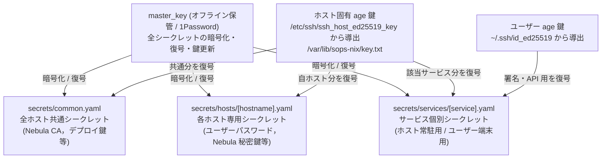

# シークレット & 鍵ライフサイクル管理

SOPS (sops-nix), age, 1Password，および Nebula 証明書による暗号化シークレットの管理方針，鍵モデル，更新手順，および失効・廃棄手順．

## 1. 鍵階層とアクセスモデル

最小権限の原則に基づき，3 種類の age 鍵を使い分ける．



| 鍵の種別 | 配置場所 | 権限範囲 | 用途 |
| :--- | :--- | :--- | :--- |
| `master_key` | 1Password / 管理者のオフライン端末 | 全ファイルの復号・暗号化 | 新ホスト追加，鍵のローテーション，暗号化ファイルの編集 |
| ホスト鍵 | `/var/lib/sops-nix/key.txt` | `secrets/hosts/<hostname>.yaml`, [secrets/common.yaml](../../secrets/common.yaml)，および該当ホストの `secrets/services/*.yaml` | 起動時の自動復号，ホスト常駐サービス用クレデンシャルの読み込み |
| ユーザー鍵 | `~/.ssh/id_ed25519` | [secrets/services/signing.yaml](../../secrets/services/signing.yaml) および [secrets/services/conoha-vps-mcp.yaml](../../secrets/services/conoha-vps-mcp.yaml) | コミット署名鍵，ConoHa API クレデンシャルの復号 (デスクトップ環境) |

---

## 2. 秘密情報のファイル構成

| ファイルパス | 格納対象・主なシークレット |
| :--- | :--- |
| [secrets/common.yaml](../../secrets/common.yaml) | 全ホストで共有される共通シークレット (Nebula ルート CA 公開証明書 `nebula_ca`, `nix-config-private` 取得用 GitHub デプロイ鍵など) |
| `secrets/hosts/<hostname>.yaml` | ホスト個別のシークレット (ログインユーザーのハッシュ化パスワード，当該ホストの Nebula ノード秘密鍵など) |
| `secrets/services/<service>.yaml` | 用途別のサービスシークレット (Cloudflare API トークン `ddns.yaml`，Restic `backup.yaml`, Minecraft `minecraft.yaml`, ConoHa API `conoha-vps-mcp.yaml`，コミット署名鍵 `signing.yaml` など) |

---

## 3. 日常のシークレット編集

シークレットの編集には `master_key` が必要である．環境変数 `SOPS_AGE_KEY_FILE` で秘密鍵パスを指定して `sops` コマンドを実行する:
```bash
# master 鍵の環境変数を指定して共通シークレットを編集
SOPS_AGE_KEY_FILE=~/.config/sops/age/keys.txt sops secrets/common.yaml

# ホスト個別シークレットの編集
SOPS_AGE_KEY_FILE=~/.config/sops/age/keys.txt sops secrets/hosts/<hostname>.yaml
```

---

## 4. Nebula 証明書のローテーション

Nebula ルート CA ([scripts/nebula-rotate-ca.ysh](../../scripts/nebula-rotate-ca.ysh) の既定配置先: `~/.nebula-ca-10-0-0/ca.crt`) の有効期限は 10 年 (`-duration 87600h`) であり，各ノード証明書もこれを継承する．鍵漏洩やノード追加・更新に伴う証明書管理の手順は以下の通りである:

```bash
CA_DIR="${CA_DIR:-$HOME/.nebula-ca-10-0-0}"

# 各ノードの証明書を署名後，SOPS へ一括インポート
SOPS_AGE_KEY_FILE=~/.config/sops/age/keys.txt ysh scripts/nebula-import-secrets.ysh "$CA_DIR"
```
※ CA 自体を更新する場合は，`ysh scripts/nebula-rotate-ca.ysh` で全ノードの証明書を再発行した上で，上記の `nebula-import-secrets.ysh` を用いて SOPS へ取り込む．
更新後は Git にコミットして各ホストへデプロイを適用し，新しい証明書へ切り替える．

---

## 5. ホスト廃棄・再インストール時の鍵失効プロトコル

マシンの破棄や OS 再インストールに伴い SSH ホスト鍵が変更された場合は，古い鍵のアクセス権を剥奪してシークレットを再暗号化する．

### Step 1: [.sops.yaml](../../.sops.yaml) の更新
[.sops.yaml](../../.sops.yaml) を更新する．破棄する場合は該当ホストの公開鍵アンカー (`&<hostKey> age1...`)，ホスト個別の `creation_rules`，およびサービス側 `creation_rules` に残る参照 (`*<hostKey>`) を削除し，再インストールの場合はアンカーを新しい公開鍵へ差し替える．

### Step 2: 共通・サービスシークレットの再暗号化
該当ホストが復号できていた共通シークレットとサービスシークレットの recipient を更新して再暗号化する．
```bash
SOPS_AGE_KEY_FILE=~/.config/sops/age/keys.txt sops updatekeys secrets/common.yaml

# 例: shosoin-tan の場合は backup.yaml と minecraft.yaml も更新する
SOPS_AGE_KEY_FILE=~/.config/sops/age/keys.txt sops updatekeys secrets/services/backup.yaml
SOPS_AGE_KEY_FILE=~/.config/sops/age/keys.txt sops updatekeys secrets/services/minecraft.yaml
```

### Step 3: ホスト個別シークレットの再暗号化 (再インストール時)
再インストールの場合は，ホスト個別シークレットの recipient も更新する (破棄する場合はファイルごと削除するため不要)．
```bash
SOPS_AGE_KEY_FILE=~/.config/sops/age/keys.txt sops updatekeys secrets/hosts/<hostname>.yaml
```

### Step 4: 不要シークレットファイルの削除 (破棄時)
ホストを完全に破棄する場合は，不要になったシークレットファイルを削除する (`git rm secrets/hosts/<hostname>.yaml`)．

### Step 5: Nebula ホスト一覧の更新 (破棄時)
ホストを完全に破棄する場合は，[scripts/nebula-lib.ysh](../../scripts/nebula-lib.ysh) の `FLEET` リストから該当ホストのエントリを削除する．

---

## 関連ドキュメント
- [目次 (設計・運用ドキュメント)](../README.md) — 設計・運用ドキュメント一覧
- [ネットワークアーキテクチャ](../architecture/network-topology.md) — ネットワーク構成とメッシュ VPN 仕様
- [新規ホスト追加手順](adding-a-host.md) — 新規ハードウェア・ノード追加時の詳細手順
- [非常用 SSH アクセス運用マニュアル (Cloudflare Tunnel)](emergency-cf-ssh.md) — Cloudflare Tunnel 経由の非常用アクセス手順
- [トラブルシューティング: 認証・シークレット](../troubleshooting/secrets-and-auth.md) — 鍵認証・SOPS 復号失敗時の切り分けと対処
