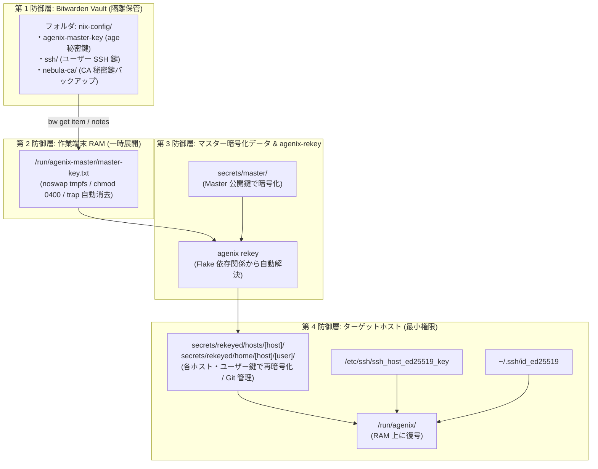

# シークレット & 鍵ライフサイクル管理

agenix-rekey, age, Bitwarden，および Nebula 証明書による暗号化シークレットの管理方針，鍵モデル，運用手順，失効・廃棄手順．

## 1. 多層防御モデルとアクセス権限

作業端末が侵害された場合でもインフラ全体の権限奪取を防ぐため，Bitwarden 隔離保管，RAM tmpfs 一時展開，agenix-rekey による最小権限配布の多層防御境界を構築する．



| 鍵の種別 | 配置場所 | 権限範囲 | 用途 |
| :--- | :--- | :--- | :--- |
| Master 鍵 | Bitwarden (`nix-config/agenix-master-key`) / RAM tmpfs (`/run/agenix-master/master-key.txt`) | 全マスター暗号化ファイルの復号・再暗号化 | 新ホスト追加，鍵の更新，マスターファイルの編集 |
| ホスト鍵 | `/etc/ssh/ssh_host_ed25519_key` (公開鍵は `hosts/<hostname>/default.nix` の `age.rekey.hostPubkey`) | 当該ホスト専用 (`secrets/rekeyed/hosts/<hostname>/*.age`) | 起動時の自動復号，ホスト常駐サービス用クレデンシャルの配置 (`/run/agenix/`) |
| ユーザー SSH 鍵 | Bitwarden (`nix-config/ssh/<hostname>`) / 開発端末 (`~/.ssh/id_ed25519`) | リモートホストへの SSH 接続，Git 操作，home-manager シークレットの復号 | 運用者認証，home-manager シークレットの配布，ディザスタリカバリ時の SSH 鍵復旧 |

### 1.1 Bitwarden 保管庫構造 (`nix-config/`)

Bitwarden 上のインフラ資格情報は，専用フォルダ `nix-config/` 配下に格納する．

```text
nix-config/                          # ルートフォルダ
├── agenix-master-key                # [セキュアメモ] AGE-SECRET-KEY-1... (agenix-rekey Master 鍵)
├── nebula-ca/                       # [サブフォルダ] オフライン CA 秘密鍵バックアップ
│   └── ca.key                       # [セキュアメモ] Nebula ルート CA 秘密鍵
└── ssh/                             # [サブフォルダ] 対外認証・フェイルオーバー用 SSH 鍵
    ├── BrokenPC                     # [SSH キー] BrokenPC の id_ed25519 (秘密鍵・公開鍵)
    ├── x1c7                         # [SSH キー] x1c7 の id_ed25519 (秘密鍵・公開鍵)
    └── torii-chan                   # [SSH キー] torii-chan の ssh_host_ed25519_key (VPS フェイルオーバー用ホスト鍵)
```

| アイテム | 種別 | 格納内容 | 説明 |
| :--- | :--- | :--- | :--- |
| `nix-config/agenix-master-key` | セキュアメモ | `AGE-SECRET-KEY-1...` | agenix-rekey の Master age 秘密鍵．Bech32 形式テキストとして保持する． |
| `nix-config/nebula-ca/ca.key` | セキュアメモ | `ca.key` | Nebula ルート CA 秘密鍵のディザスタリカバリ用バックアップ． |
| `nix-config/ssh/<hostname>` | SSH キー | `id_ed25519` / `ssh_host_ed25519_key` | 開発端末のユーザー SSH 鍵 (`BrokenPC`, `x1c7`) および `torii-chan` の VPS フェイルオーバー用 SSH ホスト鍵を Bitwarden の SSH キーアイテム形式で保管し，復旧時に取り出す． |

### 1.2 RAM tmpfs 一時展開と自動消去

[scripts/secrets/secret.ysh](../../scripts/secrets/secret.ysh) および [scripts/secrets/agenix-bw-lib.ysh](../../scripts/secrets/agenix-bw-lib.ysh) は，作業時に Master 秘密鍵を RAM 上の tmpfs (`/run/agenix-master/master-key.txt`) へパーミッション `0400` で展開する．[nixos/security/agenix.nix](../../nixos/security/agenix.nix) は `/run/agenix-master` に `noswap` 付きの専用 tmpfs をマウントし，スクリプトは systemd user scope (`MemorySwapMax=0`) で再実行されるため，秘密鍵がスワップやディスクへ流出しない．シェルの `trap` (EXIT/INT/TERM/HUP/QUIT) により，正常終了・エラー・シグナル割り込みを問わず一時ファイルは即時に自動削除される．`tmpfs` 以外の領域は `AGENIX_MASTER_KEY_DIR_ALLOW_UNSAFE=1` を明示しない限り拒否し，デフォルトの `/run/agenix-master` が `noswap` でない場合は処理を中止する．

---

## 2. リポジトリ内シークレット構成

シークレットはファイルパスとディレクトリでアクセス境界を分離する．

```text
secrets/
├── master/                          # Master 鍵でのみ暗号化されたマスターファイル群
│   ├── common/                      # 全ホスト共通シークレット
│   │   └── deploy_key.age           # GitHub プライベートリポジトリ取得用 deploy key
│   ├── hosts/<hostname>/            # ホスト固有シークレット
│   │   ├── user_password_hash.age   # ユーザーパスワードハッシュ
│   │   ├── nebula_key.age           # Nebula メッシュ VPN ノード秘密鍵
│   │   └── emergency_ssh_token.age  # Cloudflare Tunnel 認証トークン (常駐サーバー機)
│   └── services/<service>/          # サービス固有シークレット
│       ├── backup/                  # Restic バックアップ (password.age, ssh_key.age)
│       ├── ddns/                    # Cloudflare DDNS (cloudflare_api.env.age)
│       ├── discord-bridge/          # Discord Bot トークン (bridge.env.age)
│       ├── signing/                 # Git コミット署名用 GPG 鍵 (gpg_private_key.age)
│       └── conoha-vps-mcp/          # ConoHa API 認証情報 (credentials.env.age)
└── rekeyed/                         # agenix rekey で自動生成されるホスト・ユーザー別 .age 群 (Git 管理)
    ├── home/<hostname>/<username>/  # home-manager シークレット (ユーザー SSH 鍵で復号)
    └── hosts/<hostname>/            # NixOS ホストシークレット (ホスト SSH 鍵で復号)
```

`secrets/master/` は Master 公開鍵で暗号化された定義ファイル群であり，`secrets/rekeyed/` は各ホスト・ユーザーの公開鍵で再暗号化された配布ファイル群である (`just secret-rekey` で生成)．

| 区分 | 対象パス | 管理方式 | 説明 |
| :--- | :--- | :--- | :--- |
| マスター暗号化データ | `secrets/master/**/*.age` | age 暗号化 (Master 公開鍵) | Master 鍵でのみ復号できる定義ファイル．Git 管理する． |
| ホスト別配布データ | `secrets/rekeyed/hosts/<hostname>/*.age` | age 暗号化 (ホスト公開鍵) | `agenix rekey` が出力する各ホスト専用暗号化ファイル (`<hash>-<secret名>.age`)．Git 管理し CI での純粋ビルドを維持する． |
| ユーザー別配布データ | `secrets/rekeyed/home/<hostname>/<username>/*.age` | age 暗号化 (ユーザー SSH 公開鍵) | home-manager の `age.secrets` 用暗号化ファイル (`<hash>-<secret名>.age`)．Git 管理する． |
| 平文公開データ | `nixos/networking/nebula/ca.crt`, `hosts/<hostname>/nebula.crt` | 平文ファイル | 暗号化不要な公開証明書データ． |
| ローカル自動生成 | `/var/lib/minecraft/secrets/` (`forwarding.secret`, `nitac23s-rcon.secret`) | 起動時生成 | `shosoin-tan` の `minecraft-secrets.service` 起動時に `openssl rand` で生成し，Git 管理から除外する． |
| 一時ステージング | `.secrets-staging/` | 平文一時配置 (`.gitignore`) | Master 鍵を持たない環境で暗号化対象の平文を一時配置する領域．暗号化後に shred 破棄される． |

---

## 3. 日常のシークレット運用

シークレット操作は [justfile](../../justfile) または [scripts/secrets/secret.ysh](../../scripts/secrets/secret.ysh) を通じて実行する．

### 3.1 認証セッションの初期化

対話端末では，環境変数 `BW_SESSION` が未設定の場合にスクリプトが自動で `bw unlock` を対話実行する．非対話実行時は事前にセッションキーを環境変数に設定する．

```bash
# セッションキーを取得して環境変数に設定
export BW_SESSION=$(bw unlock --raw)

# またはワンショット実行
BW_SESSION=$(bw unlock --raw) just secret-rekey
```

### 3.2 マスターファイルの編集

マスター暗号化ファイルを直接編集する場合は `just secret-edit` を実行する．

```bash
# マスター暗号化ファイルを復号して編集
just secret-edit secrets/master/services/ddns/cloudflare_api.env.age

# ホスト別配布ファイルへ再暗号化して反映
just secret-rekey
```

### 3.3 ホストシークレットの再暗号化

マスターファイルやホスト公開鍵の変更後は，全ホスト向けに再暗号化を実行する．

```bash
just secret-rekey

# キャッシュを無視して全ホストを強制的に再暗号化する場合
just secret-rekey --force
# または: ysh scripts/secrets/secret.ysh rekey --force
```

### 3.4 平文ステージングの取り込み

外部クレデンシャルの追加や初期設定時は，平文ファイルを `.secrets-staging/` に一時配置し，Master 鍵で暗号化して取り込む．

```bash
# secrets/master/ に対応するパス構造で平文を配置
mkdir -p .secrets-staging/hosts/<hostname>
echo -n "<password_hash>" > .secrets-staging/hosts/<hostname>/user_password_hash

# 取り込み計画の事前検証 (dry-run)
just secret-apply-staging --dry-run
# または: ysh scripts/secrets/secret.ysh apply-staging --dry-run

# 暗号化，平文の shred 削除，および rekey を一括実行
just secret-apply-staging
```

### 3.5 ユーザーパスワードハッシュの一括更新

root パスワード廃止に伴い，ログイン資格情報は `user_password_hash.age` (yescrypt) に一本化されている．ホストのユーザーパスワードを設定・更新する場合，メモリ内で直接 yescrypt ハッシュを生成して暗号化できる:

```bash
# 全ホストの user パスワードを一括更新 (ホスト毎にソルトを個別生成)
just secret-set-host-password --all

# 特定ホストのみ更新する場合
just secret-set-host-password BrokenPC

# 更新後は再暗号化を実行して反映
just secret-rekey
```

### 3.6 ワークステーション SSH 鍵の復元とバックアップ

ワークステーションのユーザー SSH 鍵 (`~/.ssh/id_ed25519` および `~/.ssh/id_ed25519.pub`) は Bitwarden の `nix-config/ssh/<hostname>` と同期する．

```bash
# Bitwarden の nix-config/ssh/<hostname> (省略時は現在のホスト名) から SSH 鍵を復元
just secret-ssh-restore
# または: ysh scripts/secrets/secret.ysh ssh-restore [hostname] [--force]

# ローカルの ~/.ssh/id_ed25519 を Bitwarden の nix-config/ssh/<hostname> へ登録・更新
just secret-ssh-backup
# または: ysh scripts/secrets/secret.ysh ssh-backup [hostname] [--file <path>]
```

- `ssh-restore` は Bitwarden から秘密鍵を取得して `ssh-keygen -y` で公開鍵を導出し，`~/.ssh/id_ed25519` (`0600`) と `~/.ssh/id_ed25519.pub` (`0644`) にアトミックに配置する (内容が異なる既存鍵がある場合は `--force` 指定時のみ上書き)．旧 `sops-nix` 時代のシンボリックリンク (`~/.ssh/id_ed25519 -> /run/secrets/...`) が残っている場合は自動削除して実ファイルに置き換え，`hosts/<hostname>/default.nix` の `home-manager` 側 `age.rekey.hostPubkey` との一致を確認したうえで，自ホスト実行時はユーザーの `agenix.service` と `import-gpg-key.service` を再起動して `home-manager` シークレットを即時復号する．
- `ssh-backup` はローカルの `~/.ssh/id_ed25519` (または `--file <path>`) から公開鍵と SHA256 フィンガープリントを導出し，Bitwarden の `nix-config/ssh/<hostname>` へ SSH キーアイテム (サーバー非対応時はセキュアメモ) として登録・更新する．

### 3.7 環境診断

必要な CLI ツール，Master 識別子の整合性，Bitwarden 接続状態，ステージング状態，および `~/.ssh/id_ed25519` のシンボリックリンク検出・パーミッション検査・`~/.ssh/id_ed25519.pub` と `hosts/<hostname>/default.nix` の `home-manager` 側 `age.rekey.hostPubkey` との公開鍵一致検査を実行する．

```bash
just secret-doctor
# または: ysh scripts/secrets/secret.ysh doctor
```

---

## 4. Nebula CA と証明書運用

Nebula ネットワークの暗号化通信に使用する証明書と秘密鍵を管理する．

### 4.1 オフライン CA 原則

Nebula ルート CA の秘密鍵 (`ca.key`) は，運用者のオフライン環境 (`~/.nebula-ca/ca.key`) にのみ保持し，リポジトリや稼働ホストには配置しない．
ディザスタリカバリ用バックアップは Bitwarden の `nix-config/nebula-ca/ca.key` に保管する．
ルート CA 公開証明書 (`ca.crt`) は機密性がないため，平文ファイル `nixos/networking/nebula/ca.crt` としてリポジトリにコミットする．

### 4.2 ノード証明書の発行と秘密鍵の登録

各ノードの証明書発行と秘密鍵暗号化の手順．

```bash
CA_DIR="${CA_DIR:-$HOME/.nebula-ca}"

# 1. オフライン CA でノード証明書を発行
nebula-cert sign \
  -name "<hostname>" \
  -networks "10.0.0.X/24" \
  -groups "mgmt,..." \
  -ca-crt "$CA_DIR/ca.crt" \
  -ca-key "$CA_DIR/ca.key" \
  -out-crt "$CA_DIR/<hostname>.crt" \
  -out-key "$CA_DIR/<hostname>.key"

# 2. 証明書の公開とノード秘密鍵の暗号化 (Bitwarden の Master 鍵を使用)
ysh scripts/nebula/nebula-import-secrets.ysh "$CA_DIR"

# 3. 全ホストを再暗号化
just secret-rekey
```

### 4.3 CA の一括ローテーション

ルート CA を再作成する場合は，[scripts/nebula/nebula-rotate-ca.ysh](../../scripts/nebula/nebula-rotate-ca.ysh) で新 CA と全ノードの証明書・鍵を一括生成し，その後 [scripts/nebula/nebula-import-secrets.ysh](../../scripts/nebula/nebula-import-secrets.ysh) で公開証明書の配置とノード秘密鍵の暗号化を行い，`just secret-rekey` で全ホストを再暗号化する．

---

## 5. ホスト廃棄・再インストール時の鍵失効プロトコル

ハードウェア破棄または OS 再インストールに伴い SSH ホスト鍵が変更された場合の対処手順．

### 5.1 ホスト破棄手順

ホストを完全に撤退させる場合の手順．

1. `hosts/<hostname>/` を削除し，[flake/hosts.nix](../../flake/hosts.nix) から該当エントリを削除する．
2. [scripts/nebula/nebula-lib.ysh](../../scripts/nebula/nebula-lib.ysh) の `FLEET` リストから該当ホストを削除する．
3. シークレット定義ファイルを削除する．
   ```bash
   rm -rf secrets/master/hosts/<hostname>
   rm -rf secrets/rekeyed/hosts/<hostname>
   rm -rf secrets/rekeyed/home/<hostname>
   ```
4. 再暗号化を実行する．破棄されたホスト向けの再暗号化ファイルがリポジトリから消去される．
   ```bash
   just secret-rekey
   ```

### 5.2 ホスト再インストール手順

OS 再インストール等で SSH ホスト鍵が更新された場合の手順．

1. 新しい SSH ホスト公開鍵を取得する．
   ```bash
   cat /etc/ssh/ssh_host_ed25519_key.pub
   ```
2. `hosts/<hostname>/default.nix` の `age.rekey.hostPubkey` を更新する．
   ```nix
   age.rekey.hostPubkey = "ssh-ed25519 AAAAC3NzaC1lZDI1NTE5...";
   ```
3. 再暗号化を実行する．agenix-rekey が新しいホスト公開鍵で `secrets/rekeyed/hosts/<hostname>/` 配下の全ファイルを再暗号化し，旧ホスト鍵による復号権限を失効させる．
   ```bash
   just secret-rekey
   ```
4. Git コミットを作成し，変更を適用する．

---

## 関連ドキュメント
- [目次 (設計・運用ドキュメント)](../README.md) — 設計・運用ドキュメント一覧
- [ネットワークアーキテクチャ](../architecture/network-topology.md) — ネットワーク構成とメッシュ VPN 仕様
- [新規ホスト追加手順](adding-a-host.md) — 新規ハードウェア・ノード追加時の詳細手順
- [非常用 SSH アクセス運用マニュアル (Cloudflare Tunnel)](emergency-cf-ssh.md) — Cloudflare Tunnel 経由の非常用アクセス手順
- [トラブルシューティング: 認証・シークレット](../troubleshooting/secrets-and-auth.md) — 鍵認証・復号失敗時の切り分けと対処
