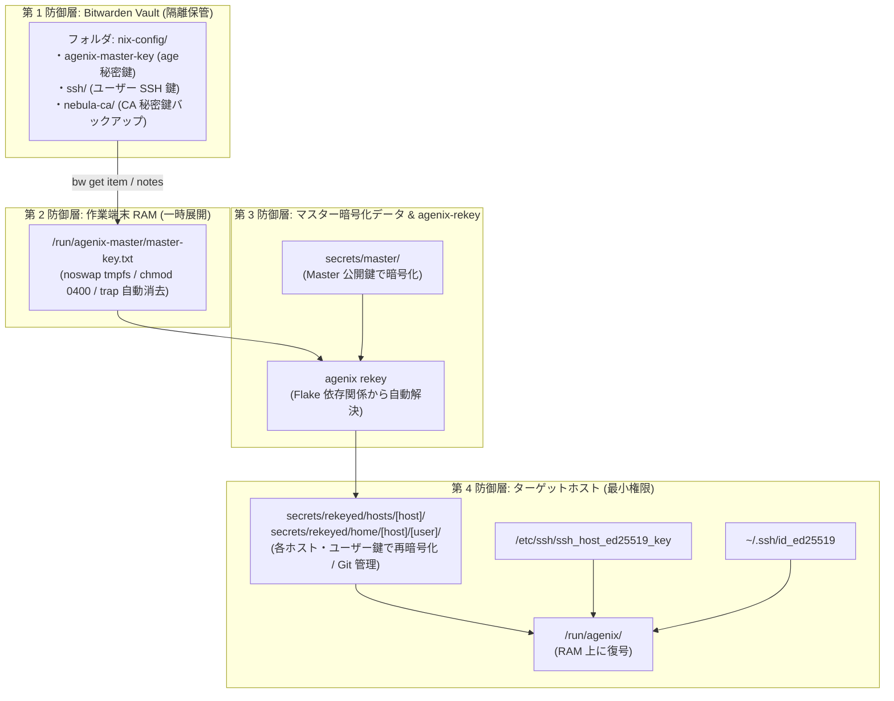

# シークレット & 鍵ライフサイクル管理

agenix-rekey, age, Bitwarden，および Nebula 証明書による暗号化シークレットの管理方針，鍵モデル，運用手順，失効・廃棄手順．

## 1. 前提条件

| 項目 | 要件・確認事項 |
| :--- | :--- |
| 対象ホスト | 全ホスト．Master 鍵を扱う操作は作業機で実行し，復号は各ホストで行う |
| 実行権限 | 作業機: 一般ユーザーと Bitwarden Master 鍵．ホスト: root (`/run/agenix/` の復号確認) |
| 必要ツール | `just`, `ysh`, `age`, `bw` (Bitwarden CLI), `nebula-cert`, `git` |

### 1.1 作業前チェックリスト

- [ ] Bitwarden の `nix-config/` フォルダへアクセスできる．
- [ ] `just secret doctor` が成功する ([4.1 環境診断](#41-環境診断))．
- [ ] 変更対象のマスターファイルと再暗号化先のホストを把握している．

---

## 2. 鍵モデルとアクセス境界

作業端末が侵害された場合でもインフラ全体の権限奪取を防ぐため，Bitwarden 隔離保管，RAM tmpfs 一時展開，agenix-rekey による最小権限配布の多層防御境界を構築する．



| 鍵の種別 | 配置場所 | 権限範囲 | 用途 |
| :--- | :--- | :--- | :--- |
| Master 鍵 | Bitwarden (`nix-config/agenix-master-key`) / RAM tmpfs (`/run/agenix-master/master-key.txt`) | 全マスター暗号化ファイルの復号・再暗号化 | 新ホスト追加，鍵の更新，マスターファイルの編集 |
| ホスト鍵 | `/etc/ssh/ssh_host_ed25519_key` (公開鍵は `hosts/<hostname>/default.nix` の `age.rekey.hostPubkey`) | 当該ホスト専用 (`secrets/rekeyed/hosts/<hostname>/*.age`) | 起動時の自動復号，ホスト常駐サービス用クレデンシャルの配置 (`/run/agenix/`) |
| ユーザー SSH 鍵 | Bitwarden (`nix-config/ssh/<hostname>`) / 開発端末 (`~/.ssh/id_ed25519`) | リモートホストへの SSH 接続，Git 操作，home-manager シークレットの復号 | 運用者認証，home-manager シークレットの配布，ディザスタリカバリ時の SSH 鍵復旧 |

### 2.1 Bitwarden 保管庫構造 (`nix-config/`)

Bitwarden 上のインフラ資格情報は，専用フォルダ `nix-config/` 配下に格納する．

```text
nix-config/                          # ルートフォルダ
├── agenix-master-key                # [セキュアメモ] AGE-SECRET-KEY-1... (agenix-rekey Master 鍵)
├── nebula-ca/                       # [サブフォルダ] オフライン CA 秘密鍵バックアップ
│   └── ca.key                       # [セキュアメモ] Nebula ルート CA 秘密鍵
└── ssh/                             # [サブフォルダ] 対外認証・フェイルオーバー用 SSH 鍵
    ├── BrokenPC                     # [SSH キー] BrokenPC の id_ed25519 (秘密鍵・公開鍵)
    ├── x1c7                         # [SSH キー] x1c7 の id_ed25519 (秘密鍵・公開鍵)
    └── torii-chan                   # [SSH キー] torii-chan の ssh_host_ed25519_key (VPS フェイルオーバー用ホスト鍵)
```

| アイテム | 種別 | 格納内容 | 説明 |
| :--- | :--- | :--- | :--- |
| `nix-config/agenix-master-key` | セキュアメモ | `AGE-SECRET-KEY-1...` | agenix-rekey の Master age 秘密鍵．Bech32 形式テキストとして保持する． |
| `nix-config/nebula-ca/ca.key` | セキュアメモ | `ca.key` | Nebula ルート CA 秘密鍵のディザスタリカバリ用バックアップ． |
| `nix-config/ssh/<hostname>` | SSH キー | `id_ed25519` / `ssh_host_ed25519_key` | 開発端末のユーザー SSH 鍵 (`BrokenPC`, `x1c7`) および `torii-chan` の VPS フェイルオーバー用 SSH ホスト鍵を Bitwarden の SSH キーアイテム形式で保管し，復旧時に取り出す． |

### 2.2 RAM tmpfs 一時展開と自動消去

[scripts/secrets/lib/bitwarden.ysh](../../scripts/secrets/lib/bitwarden.ysh) と各コマンドスクリプト (例: [scripts/secrets/rekey.ysh](../../scripts/secrets/rekey.ysh)) は，作業時に Master 秘密鍵を作業端末の RAM 上 tmpfs (`/run/agenix-master/master-key.txt`) へパーミッション `0400` で展開する．[nixos/security/agenix.nix](../../nixos/security/agenix.nix) は `/run/agenix-master` に `noswap` 付きの専用 tmpfs をマウントする．スクリプトは systemd user scope (`MemorySwapMax=0`) で再実行されるため，秘密鍵はスワップやディスクへ流出しない．

シェルの `trap` (EXIT/INT/TERM/HUP/QUIT) により，正常終了・エラー・シグナル割り込みを問わず一時ファイルは即時に削除される．`tmpfs` 以外の領域は `AGENIX_MASTER_KEY_DIR_ALLOW_UNSAFE=1` を明示しない限り拒否し，既定の `/run/agenix-master` が `noswap` でない場合は処理を中止する．

### 2.3 リポジトリ内シークレット構成

シークレットはファイルパスとディレクトリでアクセス境界を分離する．

```text
secrets/
├── master/                          # Master 鍵でのみ暗号化されたマスターファイル群
│   ├── common/                      # 全ホスト共通シークレット
│   │   └── deploy_key.age           # GitHub プライベートリポジトリ取得用 deploy key
│   ├── hosts/<hostname>/            # ホスト固有シークレット
│   │   ├── user_password_hash.age   # ユーザーパスワードハッシュ
│   │   ├── nebula_key.age           # Nebula メッシュ VPN ノード秘密鍵
│   │   └── emergency_ssh_token.age  # Cloudflare Tunnel 認証トークン (常駐サーバー機)
│   └── services/<service>/          # サービス固有シークレット
│       ├── backup/                  # Restic バックアップ (password.age, ssh_key.age)
│       ├── ddns/                    # Cloudflare DDNS (cloudflare_api.env.age)
│       ├── discord-bridge/          # Discord Bot トークン (bridge.env.age)
│       ├── signing/                 # Git コミット署名用 GPG 鍵 (gpg_private_key.age)
│       └── conoha-vps-mcp/          # ConoHa API 認証情報 (credentials.env.age)
└── rekeyed/                         # agenix rekey で自動生成されるホスト・ユーザー別 .age 群 (Git 管理)
    ├── home/<hostname>/<username>/  # home-manager シークレット (ユーザー SSH 鍵で復号)
    └── hosts/<hostname>/            # NixOS ホストシークレット (ホスト SSH 鍵で復号)
```

`secrets/master/` は Master 公開鍵で暗号化された定義ファイル群であり，`secrets/rekeyed/` は各ホスト・ユーザーの公開鍵で再暗号化された配布ファイル群である (`just secret rekey` で生成)．

| 区分 | 対象パス | 管理方式 | 説明 |
| :--- | :--- | :--- | :--- |
| マスター暗号化データ | `secrets/master/**/*.age` | age 暗号化 (Master 公開鍵) | Master 鍵でのみ復号できる定義ファイル．Git 管理する． |
| ホスト別配布データ | `secrets/rekeyed/hosts/<hostname>/*.age` | age 暗号化 (ホスト公開鍵) | `agenix rekey` が出力する各ホスト専用暗号化ファイル (`<hash>-<secret名>.age`)．Git 管理し CI での純粋ビルドを維持する． |
| ユーザー別配布データ | `secrets/rekeyed/home/<hostname>/<username>/*.age` | age 暗号化 (ユーザー SSH 公開鍵) | home-manager の `age.secrets` 用暗号化ファイル (`<hash>-<secret名>.age`)．Git 管理する． |
| 平文公開データ | [nixos/networking/nebula/ca.crt](../../nixos/networking/nebula/ca.crt), [hosts/shosoin-tan/nebula.crt](../../hosts/shosoin-tan/nebula.crt) | 平文ファイル | 暗号化不要な公開証明書データ．ノード証明書は各ホストの `hosts/<hostname>/nebula.crt` に配置する． |
| ローカル自動生成 | `/var/lib/minecraft/secrets/` (`forwarding.secret`, `nitac23s-rcon.secret`) | 起動時生成 | `shosoin-tan` の `minecraft-secrets.service` 起動時に `openssl rand` で生成し，Git 管理から除外する． |
| 一時ステージング | `.secrets-staging/` | 平文一時配置 ([.gitignore](../../.gitignore)) | Master 鍵を持たない環境で暗号化対象の平文を一時配置する領域．暗号化後に shred 破棄される． |

---

## 3. 作業手順

シークレット操作は [justfile](../../justfile) のサブコマンド (`just secret <recipe>`) または [scripts/README.md](../../scripts/README.md) に一覧したコマンド別スクリプトを通じて実行する．使用可能な recipe は `just --list secret` で確認できる．旧形式の `just secret-<recipe>` は後方互換エイリアスとして引き続き動作するが，新規の手順では `just secret <recipe>` を使用する．

### Step 1: 認証セッションの初期化

対話端末では，セッションが未確立の場合に各コマンドが自動で Bitwarden の認証を求める．事前に認証を済ませる場合は `just secret unlock` ([scripts/secrets/unlock.ysh](../../scripts/secrets/unlock.ysh)) を実行する．未ログイン (`unauthenticated`) 時は `bw login`，ロック (`locked`) 時は `bw unlock` を自動判別して対話実行し，取得したセッショントークンをインメモリ常駐エージェント ([scripts/secrets/lib/agent.pl](../../scripts/secrets/lib/agent.pl)，Unix ドメインソケット経由) に渡す．

セッショントークンはファイルシステム (tmpfs を含む) に書き出されず，エージェントプロセスのヒープメモリ (RAM) 上のみに保持される．一度エージェントへ保持されると，以降の全 `just secret ...` コマンドは `export BW_SESSION=...` なしでソケット経由のセッションを自動再利用する．

エージェントプロセスは 15 分無操作で自律的にメモリをゼロクリアして終了し，`bw lock` を発行する (コマンド実行ごとに 15 分延長されるスライディング方式，環境変数 `AGENIX_BW_SESSION_TTL` で変更可能)．エージェントが kill されたり停止した場合も，プロセスメモリごとセッションが消滅する．セッショントークンが平文ファイルとしてディスクや tmpfs に残ることはない．

セッションを明示的に破棄して保管庫をロックする場合は，`just secret lock` ([scripts/secrets/lock.ysh](../../scripts/secrets/lock.ysh)) を実行する．エージェントに終了とメモリ消去を指示し，即座に保管庫をロックする．

```bash
# Bitwarden をアンロックしてインメモリ常駐エージェントにセッションを保持
# 以降のコマンドで export BW_SESSION=... の指定は不要
just secret unlock

# 任意のシークレット操作 (エージェントからセッションを自動再利用しタイマーを延長)
just secret rekey

# 作業終了後にエージェントを終了・メモリ消去して保管庫をロック
just secret lock

# (参考) セッショントークンを環境変数として取得する従来形式
export BW_SESSION=$(just secret unlock --raw)
# または: eval "$(just secret unlock --env)"
```

### Step 2: マスターファイルの編集

マスター暗号化ファイルを直接編集する場合は `just secret edit` を実行する．

```bash
# マスター暗号化ファイルを復号して編集
just secret edit secrets/master/services/ddns/cloudflare_api.env.age

# ホスト別配布ファイルへ再暗号化して反映
just secret rekey
```

### Step 3: 平文ステージングの取り込み

外部クレデンシャルの追加や初期設定時は，平文ファイルを `.secrets-staging/` に一時配置し，Master 鍵で暗号化して取り込む．

```bash
# secrets/master/ に対応するパス構造で平文を配置
mkdir -p .secrets-staging/hosts/<hostname>
echo -n "<password_hash>" > .secrets-staging/hosts/<hostname>/user_password_hash

# 取り込み計画の事前検証 (dry-run)
just secret apply-staging --dry-run
# または: ysh scripts/secrets/apply-staging.ysh --dry-run

# 暗号化，平文の shred 削除，および rekey を一括実行
just secret apply-staging
```

### Step 4: ホストシークレットの再暗号化

マスターファイルやホスト公開鍵の変更後は，全ホスト向けに再暗号化を実行する．

```bash
just secret rekey

# キャッシュを無視して全ホストを強制的に再暗号化する場合
just secret rekey --force
# または: ysh scripts/secrets/rekey.ysh --force
```

### Step 5: ユーザーパスワードハッシュの一括更新

root パスワード廃止に伴い，ログイン資格情報は `user_password_hash.age` (yescrypt) に一本化されている．ホストのユーザーパスワードを設定・更新する場合，メモリ内で直接 yescrypt ハッシュを生成して暗号化する．

```bash
# 全ホストの user パスワードを一括更新 (ホスト毎にソルトを個別生成)
just secret set-host-password --all

# 特定ホストのみ更新する場合
just secret set-host-password BrokenPC

# 更新後は再暗号化を実行して反映
just secret rekey
```

### Step 6: ユーザー SSH 鍵の復元とバックアップ

作業端末のユーザー SSH 鍵 (`~/.ssh/id_ed25519` および `~/.ssh/id_ed25519.pub`) は Bitwarden の `nix-config/ssh/<hostname>` と同期する．

```bash
# Bitwarden の nix-config/ssh/<hostname> (省略時は現在のホスト名) から SSH 鍵を復元
just secret ssh-restore
# または: ysh scripts/secrets/ssh-restore.ysh [hostname] [--file <path>] [--force]

# ローカルの ~/.ssh/id_ed25519 を Bitwarden の nix-config/ssh/<hostname> へ登録・更新
just secret ssh-backup
# または: ysh scripts/secrets/ssh-backup.ysh [hostname] [--file <path>] [--force]
```

| 操作 | 動作 |
| :--- | :--- |
| `ssh-restore` | Bitwarden から秘密鍵を取得し，`ssh-keygen -y` で公開鍵を導出して `~/.ssh/id_ed25519` (`0600`) と `~/.ssh/id_ed25519.pub` (`0644`) にアトミックに配置する |
| `ssh-backup` | `~/.ssh/id_ed25519` から公開鍵と SHA256 フィンガープリントを導出し，Bitwarden の `nix-config/ssh/<hostname>` へ SSH キーアイテムとして登録・更新する (サーバーが SSH キー非対応の場合はセキュアメモ) |

両コマンドは同一の鍵が配置・登録済みの場合は変更せず正常終了する．内容が異なる既存鍵があり `--force` 未指定の場合は，対話端末 (TTY) で上書き確認プロンプト `[y/N]` を表示し，`y` / `yes` 入力時のみ上書きする．非対話環境ではエラー終了し，`--force` 指定時は確認なしで上書きする．

`ssh-restore` は上書き時に旧ファイルを `~/.ssh/id_ed25519.bak` と `~/.ssh/id_ed25519.pub.bak` へ退避する．旧 `sops-nix` 時代のシンボリックリンク (`~/.ssh/id_ed25519 -> /run/secrets/...`) が残っている場合は削除して実ファイルへ置き換え，`hosts/<hostname>/default.nix` の `age.rekey.hostPubkey` との一致を確認する．自ホストで実行した場合は `agenix.service` と `import-gpg-key.service` を再起動して home-manager シークレットを即時復号する．

`ssh-backup` は上書き時に新アイテムを作成したうえで旧アイテムを Bitwarden のゴミ箱へ移動する (`bw delete item`)．

### Step 7: Nebula ノード証明書の発行と秘密鍵の登録

Nebula ネットワークの暗号化通信に使用する証明書と秘密鍵を管理する．Nebula ルート CA の秘密鍵 (`ca.key`) は運用者のオフライン環境 (`~/.nebula-ca/ca.key`) にのみ保持し，リポジトリや稼働ホストには配置しない．ディザスタリカバリ用バックアップは Bitwarden の `nix-config/nebula-ca/ca.key` に保管する．ルート CA 公開証明書 (`ca.crt`) は機密性がないため，平文ファイル [nixos/networking/nebula/ca.crt](../../nixos/networking/nebula/ca.crt) としてリポジトリにコミットする．

```bash
CA_DIR="${CA_DIR:-$HOME/.nebula-ca}"

# 1. オフライン CA でノード証明書を発行
nebula-cert sign \
  -name "<hostname>" \
  -networks "10.0.0.X/24" \
  -groups "mgmt,..." \
  -ca-crt "$CA_DIR/ca.crt" \
  -ca-key "$CA_DIR/ca.key" \
  -out-crt "$CA_DIR/<hostname>.crt" \
  -out-key "$CA_DIR/<hostname>.key"

# 2. 証明書の公開とノード秘密鍵の暗号化 (Bitwarden の Master 鍵を使用)
just nebula import-secrets "$CA_DIR"
# または: ysh scripts/nebula/import-secrets.ysh "$CA_DIR"

# 3. 全ホストを再暗号化
just secret rekey
```

### Step 8: CA の一括ローテーション

ルート CA を再作成する場合は，`just nebula rotate-ca` ([scripts/nebula/rotate-ca.ysh](../../scripts/nebula/rotate-ca.ysh)) で新 CA と全ノードの証明書・鍵を一括生成する．続いて `just nebula import-secrets` ([scripts/nebula/import-secrets.ysh](../../scripts/nebula/import-secrets.ysh)) で公開証明書の配置とノード秘密鍵の暗号化を行い，`just secret rekey` で全ホストを再暗号化する．

### Step 9: ホスト破棄時の鍵失効

ホストを完全に撤退させる場合の手順．

1. `hosts/<hostname>/` を削除し，[flake/hosts.nix](../../flake/hosts.nix) から該当エントリを削除する．
2. [lib/nebula-fleet.nix](../../lib/nebula-fleet.nix) の `nodes` から該当ホストを削除する (`FLEET` は [scripts/nebula/lib/fleet.ysh](../../scripts/nebula/lib/fleet.ysh) が読み込む)．
3. シークレット定義ファイルを削除する．
   ```bash
   rm -rf secrets/master/hosts/<hostname>
   rm -rf secrets/rekeyed/hosts/<hostname>
   rm -rf secrets/rekeyed/home/<hostname>
   ```
4. 再暗号化を実行する．破棄されたホスト向けの再暗号化ファイルがリポジトリから消去される．
   ```bash
   just secret rekey
   ```

### Step 10: ホスト再インストール時のホスト鍵ローテーション

OS 再インストール等で SSH ホスト鍵が更新された場合の手順．

1. 新しい SSH ホスト公開鍵を取得する．
   ```bash
   cat /etc/ssh/ssh_host_ed25519_key.pub
   ```
2. `hosts/<hostname>/default.nix` の `age.rekey.hostPubkey` を更新する．
   ```nix
   age.rekey.hostPubkey = "ssh-ed25519 AAAAC3NzaC1lZDI1NTE5...";
   ```
3. 再暗号化を実行する．agenix-rekey が新しいホスト公開鍵で `secrets/rekeyed/hosts/<hostname>/` 配下の全ファイルを再暗号化し，旧ホスト鍵による復号権限を失効させる．
   ```bash
   just secret rekey
   ```
4. Git コミットを作成し，変更を適用する．

---

## 4. 事後検証

### 4.1 環境診断

`just secret doctor` ([scripts/secrets/doctor.ysh](../../scripts/secrets/doctor.ysh)) は CLI ツールの有無，Master 識別子の整合性，Bitwarden 接続状態，ステージング状態を検査する．`~/.ssh/id_ed25519` のシンボリックリンクとパーミッション，および `~/.ssh/id_ed25519.pub` と `hosts/<hostname>/default.nix` の `age.rekey.hostPubkey` の公開鍵一致も検査する．

```bash
just secret doctor
```

期待出力:
```text
Doctor passed (0 errors, 0 warnings)
```

### 4.2 シークレット復号の確認

変更を適用したホストで，agenix がシークレットを復号できていることを確認する．

```bash
sudo ls -la /run/agenix/
```

期待出力:
```text
lrwxrwxrwx ... user_password_hash -> /run/agenix.d/1/user_password_hash
lrwxrwxrwx ... nebula_key -> /run/agenix.d/1/nebula_key
```

シンボリックリンクの参照先が存在し，対象デーモンや root から読み取り可能であることを確認する．

### 4.3 ホスト鍵ローテーションの確認

`age.rekey.hostPubkey` を更新したホストでは，再暗号化ファイルが新しいホスト鍵で復号できることを確認する．

```bash
sudo systemctl restart agenix.service
systemctl status agenix.service
```

期待出力:
```text
Active: active (running)
```

`agenix.service` が失敗する場合は，ホスト公開鍵と `age.rekey.hostPubkey` の不一致，または `just secret rekey` の未実行を疑う ([トラブルシューティング: 認証・シークレット](../troubleshooting/secrets-and-auth.md))．

---

## 関連ドキュメント
- [目次](../README.md) — 設計・運用ドキュメント一覧
- [ネットワークアーキテクチャ](../architecture/network-topology.md) — ネットワーク構成とメッシュ VPN 仕様
- [新規ホスト追加手順](adding-a-host.md) — 新規ハードウェア・ノード追加時の詳細手順
- [非常用 SSH アクセス運用マニュアル (Cloudflare Tunnel)](emergency-cf-ssh.md) — Cloudflare Tunnel 経由の非常用アクセス手順
- [トラブルシューティング: 認証・シークレット](../troubleshooting/secrets-and-auth.md) — 鍵認証・復号失敗時の切り分けと対処
