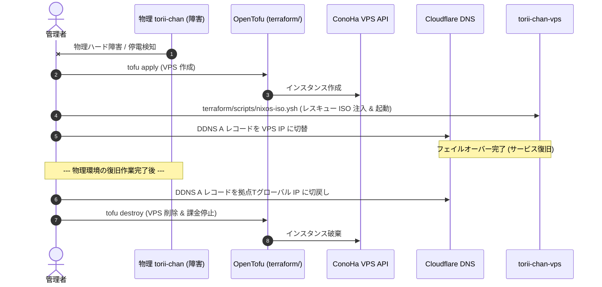

# ConoHa VPS プロビジョニング & フェイルオーバー手順

物理エッジゲートウェイ (`torii-chan`) 停止時に ConoHa VPS 上で待機系 (`torii-chan-vps`) へ切り替え，物理復旧後に切り戻す緊急時手順．

## 1. フェイルオーバー概要

平時は拠点Tの SBC (Orange Pi Zero 3) がエッジゲートウェイとして稼働する．物理障害時のみ ConoHa VPS (従量課金) を起動する．



---

## 2. フェイルオーバー起動手順

### Step 1: OpenTofu による VPS プロビジョニング
`terraform/` ディレクトリで VPS を作成する:
```bash
cd terraform
# 認証情報を SOPS から注入 (詳細は terraform/README.md 参照)
export CONOHAVPS_USER_ID=$(sops -d --extract '["OPENSTACK_USER_ID"]' ../secrets/services/conoha-vps-mcp.yaml)
export CONOHAVPS_TENANT_ID=$(sops -d --extract '["OPENSTACK_TENANT_ID"]' ../secrets/services/conoha-vps-mcp.yaml)
export CONOHAVPS_PASSWORD=$(sops -d --extract '["OPENSTACK_PASSWORD"]' ../secrets/services/conoha-vps-mcp.yaml)
export TF_VAR_ssh_public_key='ssh-ed25519 ...'
export TF_VAR_admin_password='<管理者パスワード>'  # 必須: 9-70文字，英大文字/小文字/数字/記号を含む
tofu init
tofu apply
```
出力された VPS のインスタンス ID およびパブリック IP アドレスを確認する．

### Step 2: NixOS の導入 (ISO レスキュー)
リポジトリルートに戻り，レスキュー ISO をビルドして ConoHa API 経由でアタッチ・起動する:
```bash
# リポジトリルートへ復帰
cd ..

# 一時パスワード付きレスキュー ISO をビルド
./hosts/torii-chan/build-vps-iso.ysh

# レスキュー ISO のアタッチ・起動
./terraform/scripts/nixos-iso.ysh install <instance_id> ./result-iso/iso/nixos-*.iso

# VNC コンソールで NixOS インストール後，ISO をイジェクト
./terraform/scripts/nixos-iso.ysh eject <instance_id>
```

### Step 3: DNS 切替
Cloudflare ダッシュボード (または API) で，ドメインの A レコードを拠点T回線の IP から VPS のパブリック IP へ手動で切り替える (VPS 上の Cloudflare DDNS サービス起動後は自動更新される)．

---

## 3. 切り戻し手順 (課金停止)

拠点Tの物理 SBC (`torii-chan`) 復旧後の切り戻し手順:

### Step 1: 物理 SBC の起動と疎通確認
物理マシンを起動し，LAN 内および Nebula 内で拠点T SBC (`torii-chan`, `10.0.0.1`) の疎通を確認する．

### Step 2: DNS 切り戻し
Cloudflare の A レコードを拠点Tのグローバル IP へ戻して DNS を切り戻す．

### Step 3: VPS 破棄と課金停止
不要になった VPS を破棄し，課金を停止する:
```bash
cd terraform
tofu destroy
```

### Step 4: ステートファイルの保管
実行後のステートファイル `terraform/terraform.tfstate` をバックアップ・保管する．

---

## 関連ドキュメント
- [目次 (設計・運用ドキュメント)](../README.md) — 設計・運用ドキュメント一覧
- [ネットワークアーキテクチャ](../architecture/network-topology.md) — ネットワーク構成とメッシュ VPN 仕様
- [Terraform モジュール仕様](../../terraform/README.md) — ConoHa VPS プロビジョニング用 OpenTofu 定義
- [トラブルシューティング: ネットワーク](../troubleshooting/network-recovery.md) — ネットワーク障害時の切り分けと復旧手順
