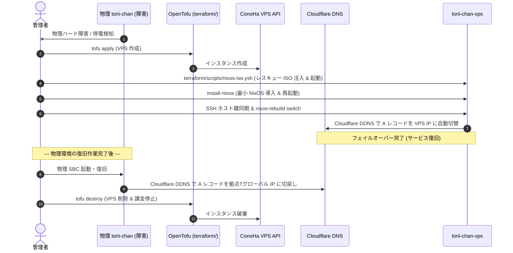

# ConoHa VPS プロビジョニング & フェイルオーバー手順

物理エッジゲートウェイ (`torii-chan`) 停止時に ConoHa VPS 上で待機系 (`torii-chan-vps`) へ切り替え，物理復旧後に切り戻す緊急時手順．

## 1. フェイルオーバー概要

平時は拠点Tの SBC (Orange Pi Zero 3) がエッジゲートウェイとして稼働する．物理障害時のみ ConoHa VPS (従量課金) を起動する．



---

## 2. フェイルオーバー起動手順

### Step 1: OpenTofu による VPS プロビジョニング
`terraform/` ディレクトリで VPS を作成する:
```bash
cd terraform
# 認証情報を環境変数へ注入 (詳細は terraform/README.md 参照)
export CONOHAVPS_USER_ID="..."
export CONOHAVPS_TENANT_ID="..."
export CONOHAVPS_PASSWORD="..."
export TF_VAR_ssh_public_key='ssh-ed25519 ...'
export TF_VAR_admin_password='<管理者パスワード>'  # 必須: 9-70文字，英大文字/小文字/数字/記号を含む
tofu init
tofu apply
```
出力された VPS のインスタンス ID およびパブリック IP アドレスを確認する (`tofu output -json torii_chan_addresses`)．

### Step 2: NixOS の導入 (ISO レスキュー)
リポジトリルートに戻り，レスキュー ISO をビルドして ConoHa API 経由でアタッチ・起動する:
```bash
# リポジトリルートへ復帰
cd ..

# 一時パスワード付きレスキュー ISO をビルド
./hosts/torii-chan/build-vps-iso.ysh

# レスキュー ISO のアタッチ・起動
./terraform/scripts/nixos-iso.ysh install <instance_id> ./result-iso/iso/nixos-*.iso
```
VNC コンソール (またはレスキュー環境の SSH) で `install-nixos` を実行し，最小 NixOS をディスクへ導入する:
```bash
# ConoHa VPS 上で実行
IPV4="<vps_ip>" GATEWAY="<gateway_ip>" INSTALL_YES=1 install-nixos install

# ISO をイジェクトしてディスクから再起動
./terraform/scripts/nixos-iso.ysh eject <instance_id>
```

### Step 3: SSH ホスト鍵の配備とシークレット同期
`torii-chan` の gateway ロールは共通のホスト名と暗号化シークレット (`secrets/rekeyed/hosts/torii-chan/`) を共有する．

#### パターン A: 同一ホスト鍵の共有 (推奨: 即時復旧)
Bitwarden (`nix-config/ssh/torii-chan` 等) に保管された `torii-chan` の SSH ホスト秘密鍵 (`ssh_host_ed25519_key`) を VPS の `/etc/ssh/ssh_host_ed25519_key` へ配置する:
```bash
# VPS 上に SSH ホスト秘密鍵を配置
sudo chmod 600 /etc/ssh/ssh_host_ed25519_key
```
これにより，リポジトリ内の既存再暗号化ファイル (`nebula_key.age`，`cloudflare_api_env.age` 等) をそのまま復号でき，シークレットの再暗号化やコミットなしで即時に立ち上げられる．

#### パターン B: 新規ホスト鍵を生成する場合
VPS の `/etc/ssh/ssh_host_ed25519_key.pub` から SSH ホスト公開鍵 (`cat /etc/ssh/ssh_host_ed25519_key.pub`) を取得し，管理端末で `hosts/torii-chan/default.nix` の `age.rekey.hostPubkey` を更新して `just secret-rekey` を実行し，Git コミットする．

### Step 4: ネットワーク設定の反映とゲートウェイ構成の適用
1. `hosts/torii-chan/vps.nix` 内の `wanIp` および `wanGateway` を ConoHa で割り当てられた値へ書き換える．
2. 初回デプロイ時は WAN からの SSH を一時開放するため，`hosts/torii-chan/vps.nix` の `my.services.gateway.restrictAccess = lib.mkForce false;` を有効化する．
3. 管理機から VPS へ向けて設定を適用する:
   ```bash
   nixos-rebuild switch --flake .#torii-chan-vps --target-host root@<vps_ip>
   ```
4. サービス稼働を確認する:
   - Nebula インターフェース (`nebula0`, `10.0.0.1:4242`)
   - Cloudflare DDNS サービス (`systemctl status cloudflare-ddns.service`)
   - 非常用 SSH (`emergency-ssh`)
5. 正常稼働を確認後，`restrictAccess` の行を再コメントアウトし，再度 switch を実行して WAN SSH を遮断する．

### Step 5: DNS 切替確認
Cloudflare DDNS サービスにより `torii-chan.t3u.uk` の A レコードが VPS のパブリック IP へ自動更新されることを確認する (または手動切替)．Nebula クラスター内の全ノードが `10.0.0.1` 経由で再疎通することを確認する．

---

## 3. 切り戻し手順 (課金停止)

拠点Tの物理 SBC (`torii-chan`) 復旧後の切り戻し手順:

### Step 1: 物理 SBC の起動と疎通確認
1. 物理マシンを起動し，LAN 内および Nebula 内で拠点T SBC (`torii-chan`, `10.0.0.1`) の疎通を確認する．
2. パターン B でホスト公開鍵を更新していた場合は，SBC のホスト公開鍵を `hosts/torii-chan/default.nix` に戻して `just secret-rekey` を適用する (パターン A で共有していた場合は再暗号化不要)．

### Step 2: DNS 切り戻し確認
物理 SBC 上の Cloudflare DDNS により A レコードが拠点Tのグローバル IP へ戻ることを確認する (必要に応じて手動切戻し)．

### Step 3: VPS 破棄と課金停止
不要になった VPS を破棄し，課金を停止する:
```bash
cd terraform
tofu destroy
```

### Step 4: ステートファイルの保管
実行後のステートファイル `terraform/terraform.tfstate` をバックアップ・保管する．

---

## 関連ドキュメント
- [目次 (設計・運用ドキュメント)](../README.md) — 設計・運用ドキュメント一覧
- [ネットワークアーキテクチャ](../architecture/network-topology.md) — ネットワーク構成とメッシュ VPN 仕様
- [Terraform モジュール仕様](../../terraform/README.md) — ConoHa VPS プロビジョニング用 OpenTofu 定義
- [トラブルシューティング: ネットワーク](../troubleshooting/network-recovery.md) — ネットワーク障害時の切り分けと復旧手順
