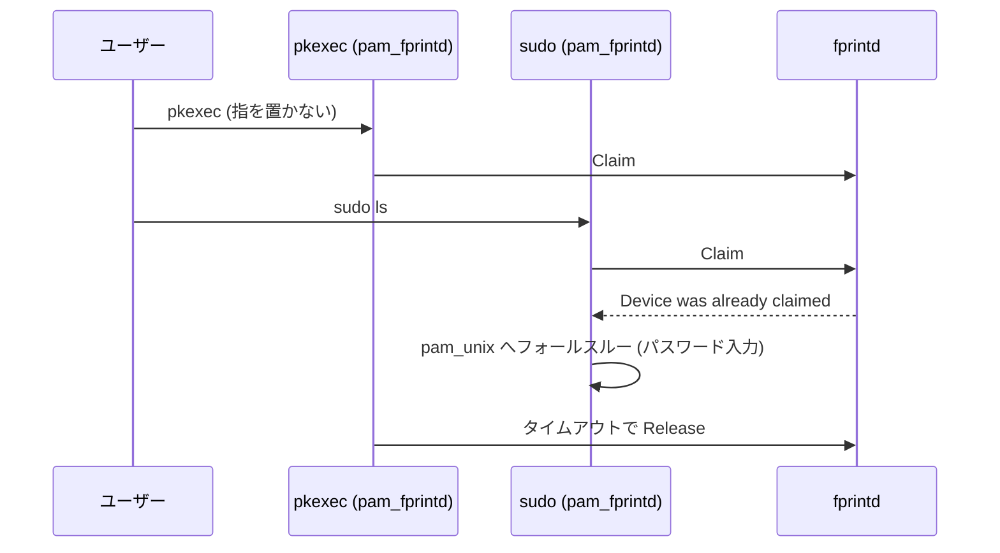

# fprintd トリアージ記録 (x1c7)

ホスト `x1c7` で観測された指紋認証の待ち時間，照合失敗ログ，サスペンド復帰時の挙動を，実機ログ・sysfs・upstream ソースから切り分けた記録．2026-10-15 のトリアージを起点とし，以降の設定変更を反映する．

| 項目 | 要件・確認事項 |
| :--- | :--- |
| 対象ホスト | `x1c7` (Kernel 6.18.56-xanmod1 / NixOS 26.05.20261012.7993f34) |
| 検証環境 | fprintd 1.94.5 / libfprint 1.94.10 / Noctalia 5.2.1 / polkit 127 / polkit-kde-agent-1 6.6.6 |
| upstream リビジョン | fprintd `b10251e` (1.94.5) / libfprint 1.94.10 |
| センサー | Synaptics Prometheus MIS `06cb:00bd` (match-on-chip，テンプレートはデバイス内保存) |
| 登録指 | right-index-finger / left-index-finger (`fprintd-list t3u`) |
| `fprintd.service` | `Type=dbus`, `BusName=net.reactivated.Fprint`，Idle 30 秒で自動終了 (`src/fprintd.h: #define TIMEOUT 30`)，`ExecStartPre` に `udevadm settle --timeout=5`，`TimeoutStopSec=5s` |
| `fprintd-pre-sleep.service` | `Type=oneshot`，`before` / `wantedBy` = `sleep.target`，`sleep.target` の前に `systemctl stop fprintd.service` を実行する |
| 再発 (2026-11) | 2026-11-03, 11-08, 11-12 に stale USB ハンドルで停止不能となり，udev の `ATTR{power/persist}="0"` 明示，`TimeoutStopSec`，`ExecStartPre` の `udevadm settle`，`fprintd-pre-sleep.service` の追加で修正した (第 2.2 節) |

---

## 1. 概要と結論

| 問い | 回答 | 判定 |
| :--- | :--- | :--- |
| `fprintd.service` が 30 秒で終了するのは異常か | `Type=dbus` の D-Bus activation による正常終了．必要時に systemd が D-Bus 経由で再起動する | Working as Designed |
| polkit-1 / sudo でパスワード欄が 30 秒出ない原因は | PAM 評価順序 (`pam_fprintd` 11400 → `pam_unix` 11700)．`timeout = 5`, `max-tries = 3` に短縮して解消した．`su` は既定スタックのまま | Direct Root Cause |
| 指紋不一致ログはテンプレート破損か | 破損ではない．MoC 照合の `verify-no-match` 通知であり，未登録指や接触不良で発生する | Working as Designed |
| サスペンド復帰後の USB エラーは fprintd の不具合か | 2026-11 にロック直後のサスペンドで stale USB ハンドルによる停止不能が再発した．udev の `power/persist=0` 明示，`fprintd-pre-sleep.service` による sleep 前停止，`ExecStartPre` (`udevadm settle`)，および `TimeoutStopSec=5s` で修正した | Recurred 2026-11 / Fixed |
| Noctalia の Claim 保持と `stopVerify` は解放漏れか | `claimed` / `released` は対で出力される．`Device was already claimed` は認証要求の競合時のみ生じる | Working as Designed (競合時のみ Conditional) |
| polkit エージェントはどれが有効か | `niri-flake-polkit.service` が起動する KDE エージェント．Noctalia の `polkit_agent` は `false` | Ruled Out / Mitigated |
| USB autosuspend / TLP の追加対処は必要か | 不要．udev の `power/control=on` と TLP denylist (`USB_DENYLIST="06cb:00bd"`) で抑止済み (`power/persist` は `0` に変更) | Ruled Out / Mitigated |
| error 789 は対処が必要か | 不要．ドライバが初回応答を 1 回リトライして回復する良性応答．ファームウェア更新の有無のみ fwupd で継続確認する | Working as Designed |

---

## 2. fprintd のライフサイクル

### 2.1 D-Bus activation と 30 秒 auto-exit

`fprintd.service` は `Type=dbus`, `BusName=net.reactivated.Fprint` で動作し，未使用のまま 30 秒経過すると `Deactivated successfully` で終了する．

```c
/* src/fprintd.h */
#define TIMEOUT 30
```

必要時は systemd が D-Bus 経由で自動起動するため，`systemctl status fprintd` が普段 `inactive` でも機能上の問題はない．トリアージ当日の長時間稼働 (07:36–07:54) は，別プロセスが pkexec を連続実行して Claim を維持したことによる一時的挙動である．

### 2.2 サスペンド復帰と USB ハンドル

### 2.2 サスペンド復帰と USB ハンドル

resume 時に `xhci_hcd 0000:2d:00.0: xHC error in resume, USBSTS 0x401, Reinit` が記録され USB が再初期化される (カーネル / BIOS 側の既知挙動)．Noctalia は resume 後に `using fingerprint device` → `claimed` → `released` と毎回新しいハンドルで Claim し直す．復帰側の個別サービスは置かず，ClaimDevice の再試行と D-Bus activation に任せる．

2026-10-09 導入の `power/control=on` / `power/persist=1` (udev) と TLP denylist により一時は抑制されていたが，2026-11-03, 11-08, 11-12 に stale ハンドル事象が再発した．サスペンド直前に画面ロックが走ると，Noctalia がサスペンドをまたいで fprintd の Claim / VerifyStart を保持し続ける．この状態で USB 1-9 が disconnect して再列挙されると，fprintd は `AlreadyInUse`，`unsupported firmware version`，`No such device [-4]` を返し，以後 90 秒の `stop-sigterm` タイムアウトで SIGKILL されるまで応答しなくなった．

これを解消するため，[hosts/x1c7/default.nix](../../hosts/x1c7/default.nix) に以下の対策を追加した．

1. udev ルールを `ATTR{power/persist}="0"` の明示に変更する．libfprint (`fp-device.c` / `fp-context.c` / `fpi-device.c`) は `power/persist=0` を前提に resume 時の reset / replug を unplug として扱って新しい `FpDevice` を生成するため，既存の `persist=1` を上書きして 0 を強制する．
2. `systemd.services.fprintd-pre-sleep` (`Type=oneshot`, `before` / `wantedBy` = `sleep.target`) で `sleep.target` 突入前に `systemctl stop fprintd.service` を実行する．アクティブな Claim / VerifyStart がサスペンドをまたがないため，復帰時に Noctalia は再試行されない `AlreadyInUse` ではなく再取得対象の `ClaimDevice` を受け取り，D-Bus 経由で自動起動した fprintd へ再接続できる．
3. `systemd.services.fprintd.serviceConfig.TimeoutStopSec = "5s"` を設定し，`fprint_device_release()` の入れ子メインループが stale ハンドルで停止不能になっても 5 秒で強制終了させる．
4. `systemd.services.fprintd.serviceConfig.ExecStartPre` に `udevadm settle --timeout=5` を設定し，復帰直後の D-Bus activation が USB 再列挙完了前に古い sysfs パスを参照しないようにする．

なお，2026-09-29 に fprintd の SIGSEGV が 1 回記録されたが (`fprintd.service: Failed with result 'core-dump'`)，以降の再発は確認されていない．

### 2.3 error 789 のリトライ

`synaptics.c` の probe 冒頭，SENSOR_CMD_GET_VERSION の初回応答 status が 0 以外だと次の警告を出力して 1 回だけ即時リトライする (`retry` 初期値 TRUE → FALSE)．

```c
g_warning ("Device responded with error: %d retry: %d", status, retry);
```

リトライは常に成功し probe 処理は継続する．発生は電源投入後やデバイス初期化後の最初の 1 回のみである．直近 57 boot 中 46 boot で各 1 回記録され (boot あたり最大 1 回)，severity は warning であり照合結果には影響しない．789 (0x0315) は Prometheus ファームウェアが返す初期化ステータスであり，ドライバ層でリトライによる回復処理が実装されている．

---

## 3. PAM 統合と待ち時間

### 3.1 polkit-1 / sudo / su の評価順序

`/etc/pam.d/polkit-1`, `/etc/pam.d/sudo`, `/etc/pam.d/su` はいずれも `auth sufficient pam_fprintd.so` (order 11400) → `auth sufficient pam_unix ... try_first_pass` (11700) の順で評価する．`pam/pam_fprintd.c` は `DEFAULT_TIMEOUT 30`, `DEFAULT_MAX_TRIES 3` を持ち，`conv` を `PAM_TEXT_INFO` ("Place your finger...") の送信のみに使用する．タイムアウト時は `PAM_AUTHINFO_UNAVAIL` を返して次モジュールへフォールスルーする．

指を置かない限り最大 30 秒パスワード入力欄が出ない．実測では `sudo ls /proc/9706/fd` の実行時に，指を置かない場合は 30 秒のタイムアウトまでパスワードプロンプトが表示されず待機状態となった．`greetd` は先行設定 (`35b97f0` / `5a7563d`) で `pam_unix` 優先 (`use_first_pass`) に変更済みであったが，`polkit-1`, `sudo`, `su` は未適用であった．

現在の評価順序と `pam_fprintd` のオプションは [thinkpad-x1c7.md](../hardware/thinkpad-x1c7.md) を基準とする．`sudo` / `polkit-1` は既定の順序を維持したままタイムアウトと試行回数を短縮し，`su` は既定スタックのままである．

### 3.2 センサ Claim の競合

`pam_fprintd` は最大 30 秒デバイスを Claim し続けるため，同時に複数の認証要求が来ると後続が `Device was already claimed` で即座に失敗し，パスワード認証へフォールスルーする．



当日 07:52–07:54 の `Device was already claimed` 多発は，並行プロセスが pkexec (`pam_fprintd`) を連続実行し，先行 Claim がタイムアウトまでセンサを占有したことによる．単一プロセスの認証では発生せず，競合時のみ生じる一時的挙動である．

---

## 4. 指紋照合のログ

### 4.1 `verify-no-match` と MoC テンプレート

ログの `Failed to match fingerprint` (pam_fprintd / greeter / polkit-kde) は `verify-no-match` の正常通知である．Synaptics ドライバは `fpi_print_set_device_stored(print, TRUE)` で照合をチップ内で行い，不一致時に `BMKT_FP_NO_MATCH` → `FPI_MATCH_FAIL` を返す．テンプレート破損の形跡はない．`fprintd-list t3u` は right-index-finger / left-index-finger の 2 指を正常に列挙でき，resume 後も `claimed` → `released` → `session unlock requested` の遷移が成立している．MoC はデバイスハードウェアの基本仕様であり，不一致ログは未登録指や接触不良に起因する正常通知である．

### 4.2 Noctalia の Claim / Release

ログは `claimed fingerprint device` → `released fingerprint device` を必ず対で出力しており，解放漏れはない．`Verification was in progress, stopping it` は fprintd `device.c` の `fprint_device_release()` が出す警告であり，Release 処理中に進行中の verify を正常にキャンセルしたことを意味する．Noctalia 側での明示的な VerifyStop は不要である．

---

## 5. 周辺コンポーネント

### 5.1 polkit エージェント

実効エージェントは `niri-flake-polkit.service` (user unit) が起動する `polkit-kde-authentication-agent-1` (cgroup: `.../niri-flake-polkit.service`) である．Noctalia は `[app] polkit agent disabled: ... An authentication agent already exists` を出力して自主的に無効化する．polkit 認証自体は KDE エージェントで正常動作するためユーザー影響はない．[home/desktop/noctalia/default.nix](../../home/desktop/noctalia/default.nix) の `polkit_agent` はトリアージ当時 `true` であったが，現在は `false` に設定されている (重複登録を避けるため)．

### 5.2 USB autosuspend / TLP

`/sys/bus/usb/devices/1-9/` は `power/control=on`, `power/persist=0`, `power/autosuspend=2` であり，`control=on` のため autosuspend は無効化されている．udev ルール ([hosts/x1c7/default.nix](../../hosts/x1c7/default.nix)) は `ATTR{power/control}="on"` と `ATTR{power/persist}="0"` を設定し，TLP は `USB_DENYLIST="06cb:00bd"` (`/run/tlp/run.conf`, `/etc/tlp.conf`) を設定する．autosuspend は udev と TLP の双方で抑止されており，追加の対処は不要である．

---

## 関連ドキュメント

- [parallel-auth-architecture.md](parallel-auth-architecture.md) — 指紋 + パスワード並行待ち受けの可否と，GDM / Noctalia / greetd / polkit / sudo の実装比較
- [bsd-auth-architecture.md](bsd-auth-architecture.md) — BSD 系 (OpenPAM / BSD Authentication) の同期性・並行性の調査
- [thinkpad-x1c7.md](../hardware/thinkpad-x1c7.md) — x1c7 の指紋認証・PAM 統合と評価順序の調整
- [hosts/x1c7/default.nix](../../hosts/x1c7/default.nix) — `services.fprintd.enable` と udev / TLP 設定
- [nixos/services/desktop/greetd.nix](../../nixos/services/desktop/greetd.nix) — greetd / `login` の PAM 構成

## 出典

- fprintd 1.94.5 (upstream `b10251e`) — `src/fprintd.h` (`TIMEOUT`), `pam/pam_fprintd.c` (`DEFAULT_TIMEOUT`, `DEFAULT_MAX_TRIES`), `src/device.c` (`fprint_device_release()` の警告)
- libfprint 1.94.10 — Synaptics Prometheus ドライバ (`synaptics.c` の `g_warning` と `fpi_print_set_device_stored`)
- 実機 `/etc/pam.d/{polkit-1,sudo,su,greetd,login}` (NixOS 26.05)
- 実機 `journalctl -u fprintd`，`/sys/bus/usb/devices/1-9/power/*`，`/run/tlp/run.conf`
