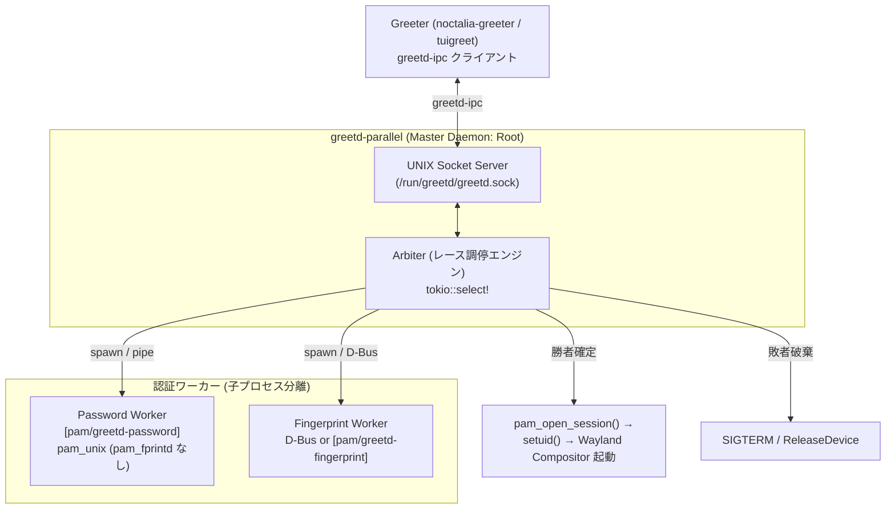
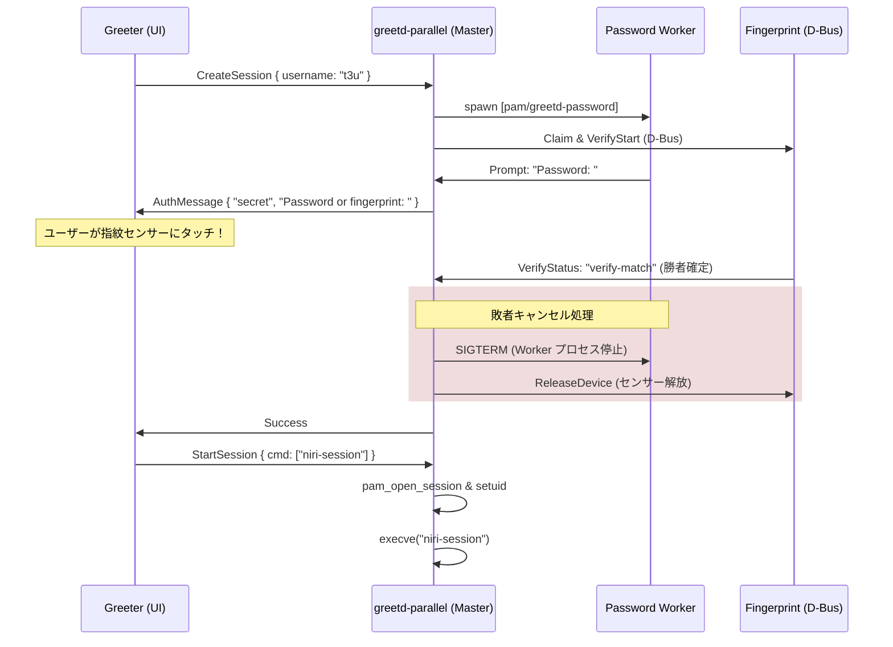

# greetd API 互換並行認証デーモン（greetd-parallel）の設計仕様

本稿は，「greetd の API 互換を保ちながら，ゼロから並行認証（指紋 + パスワード同時待ち受け）対応のディスプレイマネージャを自作・設計できるか？」という問いに対する，アーキテクチャ設計書および技術的実現性の検証記録である．

---

## 0. 設計目標とコンセプト

- **目的**: 既存の Wayland グリーター（`noctalia-greeter`，`tuigreet`，`regreet` 等）の資産を活かしつつ，GDM 相当の「パスワード入力と指紋タッチの真の同時待ち受け」を実現する．
- **アプローチ**: `greetd` デーモン本体を，**マルチワーカー・レース調停エンジンを備えた Rust 製の軽量互換デーモン（`greetd-parallel`）** として再設計・自己実装する．



---

## 1. greetd-ipc プロトコルの分析と課題

### 1.1 既存の `greetd-ipc(7)` 仕様
greetd の IPC は JSON をバイト列の長さ付きプレフィックス（4 バイト Big-Endian）でやり取りする同期型プロトコルである．

- **クライアント $\to$ サーバー**:
  - `create_session { username }`
  - `post_auth_message_response { response }`
  - `start_session { cmd, env }`
  - `cancel_session`
- **サーバー $\to$ クライアント**:
  - `success`
  - `error { error_type, description }`
  - `auth_message { auth_message_type, auth_message }`

### 1.2 最大の設計障壁: 「サーバー主導の非同期プッシュ（Server-initiated Push）」の欠如
既存のプロトコルは **厳密な Request-Response 型（同期 RPC）** である．
1. クライアントが `create_session` を送る．
2. サーバーが `auth_message ("Password: ")` を返す．
3. クライアントは UI 上でキー入力を待ち，Enter が押されるまでソケットに何も送信しない．

**ここでユーザーがパスワードを打たずに指紋センサーにタッチした場合**:
- デーモン側で指紋認証が成功する．
- しかし，クライアント（greeter）は `post_auth_message_response` を送信するのを待機している．
- **オリジナルの greetd-ipc 仕様には，クライアントからのリクエストがない状態でサーバーが自発的に「認証成功したよ！」と通知するイベント機構が存在しない**．

---

## 2. プロトコル互換アプローチの比較

| 方式 | 仕組み | グリーター側の改修 | 互換性・安定性 |
| :--- | :--- | :--- | :--- |
| **A. 投機的レスポンス送信**<br>(完全無改造互換) | クライアントが `post_auth_message_response` を送る前に，指紋成功時点でソケットに勝手に `{"type":"success"}` を流し込む | **不要**（無改造） | **△ グリーターの実装依存**．ソケットをイベントループで `poll` しているグリーターなら通るが，同期 `write` $\to$ `read` で書かれているとデッドロックやプロトコル不整合を起こす |
| **B. スーパーセット拡張**<br>(後方互換 + イベント拡張) | `create_session` に `capabilities: ["parallel"]` を追加．並行モード時はサーバーから非同期 `auth_status` / `event` を送信可能にする | **小規模改修**<br>(noctalia-greeter に数十行) | **◎ 最も堅牢でクリーン**．未対応グリーターには従来の直列動作，対応グリーターには真の並行 UX を提供 |

---

## 3. アーキテクチャ設計仕様

### 3.1 コンポーネント構成

1. **Master Daemon（特権 Root）**:
   - `/run/greetd/greetd.sock` をリッスンする．
   - セッションライフサイクル（`pam_open_session`，`pam_setcred`），ログインユーザーの UID/GID への降格（`setgid`, `initgroups`, `setuid`），セッションプロセス（Niri や Hyprland）の `exec` を担う．
2. **Password Worker（独立プロセス）**:
   - `fork` + `exec` された隔離プロセス．
   - 専用の PAM 設定 `/etc/pam.d/greetd-password` を読み込み，`pam_unix` を同期実行する．
   - **重要**: この PAM スタックには `pam_fprintd.so` を絶対に含めない（パスワードプロンプトを即座に出すため）．
3. **Fingerprint Worker / D-Bus Controller**:
   - 指紋照合を担うコンポーネント．実装方法は 2 通り：
     - **方式 1 (D-Bus 直接通信)**: Master プロセス内の async タスクが `zbus` 等で直接 `net.reactivated.Fprint` D-Bus API を監視する．PAM のオーバーヘッドがなく最も高速・安全．
     - **方式 2 (PAM プロセス分離)**: `/etc/pam.d/greetd-fingerprint` を実行する子プロセスを spawn する．
4. **Arbiter（調停エンジン）**:
   - `tokio::select!` により，Password Worker のパイプと Fingerprint の照合完了イベントをレース待ち受けする．

### 3.2 レース調停と敗者キャンセルの詳細シーケンス



#### キャンセル処理の厳密なルール
1. **Password 側が勝った場合**:
   - 指紋センサーに対して直ちに D-Bus `StopVerify()` および `Release()` を発行する．これを怠ると，セッション開始後にセンサーがロックされたまま（`Device was already claimed`）になり，デスクトップのロック画面で指紋が使えなくなる．
2. **Fingerprint 側が勝った場合**:
   - Password Worker プロセスに `SIGTERM` を送信する．一定時間（例: 200ms）応答がなければ `SIGKILL` する．
   - Password 側の PAM 会話は破棄されるため，`pam_faillock` に失敗が誤カウントされないよう，`greetd-password` 側には `audit` や `fail_interval` の影響を局所化する設定を施す．

---

## 4. Gnome Keyring / 暗号鍵問題への対処

並行認証において，指紋で勝った場合は **メモリ上に平文パスワードが存在しない**．
このため，ログイン時に `pam_gnome_keyring` がログインキーリングを解錠できないという原理的制約が生じる．

### 現実的な 3 つの設計パターン
1. **パターン A: GDM 方式（ログイン後フォールバック）**【推奨】
   - 指紋でログインした場合，Keyring はロックされたままデスクトップが起動する．
   - ログイン後に Keyring を必要とするアプリ（ブラウザや Nextcloud 等）が起動した時点で，デスクトップの Polkit / Keyring プロンプトが「キーリングのパスワードを入力してください」と要求する．
2. **パターン B: ログイン画面での指紋バイパス（GNOME 51 方式）**
   - そもそも初回ログインではパスワード入力を必須とし，指紋並行認証は「画面ロック（Lockscreen）」でのみ許可する．
3. **パターン C: TPM2 / FIDO2 HMAC-secret 連携**
   - 将来的な拡張として，指紋照合成功のイベントを契機に TPM2 / Secure Enclave から暗号化キーをアンラップして Keyring に渡す高度なアーキテクチャ（要カスタム pam モジュール）．

---

## 5. 実装規模と工数見積もり

Rust を用いてゼロから `greetd-parallel` を自己実装する場合の見積もりである．

| コンポーネント | 想定コード量 (Rust) | 実装内容・技術要素 |
| :--- | :--- | :--- |
| **IPC サーバー** | 約 300〜400 行 | `tokio::net::UnixListener`，`greetd-ipc` の JSON パース・シリアライズ |
| **PAM Worker** | 約 300〜500 行 | `fork` + `exec`，パイプ経由の同期 PAM 会話（`pam` crate 併用） |
| **D-Bus 指紋監視** | 約 200〜300 行 | `zbus` による `net.reactivated.Fprint` の非同期 Claim / VerifyStart / シグナル監視 |
| **Arbiter & 調停** | 約 300〜400 行 | レース調停（`tokio::select!`），子プロセスのシグナル終了，タイムアウト管理 |
| **セッションランナー** | 約 300〜400 行 | `pam_open_session`，`pam_setcred`，`setuid`，環境変数注入，`execve` |
| **合計** | **約 1,400〜2,000 行** | **一般的な Rust デーモンの小〜中規模レベル** |

### 既存の参考実装・流用元
- `greetd` 本体のリポジトリ（Kenny Levinsen）から IPC プロトコル定義（`greetd_ipc` crate）や環境変数処理をそのままクレートとして利用可能．
- GDM の `gdm-session-worker.c` および hyprlock の `Fingerprint.cpp` からセンサー競合回避のステートマシン設計を流用可能．

---

## 6. NixOS での統合・導入手順

NixOS では `services.displayManager.greetd` モジュールが提供されているため，独自実装したデーモンパッケージへの差し替えは非常にシンプルである．

```nix
# 自作デーモンの差し替え例 (configuration.nix / host module)
{ pkgs, ... }:
{
  services.displayManager.greetd = {
    enable = true;
    package = pkgs.callPackage ./pkgs/greetd-parallel { }; # 自作バイナリに置換
    settings = {
      default_session = {
        command = "${pkgs.noctalia-greeter}/bin/noctalia-greeter";
        user = "greeter";
      };
    };
  };

  # 並行認証用の分割 PAM 設定
  security.pam.services = {
    greetd-password = {
      text = ''
        auth include login
      ''; # pam_fprintd は含まない
    };
    greetd-fingerprint = {
      text = ''
        auth required pam_fprintd.so
      '';
    };
  };
}
```

---

## 7. 結論: 自己実装すべきか否かの判断基準

- **技術的実現性**: **完全に可能（Feasible）**．GDM が 15 年間運用してきた dual-worker アーキテクチャを Rust で現代的に再実装する形となり，PAM の未定義動作や SEGV クラッシュを回避できる．
- **最大のメリット**: `noctalia-greeter` や `tuigreet` をそのまま使いながら，Linux ログイン画面で「指紋でもパスワードでも即解錠」という macOS 同等の体験を得られる．
- **最大のデメリット / トレードオフ**:
  1. 約 1,500〜2,000 行の特権デーモンの開発・保守責任が発生する．
  2. 指紋でログインした場合，Gnome Keyring が解錠されないため，ログイン後に結局パスワード入力ダイアログが出る（GDM と同様）．

**推奨**:
日常の利便性向上（UX 改善）を目的とする場合，まずは工数が最小（数十行）で Keyring の問題も起きない **「Noctalia ロック画面のデュアルチャネル並行化」** を優先し，ログイン画面の並行化がどうしても欲しくなった段階で，本設計仕様に基づく `greetd-parallel` の PoC 実装に着手するのが最も投資対効果（ROI）が高い．

---

## 関連ドキュメント

- [`parallel-auth-upstream-history.md`](parallel-auth-upstream-history.md) — 各 upstream の並行化の歴史と挫折理由
- [`parallel-auth-architecture.md`](parallel-auth-architecture.md) — 単一 PAM スタックの逐次性と各種実装比較
- [`nixos/services/desktop/greetd.nix`](../../nixos/services/desktop/greetd.nix) — 本リポジトリの greetd / PAM 設定
