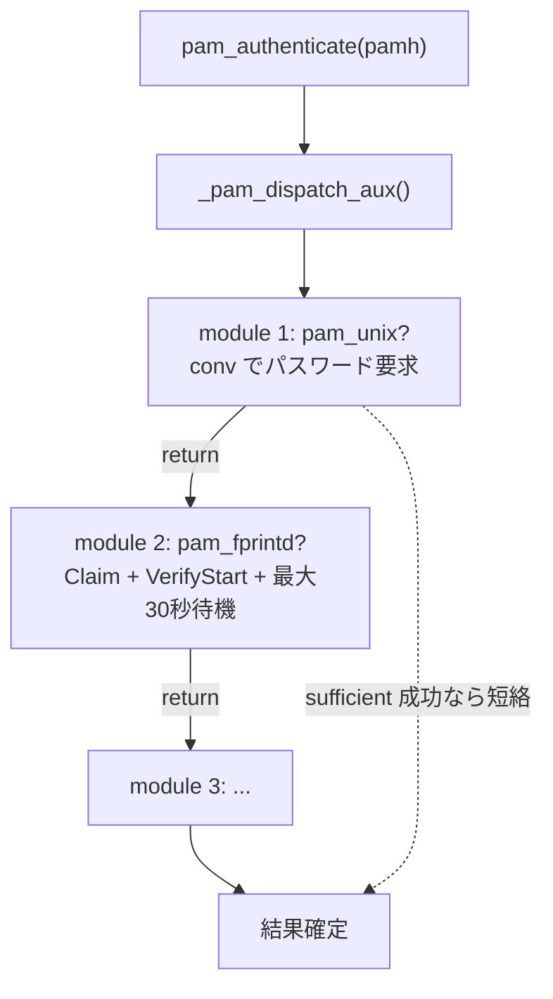
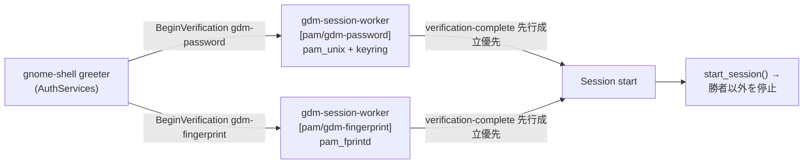

# 指紋 + パスワード並行待ち受けアーキテクチャ調査

Linux における生体認証（指紋）とパスワードの同時待ち受け（並行マルチモーダル認証）について，単一 PAM スタック内での実現が不可能な構造的理由，および GDM / Noctalia / greetd / polkit / sudo における実装仕様の調査記録．

| 項目 | 対象・バージョン |
| :--- | :--- |
| 対象ホスト | x1c7（Synaptics Prometheus `06cb:00bd`） |
| 実機検証環境 | Linux-PAM 1.7.2 / fprintd 1.94.5 / libfprint 1.94.10 / greetd 0.10.3 / Noctalia 5.2.1 |
| upstream 調査リビジョン | greetd `d6733e9` / gdm `ba34b08` / noctalia `f157ebe` / fprintd `b10251e` / linux-pam `584ef22` / gnome-keyring `a4a1730` / polkit `d3ba690` / sudo `43defa1`（2026-10-15 時点の HEAD） |

---

## 概要と結論

| 問い | 回答 |
| :--- | :--- |
| Linux で指紋とパスワードを同時に待ち受けられるか | 可能．単一の PAM 会話内では不可能 |
| 単一 PAM スタックで可能か | 不可能．`pam_authenticate()` は逐次ディスパッチであり，`pam_conv` は 1 ハンドルに 1 個で同期 request/response しか表現できない |
| アプリケーション層での実現方式 | アプリケーションが複数の PAM トランザクション（複数の `pam_handle_t`）を別プロセス／別スレッドで並行実行し，先行成立した処理以外をキャンセルするオーケストレータとなる（GDM の実装方式） |
| もうひとつの実現方式 | デュアルチャネル調停（パスワードは PAM，指紋は `net.reactivated.Fprint` D-Bus 経由での直接呼び出し）．Noctalia ロック画面が採用．センサの二重 Claim を回避するため検証処理は直列化される |
| greetd / polkit / sudo で可能か | 設定変更では不可能．いずれも「1 リクエスト = 1 PAM トランザクション」を前提とした API / プロトコルであり，並行化には本体の再設計が必要 |

要約: 並行待ち受けが不可能なのは単一の標準 PAM 会話内部に限定される．実現にはアプリケーション側で複数 PAM を調停するオーケストレータ（dual-PAM）を組むか，生体認証を PAM 外部へ分離して D-Bus 経由で直接制御する（デュアルチャネル調停）設計が必要となる．

---

## 1. 単一 PAM スタックが本質的に逐次である理由

### 1.1 `pam_authenticate()` は「1 ハンドル × 逐次ディスパッチ」

`pam_authenticate()` 自体はハンドルを受け取り，`_pam_dispatch(pamh, flags, PAM_AUTHENTICATE)` を呼ぶだけである．

```c
/* libpam/pam_auth.c (Linux-PAM 1.7.2) */
int pam_authenticate(pam_handle_t *pamh, int flags)
{
    ...
    retval = _pam_dispatch(pamh, flags, PAM_AUTHENTICATE);
    ...
}
```

`_pam_dispatch_aux()` はモジュールハンドラの連結リストを先頭から 1 つずつ順に呼ぶ．

```c
/* libpam/pam_dispatch.c */
for (depth = 0; h != NULL; prev_level = stack_level, h = h->next, ++depth) {
    ...
    retval = h->func(pamh, flags, h->argc, h->argv);   /* 1 モジュールずつ同期呼び出し */
    ...
}
```

`sufficient` / `required` / `optional` などの制御フラグも，この逐次ループの各ステップで「打ち切るか継続するか」を決めるだけである．同一スタック内の `pam_fprintd.so` と `pam_unix.so` が同時に実行されることはなく，必ず逐次実行となる．



### 1.2 `pam_conv` は「1 ハンドルに 1 個・同期 request/response」

`struct pam_conv` は `pam_start()` 時にアプリが渡すコールバック 1 個と `appdata_ptr` である（`pam_conv(3)`）．

```c
struct pam_conv {
    int (*conv)(int num_msg, const struct pam_message **msg,
                struct pam_response **resp, void *appdata_ptr);
    void *appdata_ptr;
};
```

- モジュールは `pam_get_item(pamh, PAM_CONV, ...)` でこの 1 個のコールバックを取り出し，`pc->conv(num_msg, msgs, &resp, pc->appdata_ptr)` を同期呼び出しする．`resp` 配列が返るまでモジュールは先へ進めない．
- `num_msg` で複数メッセージを 1 回にまとめられるが，これは man ページの説明どおり「フォームに複数欄を一括表示する」ための機構である．
- 1 つの conversation が持てる状態は「今どのモジュールの，どのプロンプトを，誰に対して待っているか」という単一の状態だけである．指紋センサの完了とパスワード入力の完了を 2 本の非同期イベントとして同時に待つ表現力はない．

`pam_fprintd.c` もこの規約に従い，`PAM_TEXT_INFO`（"Place your finger on the fingerprint reader" 等）の送信に `conv` を使用する．

```c
/* pam/pam_fprintd.c: send_msg() */
const struct pam_message mymsg = { .msg_style = style, .msg = msg };
...
return pc->conv (1, &msgp, &resp, pc->appdata_ptr) == PAM_SUCCESS;
```

### 1.3 `PAM_INCOMPLETE` でも並行にはならない

Linux-PAM には，モジュールが `PAM_INCOMPLETE` を返して `pam_authenticate()` を一旦アプリに戻し，後で再開する「中断・再開」機構がある（`pam_dispatch.c` の `former`/`resumed` 状態）．再開できるのは同じハンドルの同じスタック位置であり，「別のイベントが先に成立したらこちらを捨てる」という分岐は表現できない．`fprintd` は `PAM_INCOMPLETE` を使って非同期 D-Bus 応答を待つが（`DEFAULT_TIMEOUT 30` 秒），これは「指紋という 1 本の認証を待つ」ための中断である．

### 1.4 実機で観測される帰結

| スタック | 認証順序 | 帰結 |
| :--- | :--- | :--- |
| `/etc/pam.d/polkit-1` / `sudo` / `su` | `pam_fprintd` (11400) → `pam_unix try_first_pass` (11700) | 指を置かない限り最大 30 秒パスワード欄が出ない |
| `/etc/pam.d/greetd`（本リポジトリ） | `pam_unix` (unix-early, 11700) → `pam_gnome_keyring` → `pam_unix use_first_pass` (12900) → `pam_fprintd` (12910) | `unix-early` が 1 回だけパスワードをプロンプトして `PAM_AUTHTOK` を入れ，空送信なら `use_first_pass` の `pam_unix` が失敗して `pam_fprintd` にフォールスルーする |

greetd の構成は，単一スタックの逐次制約に対する空送信フォールスルーによる回避策である．[`nixos/services/desktop/greetd.nix`](../../nixos/services/desktop/greetd.nix) に設計意図が記載されており，グリーター側で `auth.allow_empty_password = true` の設定を前提とする．

```nix
# nixos/services/desktop/greetd.nix（本リポジトリ）
# Requires unix-early (inserted by enableGnomeKeyring) to populate PAM_AUTHTOK
# first, allowing a single empty submission to fall through to fprintd immediately.
rules.auth.unix.settings = {
  try_first_pass = lib.mkForce false;
  use_first_pass = lib.mkForce true;
};
rules.auth.fprintd.order = config.security.pam.services.greetd.rules.auth.unix.order + 10;
```

---

## 2. GDM の実装方式 — dual-PAM オーケストレータ

GDM は「単一スタックの限界」を PAM の外側で回避する．PAM サービスごとに会話（conversation）と専用の worker プロセスを持ち，複数を同時に進行させる．

### 2.1 会話の多重化

`GdmSession` は PAM サービス名をキーとするハッシュテーブルを持つ．

```c
/* daemon/gdm-session.c */
GHashTable *conversations;   /* key = service name ("gdm-password", "gdm-fingerprint", ...) */
```

`gdm_session_start_conversation(service_name)` はサービスごとに `GdmSessionConversation` を生成し，`gdm_session_worker_job_start()` で別プロセスの `gdm-session-worker` を spawn する．プロセス名は `gdm-session-worker [pam/<service>]`．同じサービスを二重起動しようとすると warning で拒否する＝「サービス単位で複数同時」が設計前提である．

```c
/* daemon/gdm-session.c: start_conversation() */
conversation->service_name = g_strdup (service_name);
conversation->job = gdm_session_worker_job_new ();
...
job_name = g_strdup_printf ("gdm-session-worker [pam/%s]", service_name);
gdm_session_worker_job_start (conversation->job, job_name);
```

worker は `g_spawn_async_with_pipes()` で実際に別プロセスとして起動される（`daemon/gdm-session-worker-job.c`）．各 worker は独自の `pam_handle_t` と `pam_conv` を持ち，他 worker と PAM 状態を共有しない．

greeter（gnome-shell）側は，有効なサービスを列挙してそれぞれ D-Bus `BeginVerification` を発行する．`gdm-password` / `gdm-smartcard` / `gdm-fingerprint` は別サービスとして同時に開始される．

```js
// gnome-shell js/gdm/authServices.js: _startServices()
for (const serviceName of this._getEnabledServices()) {
    if (this._canStartService(serviceName)) {
        await this._startService(serviceName, cancellable);   // service ごとに会話を開始
    }
}
```

```js
// gnome-shell js/gdm/authServicesLegacy.js
const PASSWORD_SERVICE_NAME   = 'gdm-password';
const SMARTCARD_SERVICE_NAME  = 'gdm-smartcard';
const FINGERPRINT_SERVICE_NAME = 'gdm-fingerprint';
```



### 2.2 勝者の確定と敗者のキャンセル

いずれかの会話が成功すると `verification-complete` が発火し，greeter はそのサービスでセッション開始を要求する．GDM はこのとき勝者以外の会話を停止する．

```c
/* daemon/gdm-session.c */
void gdm_session_start_session (GdmSession *self, const char *service_name)
{
    ...
    stop_all_other_conversations (self, conversation, FALSE);   /* 敗者を cancel */
    ...
}
```

`stop_all_other_conversations()` は `conversations` を走査し，`conversation_to_keep` 以外の worker job を `gdm_session_worker_job_stop()` で終了させる．これにより，先行成立した認証を採用し，競合する他方の処理を破棄する並行レースが実現される．

### 2.3 gnome-keyring と `PAM_AUTHTOK` の仕様的制約

並行認証の副作用として，指紋で勝った場合のキーリング解錠が問題になる．理由はサービスごとに PAM スタックが完全に別であることにある．

| PAM ファイル | 内容 | `PAM_AUTHTOK` |
| :--- | :--- | :--- |
| `data/pam-arch/gdm-password.pam` | `auth include system-local-login` + `pam_gnome_keyring` | 設定される（pam_unix が入る） |
| `data/pam-arch/gdm-fingerprint.pam` | `auth required pam_fprintd.so` + `pam_gnome_keyring`（pam_unix なし） | 設定されない |

```pam
# data/pam-arch/gdm-fingerprint.pam
auth       required                    pam_fprintd.so
auth       optional                    pam_gnome_keyring.so
...
session    include                     system-local-login
session    optional                    pam_gnome_keyring.so auto_start
```

`pam_gnome_keyring` は auth フェーズで `PAM_AUTHTOK` を取り出そうとし，無ければ警告して `PAM_SUCCESS` を返す（= 解錠材料を持たない）．session フェーズの `auto_start` はパスワード NULL でデーモンを起動するため，ログインキーリングはロックされたまま起動する．

```c
/* gnome-keyring pam/gkr-pam-module.c: pam_sm_authenticate() */
ret = pam_get_item (ph, PAM_AUTHTOK, (const void**)&password);
if (ret != PAM_SUCCESS || password == NULL) {
    syslog (GKR_LOG_WARN, "gkr-pam: no password is available for user");
    return PAM_SUCCESS;     /* 解錠材料なしで通過 */
}
```

会話はサービスごとに別プロセスであり，`gdm-password` 側で入力された authtok が `gdm-fingerprint` 側へ引き継がれることもない．指紋照合で認証が成立した場合，後続で Secret Service を要求するアプリケーションが「Enter password to unlock your login keyring」を提示する（キーリング・フォールバック）．これは指紋認証スタックが `PAM_AUTHTOK`（平文パスワード文字列）を保持し得ない仕様上の帰結である．これを回避するには，指紋照合の成功後に別途パスワードを入力させてキーリングへ渡す設計が必要となる．

---

## 3. 各コンポーネントの対応状況（greetd / polkit / sudo / Noctalia）

### 3.1 greetd — プロトコルレベルでの単一セッション制約

greetd の IPC は「1 接続につき 1 認証フロー」である．

```rust
/* greetd_ipc/src/lib.rs */
pub enum Request {
    CreateSession { username: String },          // PAM サービス名を指定するフィールドが無い
    PostAuthMessageResponse { response: Option<String> },
    StartSession { cmd: Vec<String>, env: Vec<String> },
    CancelSession,
}
```

- 使用する PAM サービスは設定ファイルの `[general] service`（既定 `greetd`）で固定される（`greetd/src/config/mod.rs`）．greeter が `gdm-password` と `gdm-fingerprint` を選び分ける余地がない．
- サーバ側 `Context::create_session()` は，既に `configuring` なセッションがあると `"a session is already being configured"` で拒否する（`greetd/src/context.rs`）．
- セッション worker は `fork` + `execv` で 1 プロセス生成される（`greetd/src/session/interface.rs`）．

```rust
/* greetd/src/context.rs: create_session() */
if inner.configuring.is_some() {
    return Err("a session is already being configured".into());
}
```

判定: greetd はプロトコル構造上，並行認証に対応できない．本リポジトリにおける指紋対応は，単一 PAM スタックを「空送信フォールスルー」で処理する逐次的な運用回避策である．

### 3.2 polkit-1 — 単一 pam_authenticate() 実行制約

polkit の認証は setuid（または socket 起動）ヘルパ `polkit-agent-helper-1` が担う．

```c
/* src/polkitagent/polkitagenthelper-pam.c */
rc = pam_start ("polkit-1", user_to_auth, &pam_conversation, &pam_h);
...
rc = pam_authenticate (pam_h, 0);
```

- `PolkitAgentSession` はヘルパプロセスを 1 つ spawn し，stdin/stdout で cookie と conversation をやり取りする（`src/polkitagent/polkitagentsession.c`）．
- `PolkitAgentTextListener` は `active_session` が既にあると `"An authentication session is already underway."` で拒否する（`src/polkitagent/polkitagenttextlistener.c`）．
- API 自体が「1 リクエスト = 1 begin/response/completed」であり，2 つの認証を同一リクエストに対して並行に走らせ，敗者を捨てる概念がない．

判定: 並行化には polkit 本体，エージェント API，および helper プロセスの再設計を要する．実用上の対策は，PAM スタックの順序見直しや `pam_fprintd` の `timeout` 値短縮による UX 改善に限定される．

### 3.3 sudo — 逐次ループによる認証エンジン

`sudo` は認証方式を `auth_switch[]` 配列で持ち，`verify_user()` が逐次呼び出す．

```c
/* plugins/sudoers/auth/sudo_auth.c */
static sudo_auth auth_switch[] = { ... };
...
for (auth = auth_switch; auth->name; auth++) { ... }   /* 逐次 */
```

PAM 経路も 1 回の `pam_start` + `pam_authenticate` のみである．

```c
/* plugins/sudoers/auth/pam.c: sudo_pam_verify() */
pam_status = pam_start (pam_service, pw->pw_name, &pam_conv, &pamh);
...
*pam_status = pam_authenticate (pamh, def_pam_silent ? PAM_SILENT : 0);
```

`def_passwd_tries` によるリトライは同じ認証経路を逐次再実行する．

判定: `def_passwd_tries` による再試行ループは逐次実行される．sudo での並行認証には内部認証エンジンの抜本的な書き換えを要するため，設定レベルでの対応は不可能である．

### 3.4 Noctalia ロック画面 — デュアルチャネル調停と直列化検証

Noctalia 5.2.1 のロック画面は，パスワードを PAM で，指紋を `net.reactivated.Fprint` D-Bus 経由での直接呼び出しで扱う．この点は「PAM + D-Bus」のデュアルチャネルであり，指紋を PAM スタックに載せない（`login` サービスから `pam_fprintd` を除去する）．

```cpp
// src/shell/lockscreen/lock_screen.cpp
// Authenticate against the "login" stack. If fingerprint is enabled, strip
// pam_fprintd from it: noctalia drives the reader itself over D-Bus and the
// two can't share the sensor. See docs/fingerprint.md.
const std::string pamService = "login";
```

指紋側はロック中に常時アームされ，マッチすれば PAM を介さず直接 `unlock()` する（`src/auth/fingerprint_authenticator.cpp`）．パスワード側は `PamAuthenticator::authenticateCurrentUser()` が `fork()` + `execv("/proc/self/exe", ...)` で子プロセスを立て，その中で `pam_start`/`pam_authenticate` を実行する（`src/auth/pam_authenticator.cpp`）．PAM を子プロセスに隔離する点は GDM の worker 方式に近い．

```cpp
// src/auth/pam_authenticator.cpp
const pid_t pid = ::fork();
if (pid == 0) {
    ... ::execv("/proc/self/exe", const_cast<char* const*>(helperArgv));
}
...
const auto result = authenticator.authenticateCurrentUser(password, pamService, pamLanguage, pamStartFailure);
```

現行実装はパスワード送信時に指紋検証を明示的に停止してから PAM を開始する．

```cpp
// src/shell/lockscreen/lock_screen.cpp: tryAuthenticate()
stopFingerprint();          // ← センサを解放してから
...
std::thread([...]() {
    const auto result = authenticator.authenticateCurrentUser(password, pamService, ...);
    ...
}).detach();
```

指紋照合が成功した場合は `setAuthenticatedCallback` から即座に `unlock()` が呼ばれる．一方，パスワードが送信された場合は，`stopFingerprint()` で指紋センサーを解放してから子プロセスで PAM 認証を実行する．指紋検証はロック画面の表示中は常時アームされているが，fprintd の Claim と D-Bus 経由の直接 Claim がセンサーを取り合うため，パスワード検証と同時に進行することはない．

Noctalia は 2 つの認証トランザクションを直列化して処理する．「PAM と D-Bus の 2 チャネルを同時にアームし，ユーザーが先行完了した操作で解錠するが，実際の検証処理は直列化する」設計であり，同時待ち受けの UX を満たしつつセンサ競合を避ける調停モデルを採る．GDM は複数の PAM 会話を別 worker プロセスで並行実行する dual-PAM オーケストレーションを採る．

ここで述べたのはロック画面である．ログイン画面は `noctalia-greeter` が別実装であり，本リポジトリでは greetd 経由で動作する．

---

## 4. まとめ

- Linux で指紋とパスワードを同時に待ち受けることは可能である．単一の標準 PAM 会話内では不可能である．`pam_authenticate()` は逐次ディスパッチであり，`pam_conv` は 1 ハンドル 1 個の同期 request/response しか持てない．
- 実現手段は次の 2 つに大別できる．

| 方式 | 仕組み | 実装例 | 敗者キャンセル | キーリング |
| :--- | :--- | :--- | :--- | :--- |
| dual-PAM オーケストレータ | 複数 PAM サービス（`gdm-password` / `gdm-fingerprint` 等）を別ハンドル・別 worker プロセスで同時実行 | GDM（`gdm-session.c` の conversations 多重化） | `stop_all_other_conversations()` | 指紋勝ち時は `PAM_AUTHTOK` 無し → 後でフォールバックプロンプト |
| デュアルチャネル + 調停 | 片方を PAM，もう片方を D-Bus 等で直接駆動し，共有資源（センサ）の Claim を明示調停 | Noctalia ロック画面（PAM `login` + `net.reactivated.Fprint`） | アプリが明示的に `stopFingerprint()` | 直接 D-Bus のため PAM キーリングとは無関係 |

- `greetd` / `polkit-1` / `sudo` は，いずれも「1 リクエスト = 1 PAM トランザクション」を前提としたプロトコル / API / 実装であり，設定や PAM 順序の工夫では並行化できない．並行化には各プロジェクト本体の改修が必要である．
- 本リポジトリでの現実的な選択肢として，以下のアプローチが挙げられる．
  - greetd では，本体や noctalia-greeter を改修しない限り完全な並行化は行えない．現在の「空送信フォールスルー」を維持しつつ，`pam_fprintd` の `timeout` を短縮して体感待ち時間を低減する設計が妥当である．
  - polkit-1，sudo，su では，`pam_unix try_first_pass` を優先するか，`pam_fprintd` に `timeout=10` などを設定して 30 秒間のブロックを回避する（[`fprintd-triage-notes.md`](fprintd-triage-notes.md) の推奨と一致）．
  - 完全な並行認証が必要な場合は，GDM 相当の dual-PAM オーケストレータを実装するか，Noctalia ロック画面のような D-Bus 直接呼び出しと明示調停を組み合わせる方式を採用する．

---

## 関連ドキュメント

- [`fprintd-triage-notes.md`](fprintd-triage-notes.md) — x1c7 実機での fprintd トリアージ記録（polkit-1 / sudo の 30 秒ブロックの一次切り分け）
- [`bsd-auth-architecture.md`](bsd-auth-architecture.md) — BSD 系（OpenPAM / BSD Authentication）における同期性・並行性の調査
- [`thinkpad-x1c7.md`](../hardware/thinkpad-x1c7.md) — x1c7 の指紋認証・PAM 統合の現状
- [`nixos/services/desktop/greetd.nix`](../../nixos/services/desktop/greetd.nix) — 本リポジトリの greetd / PAM 構成
- [`hosts/x1c7/default.nix`](../../hosts/x1c7/default.nix) — `services.fprintd.enable` と udev / TLP 設定

## 出典

- Linux-PAM 1.7.2（upstream `584ef22`）: `libpam/pam_auth.c`, `libpam/pam_dispatch.c`, `pam_conv(3)`, `pam_authenticate(3)`
- fprintd 1.94.5（upstream `b10251e`）: `pam/pam_fprintd.c`
- GDM（upstream `ba34b08`）: `daemon/gdm-session.c`, `daemon/gdm-session-worker.c`, `daemon/gdm-session-worker-job.c`, `data/pam-arch/gdm-password.pam`, `data/pam-arch/gdm-fingerprint.pam`
- gnome-shell（main）: `js/gdm/authServices.js`, `js/gdm/authServicesLegacy.js`, `js/gdm/fingerprintManager.js`
- gnome-keyring（upstream `a4a1730`）: `pam/gkr-pam-module.c`
- greetd 0.10.3（upstream `d6733e9`）: `greetd/src/context.rs`, `greetd/src/config/mod.rs`, `greetd/src/session/interface.rs`, `greetd/src/session/worker.rs`, `greetd_ipc/src/lib.rs`
- polkit（upstream `d3ba690`）: `src/polkitagent/polkitagenthelper-pam.c`, `src/polkitagent/polkitagentsession.c`, `src/polkitagent/polkitagenttextlistener.c`
- sudo（upstream `43defa1`）: `plugins/sudoers/auth/pam.c`, `plugins/sudoers/auth/sudo_auth.c`
- Noctalia 5.2.1（upstream `f157ebe`）: `src/shell/lockscreen/lock_screen.cpp`, `src/auth/pam_authenticator.cpp`, `src/auth/fingerprint_authenticator.cpp`
- 実機 `/etc/pam.d/{greetd,login,polkit-1,sudo,su}`（NixOS 26.05）
