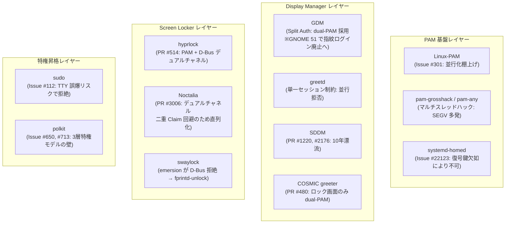

# Linux 並行認証 (指紋 + パスワード) の上流調査と歴史的経緯

Linux において指紋とパスワードの同時待ち受け (並行認証) を実現しようとした各プロジェクト (Linux-PAM, fprintd, systemd-homed, GDM, greetd, SDDM, COSMIC, hyprlock, Noctalia, swaylock, sudo, polkit) の歴史的経緯，Issue / PR，直面した技術的障壁，および現在の状況を整理する．

---

## 1. 背景と全体像

Linux-PAM (X/Open XSSO 規格) は 1995 年に設計された同期・直列パイプラインであり，単一の PAM スタック内で 2 つの認証方式を同時に走らせることは原理的に不可能である．この制約に対し，過去 15 年以上にわたりデスクトップ・組み込み・CLI の各レイヤーで並行化の試みと挫折が繰り返されてきた．

---

## 2. 認証コア基盤 (Linux-PAM, fprintd, systemd-homed)

### 2.1 Linux-PAM upstream: Issue #301 ("Parallel or 'any' PAM modules")
GitHub `linux-pam/linux-pam` の Issue #301 (2020 年〜) では，顔認証 (Howdy) や指紋とパスワードの同時待ち受けが議論されたが，コアメンテナ (Tomas Mraz, Thorsten Kukuk) から以下の技術的限界が示され，停滞している．

- 会話関数 `pam_conv` は同期ブロッキング関数であり，別スレッドで指紋照合が成功してもブロック中のパスワード入力を安全に中断する公式 API が存在しない．
- スタック設定構文 (`sufficient`, `required`, `[success=1 ...]`) が単一線形スタックの逐次評価を前提としており，並行分岐・合流を表現できない．
- PAM モジュールが認証中に `setresuid()`，環境変数，シグナルマスク，ファイルディスクリプタなどのプロセス共通リソースを操作するため，マルチスレッド実行で競合状態に陥る．
- 後方互換性を維持した再設計と実装を外部から持ち込まない限り，コアメンテナ側に新規開発のリソースが存在しない (Thorsten Kukuk, 2026 年)．

### 2.2 コミュニティ製ラッパーモジュール (grosshack, pam-any, pam-parallel) の破綻
単一 PAM モジュール内部で `pthread` を立ち上げ，片方でパスワード，片方で `fprintd` D-Bus を待つハックが試作された:
- `pam-fprint-grosshack` (GitLab: `mishakmak/pam-fprint-grosshack`)
- `pam-any` (GitHub: `ChocolateLoverRaj/pam-any`)
- `pam-parallel` (GitHub: `furiLabs/pam-parallel`)

破綻理由:
- COSMIC greeter (後述) の実証で判明したように，呼び出し側アプリケーション (Rust の tokio や GUI メインループ) の会話コールバックはマルチスレッド・リエントラントに対応しておらず，SIGSEGV クラッシュが頻発した．
- 敗者スレッドを安全に終了させる手段がないためバックグラウンドに放置され，端末 (TTY) のエコーバック設定が狂う，`pam_faillock` の失敗カウントが二重計上されるなどの副作用を招いた．

### 2.3 fprintd upstream: 責務分離と対症療法
`fprintd` はハードウェア排他制御と照合 API のみに特化しており，パスワード認証をデーモン側に内包することはセキュリティ監査上拒絶されている．
upstream (GitLab: `libfprint/fprintd`) では，並行化ができない前提のもとで以下の対症療法が進められた:
- MR !201 / MR !195 でタイムアウト設定を改善し，無応答時の待機時間を短縮した．
- MR !256 でノート PC のリッド開閉検知を導入し，フタが閉じている場合は即座に `pam_fprintd` をスキップしてパスワードへフォールスルーするよう改修した．

### 2.4 systemd-homed: 原理的障壁 (Issue #22123)
`systemd-homed` は LUKS / fscrypt でホームディレクトリを暗号化する．一般的な指紋センサー (Match-on-Chip) は照合成否の真偽値しか返さず，復号鍵 (高エントロピーなシークレット) を生成・提供できない．初回ログインで暗号化ボリュームを復号することは原理的に不可能である．

---

## 3. ディスプレイマネージャ & グリーター

### 3.1 GDM: Split Authentication の成功と GNOME 51 での指紋廃止
- GDM は特権デーモンとして動作し，`gdm-password` と `gdm-fingerprint` の 2 つの PAM サービスに対して別プロセスの `gdm-session-worker` を立ち上げて並行レースさせる (Split Authentication，2011 年〜，`-Dsplit-authentication=true`)．
- GNOME 51 以降は初期ログイン画面での指紋認証を廃止し，ロック画面解除のみに限定する方針が進められている．指紋認証では LUKS や GNOME Keyring の復号鍵を生成できず，不用意な接触による誤認証や特権昇格リスク (CVE-2024-37408) を伴うためである．

### 3.2 greetd: 単一セッション制約とミニマリズム
- デーモン本体の `ContextInner` (`greetd/src/context.rs`) は `configuring` を 1 つしか保持できず，2 つ目のセッション要求には `"a session is already being configured"` を返して即座に拒絶する．IPC プロトコル (`greetd-ipc(7)`) も 1 ソケット = 1 PAM 会話に固定されている．
- 作者 (Kenny Levinsen) が `agetty` + `login` の近代的な代替という最小主義を堅持しており，GDM 風のマルチワーカー調停ロジックを本体へ組み込む要求は拒絶されている．
- `tuigreet` や `ReGreet` (Issue #76) をはじめとする既存グリーターは，空 Enter 送信によるフォールスルーやタイムアウト待ちといった逐次運用で妥協せざるを得ない．

### 3.3 SDDM: 10 年にわたる未マージの歴史
- 指紋とパスワードの並行対応は Issue #284 (2014 年〜) として提起されたまま 10 年以上未解決の状態で残っている．
- 別 PAM サービス `sddm-fingerprint` をバックグラウンド起動する PR #1220 (2018 年) および PR #2176 (2024 年〜) が提案されたが，勝者確定時に敗者プロセスを `QProcess::terminate()` で強制終了する設計の粗さや，ディストリビューション間の PAM 差異 (`pam_faillock` など) に起因するエラー多発により承認されず漂流している．

### 3.4 COSMIC Greeter (pop-os/cosmic-greeter): クラッシュ検証と PR #480
- ロック画面で単一スタックのマルチスレッド並行化ハック (`pam-fprint-grosshack`) を検証した際，非リエントラントな PAM 会話コールバックが原因で tokio ランタイムが SIGSEGV クラッシュを起こし，単一セッション並行化の破綻が実証された (Issue #173)．
- ロック画面向けに GDM 風の dual-worker (`cosmic-greeter-password` と `cosmic-greeter-fingerprint`) を試作した PR #480 では，以下の知見が得られた:
  - ログイン画面は greetd が並行セッションを拒否するため，ログイン画面を並行化するには greetd の採用を見直す必要がある．
  - パスワード側の PAM 定義から `pam_fprintd` を除外した専用 PAM ファイルを分離しないとパスワード側も指紋待ちで 30 秒間ブロックされる (分離によって待機時間が 30.66 秒から 0.09 秒へ短縮)．

---

## 4. スクリーンロッカー (Wayland)

### 4.1 hyprlock: デュアルチャネル方式の確立とハードウェア対応
hyprlock は GDM 風 Dual-PAM を見送り，「PAM (パスワード) + D-Bus 経由での直接呼び出し (指紋)」のデュアルチャネル方式 (PR #514) を選択した．
- サスペンド復帰時に PAM が `StopVerify` を呼ぶと `device is busy` エラーで 30 秒間ロックアウトすることや，`pam_fprintd.so` の最大 99 秒タイムアウト制限で再接続ループが肥大化することから Dual-PAM の採用を見送った．
- 常時アームで放置するとセンサーが過熱保護 (`TOO_HOT`) で切断されるため，無操作タイムアウトによる動的アーム (マウス・キー操作検知時のみ Claim) を導入した (Issue #702)．
- サスペンド復帰時に D-Bus プロキシが失効する現象に対し，ThinkPad x1c7 (Synaptics Prometheus `06cb:00bd`) の実機検証を通じてバックオフ付きリトライ (500ms，最大 10 回) を実装した (PR #1066)．

### 4.2 Noctalia (noctalia-dev/noctalia): 直列化の理由
Noctalia は hyprlock を参考にしてデュアルチャネルを導入した (PR #3006)．
- ユーザー環境の `/etc/pam.d/login` に `pam_fprintd` が含まれる環境でパスワード送信時にセンサーの奪い合い (二重 Claim) が発生し 30 秒間フリーズする不具合 (Issue #3277) を回避するため，パスワード入力開始時に `stopFingerprint()` で指紋照合を明示的に停止させている．
- パスワード検証中に指紋認証が成立してアンロックイベントが二重発行されるクラッシュを防ぐため，片方の検証中は他方を止める直列化を行っている．
- 本リポジトリの設定 ([nixos/services/desktop/greetd.nix](../../nixos/services/desktop/greetd.nix)) ではすでに `login.fprintAuth = false` にしているため，実機では Issue #3277 のフリーズ要因は排除されている．

### 4.3 swaylock & gtklock: upstream の拒絶とコミュニティフォーク
- swaylock では PR #283 (D-Bus) や PR #445 (Dual-PAM) が提案されたが，メンテナ (emersion) が KISS 原則を理由に複雑なオーケストレーションの導入を拒絶した．コミュニティではフォーク (`swaylock-effects` PR #77) や外付けデーモン (`fprintd-unlock`，指紋照合成功時に `SIGUSR1` を送信) で対応している．
- gtklock 向けには Codeberg 上で有志により外部モジュール `gtklock-plugin-parallel-auth` が開発された．

---

## 5. 特権昇格ツール (sudo, polkit)

### 5.1 sudo (Issue #112)
- 単一の TTY ストリーム上でエコーバックなしのパスワード入力中に指紋認証が通ると，入力途中だったパスワード文字列が昇格後の root シェルにそのまま流し込まれ，不正なコマンドとして実行される重大なセキュリティリスクがある．入力バッファのフラッシュ (`tcflush`) とブロッキング `read()` の安全な中断を端末間で保証できないため，upstream は並行化を拒否している．

### 5.2 polkit (Issue #650, #713)
- 非特権 GUI Agent による認証成否の偽造を防ぐため，setuid root の `polkit-agent-helper-1` が単一 PAM トランザクションを同期実行する 3 層特権分離モデルに依存している．GDM と Polkit の開発者間で Multi-stack PAM 統合が議論されたものの，認可とセッション管理の責務分離の観点から見送られた経緯がある．

### 5.3 CVE-2024-37408 (安易な指紋認証への懸念)
`pam_fprintd.so` がユーザーの意図的な接触を確認せず，触れただけで sudo 権限を与えてしまう問題がセキュリティコミュニティで指摘された．現代の Linux では CLI やバックグラウンド権限昇格に指紋を安易に使うべきではない (画面ロック解除などの注意が確保できる場面に限定すべき) という方針が主流となっている．

---

## 6. 各レイヤーにおける到達点と知見
- 単一 PAM モジュール内でのマルチスレッド化は，呼び出し元アプリの非リエントラント性に起因する SIGSEGV クラッシュを招くため実用不可能である．
- 単一 TTY での入力誤爆リスクや特権分離モデルの制約から，sudo や polkit などの特権昇格レイヤーでの並行化は実現の見込みがない．
- ロック画面におけるデュアルチャネル方式 (PAM パスワード + D-Bus 直接呼び出しによる指紋照合) のみが，動的アームや復帰時リトライ等の知見によって安定稼働できる現実的な解である．

---

## 関連ドキュメント

- [parallel-auth-architecture.md](parallel-auth-architecture.md) — Linux における指紋 + パスワード並行待ち受けの構造的制約と GDM / Noctalia 実装比較
- [greetd-parallel-design.md](greetd-parallel-design.md) — greetd 互換並行認証デーモンの設計・自己実装仕様
- [fprintd-triage-notes.md](fprintd-triage-notes.md) — x1c7 実機での fprintd トリアージ記録
- [thinkpad-x1c7.md](../hardware/thinkpad-x1c7.md) — x1c7 の指紋認証・PAM 統合の現状
