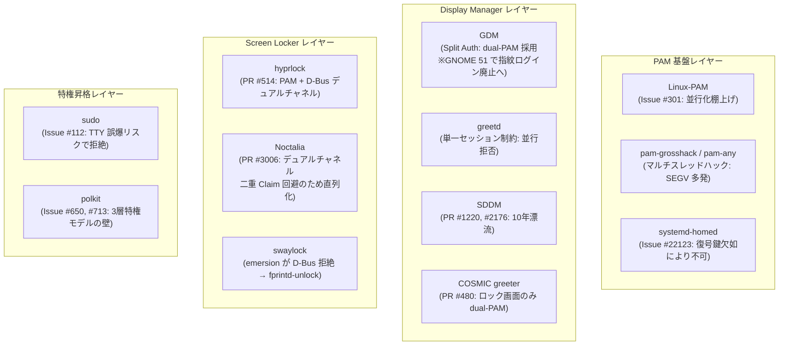

# Linux 並行認証（指紋 + パスワード）の上流調査と歴史的経緯

Linux において「指紋」と「パスワード」の同時待ち受け（並行認証 / concurrent authentication）を実現しようとした各プロジェクト（Linux-PAM，fprintd，systemd-homed，GDM，greetd，SDDM，COSMIC，hyprlock，Noctalia，swaylock，sudo，polkit）の歴史的経緯，Issue / PR，直面した技術的障壁，および現在の状況を整理する．

---

## 0. 背景と全体像

Linux-PAM（X/Open XSSO 規格）は 1995 年に設計された同期・直列パイプラインであり，単一の PAM スタック内で 2 つの認証方式を同時に走らせることは原理的に不可能である．この制約に対し，過去 15 年以上にわたりデスクトップ・組み込み・CLI の各レイヤーで並行化の試みと挫折が繰り返されてきた．

---

## 1. 認証コア基盤（Linux-PAM, fprintd, systemd-homed）

### 1.1 Linux-PAM upstream: Issue #301 ("Parallel or 'any' PAM modules")
GitHub `linux-pam/linux-pam` の Issue #301（2020 年〜）では，顔認証（Howdy）や指紋とパスワードの同時待ち受けが議論されたが，コアメンテナ（Tomas Mraz, Thorsten Kukuk）から以下の技術的限界が示され，停滞している．

1. **`pam_conv` のキャンセル不能性**: `pam_conv`（会話関数）は同期ブロッキング関数であり，POSIX スレッドのキャンセルポイントとしても定義されていない．別スレッドで指紋が成功しても，ブロック中のパスワード入力を安全に中断する公式 API が存在しない．
2. **スタック設定構文の限界**: 現在の構文（`sufficient`, `required`, `[success=1 ...]`）は単一の線形スタックの逐次評価しか記述できず，分岐・合流（並行評価）を表現できない．
3. **プロセス共通リソースの競合**: PAM モジュールは認証中に `setresuid()` や環境変数，シグナルマスク，ファイルディスクリプタを操作する．マルチスレッドで別々のモジュールが動くと致命的な Race Condition が発生する．
4. **メンテナのリソース不足**: 「後方互換性を壊さない完全な再設計とコードを外部から持ち込まない限り，メンテナ側に新設するリソースはない」（Thorsten Kukuk，2026 年）．

### 1.2 コミュニティ製ラッパーモジュール（`grosshack`, `pam-any`, `pam-parallel`）の破綻
単一 PAM モジュール内部で `pthread` を spawn し，片方でパスワード，片方で `fprintd` D-Bus を待つハックが試作された：
- **`pam-fprint-grosshack`**（GitLab: `mishakmak/pam-fprint-grosshack`）
- **`pam-any`**（GitHub: `ChocolateLoverRaj/pam-any`）
- **`pam-parallel`**（GitHub: `furiLabs/pam-parallel`）

**破綻理由**:
- COSMIC greeter（後述）の実証で判明したように，呼び出し側アプリケーション（Rust の tokio や GUI メインループ）の会話コールバックはマルチスレッド・リエントラントに対応しておらず，**`SIGSEGV` クラッシュが頻発**した．
- 敗者スレッドを安全に終了させる手段がないためバックグラウンドに放置され，端末（TTY）のエコーバック設定が狂う，`pam_faillock` の失敗カウントが二重計上されるなどの副作用を招いた．

### 1.3 fprintd upstream: 責務分離と対症療法
`fprintd` はハードウェア排他制御（Device Claim）と照合 API のみに特化しており，パスワード認証をデーモン側に内包することはセキュリティ監査上拒絶されている．
upstream（GitLab: `libfprint/fprintd`）では，並行化ができない前提のもとで以下の対症療法が進められた：
- **タイムアウト短縮**: MR !201 / MR !195（タイムアウト設定の改善）
- **Lid Closed スキップ**: MR !256（ノート PC のフタが閉じている場合は即座に `pam_fprintd` をスキップしてパスワードに進む）

### 1.4 systemd-homed: 原理的障壁 (Issue #22123)
`systemd-homed` は LUKS / fscrypt でホームディレクトリを暗号化する．一般的な指紋センサー（Match-on-Chip）は照合成否の真偽値（True / False）しか返さず，復号鍵（高エントロピーなシークレット）を生成・提供できない．したがって，**初回ログインで暗号化ボリュームを復号することは原理的に不可能**である．

---

## 2. ディスプレイマネージャ & グリーター

### 2.1 GDM: Split Authentication の成功と「GNOME 51 での指紋廃止」
- **Split Authentication（2011 年〜）**:
  - GDM は特権デーモンとして動作し，`gdm-password` と `gdm-fingerprint` という 2 つの異なる PAM サービスに対して別プロセスの `gdm-session-worker` を立ち上げ，レースさせる（`-Dsplit-authentication=true`）．
- **GNOME 51 での指紋ログイン廃止方針**:
  - GDM NEWS および upstream 議論において，**「初期ログイン画面での指紋認証を廃止し，ロック画面解除のみに限定する方針」** が進行中である．
  - 理由: 指紋では LUKS や Gnome Keyring の復号鍵が得られないこと，不用意な接触による誤ログインリスク，および後述のセキュリティ懸念（CVE-2024-37408）のためである．

### 2.2 greetd: 単一セッション制約とミニマリズム
- **デーモンの構造的拒否**:
  - `greetd/src/context.rs` の `ContextInner` は `configuring: Option<SessionSet>` を 1 つしか保持できず，2 つ目のセッション作成要求に対して `"a session is already being configured"` というエラーを返して即座に拒絶する．
  - IPC プロトコル（`greetd-ipc(7)`）も 1 ソケット = 1 PAM 会話固定である．
- **作者（Kenny Levinsen）の思想**:
  - `agetty` + `login` の近代的な代替という最小主義を標榜しており，GDM のような複雑なマルチワーカー調停ロジックを本体に持ち込むことは明確に拒絶されている．
- **Greeter の妥協**:
  - `tuigreet` や `ReGreet`（Issue #76）など，すべての greetd 向けグリーターは「空 Enter 送信によるフォールスルー」または「タイムアウト待ち」の逐次運用を余儀なくされている．

### 2.3 SDDM: 10 年にわたる未マージの歴史
- **Issue #284（2014 年〜）**:
  - 10 年以上開かれたままの長期未解決 Issue．
- **PR #1220（2018 年） / PR #2176（2024 年〜）**:
  - `sddm-fingerprint` という別 PAM サービスをバックグラウンドで走らせるパッチ．
  - **未マージ理由**: 勝者確定時に敗者プロセスを `QProcess::terminate()` で殺す実装が乱暴すぎること，ディストリビューションごとの PAM 差異（`pam_faillock` 等）で認証エラーが多発することから，upstream で承認されず塩漬けになっている．

### 2.4 COSMIC Greeter (`pop-os/cosmic-greeter`): クラッシュ検証と PR #480
- **`pam-fprint-grosshack` の検証事故（Issue #173）**:
  - ロック画面で単一スタック並行化ハックを試したところ，**tokio ランタイムが `SIGSEGV` でクラッシュ**．
  - 「PAM 会話コールバックが非リエントラントであるため，単一セッション内のマルチスレッド化は破綻する」ことが実証された．
- **PR #480 ("RFC: Unlock using fingerprint scanner")**:
  - ロック画面向けに GDM 風 dual-worker（`cosmic-greeter-password` と `cosmic-greeter-fingerprint`）を試作．
  - **得られた知見**:
    1. ログイン画面は greetd が管理しており，greetd が並行セッションを拒否する以上，ログイン画面の並行化には greetd を捨てるしかない．
    2. パスワード側の PAM から `pam_fprintd` を完全に除外した専用 PAM ファイルを用意しないと，パスワード側まで指紋待ちになり 30 秒ブロックされる（分離により待機時間が 30.66 秒から 0.09 秒に激減）．

---

## 3. スクリーンロッカー（Wayland）

### 3.1 hyprlock: デュアルチャネル方式の確立とハードウェアの死闘
hyprlock は GDM 風 Dual-PAM を見送り，**「PAM（パスワード） + D-Bus 直叩き（指紋）」のデュアルチャネル方式**（PR #514）を選択した．
- **Dual-PAM を見送った理由**:
  - サスペンド復帰時に PAM が `StopVerify` を呼ぶと `device is busy` エラーになり 30 秒ロックアウトすること．
  - `pam_fprintd.so` の最大 99 秒タイムアウト制限により，常時待ち受けで再接続ループが複雑化すること．
- **直面したハードウェアの壁と対策**:
  1. **センサー過熱（`TOO_HOT`）(Issue #702)**: 常時アームで放置するとセンサーが過熱保護で切断されるため，無操作タイムアウトによる動的アーム（マウス・キー操作検知時のみ Claim）を導入．
  2. **サスペンド復帰時の stale プロキシ (PR #1066)**: **まさに ThinkPad x1c7 の Synaptics Prometheus (`06cb:00bd`) で検証され**，バックオフ付きリトライ（500ms，最大10回）が実装された．

### 3.2 Noctalia (`noctalia-dev/noctalia`): 直列化の理由
Noctalia は hyprlock を参考にしてデュアルチャネルを導入した（PR #3006）．
- **なぜ `stopFingerprint()` で止めているのか**:
  1. **二重 Claim 競合 (Issue #3277)**: ユーザー環境の `/etc/pam.d/login` に `pam_fprintd` が含まれていた場合，パスワード送信時に PAM 側の `pam_fprintd` が走り，D-Bus 直叩きとセンサーを取り合って 30 秒フリーズするため．
  2. **二重解放クラッシュ**: パスワード検証中に指紋が通ると，Wayland セッションのアンロックが 2 回発行されてクラッシュするため．
- ※本リポジトリの設定（`hosts/x1c7/default.nix`）ではすでに `login.fprintAuth = false` にしているため，実機では #3277 のフリーズ要因は排除されている．

### 3.3 swaylock & gtklock: upstream の拒絶とコミュニティフォーク
- **swaylock**: PR #283 (D-Bus), PR #445 (Dual-PAM) が出されたが，メンテナ（emersion）が「KISS 原則を維持したい．ロッカーに D-Bus や複雑なオーケストレーションを持ち込みたくない」として拒絶．
  - 代替: `swaylock-effects` PR #77，および **`fprintd-unlock`**（指紋が通ったら swaylock に `SIGUSR1` を送るデーモン wrapper）が作られた．
- **gtklock**: Codeberg 上で **`gtklock-plugin-parallel-auth`** というモジュールプラグインが有志により開発された．

---

## 4. 特権昇格ツール（sudo, polkit）

### 4.1 sudo (Issue #112)
- **最大の技術的・セキュリティ的壁（TTY 入力誤爆）**:
  - CLI（標準入力）は単一ストリームである．パスワード入力（`termios` で echo off）中に指紋センサーが通った場合，**ユーザーが入力途中だったパスワード文字列が，昇格完了後の root シェルにそのまま流し込まれ，不正なコマンドとして実行される重大なセキュリティリスク** が生じる．
  - 入力バッファの安全なフラッシュ（`tcflush`）とブロッキング `read()` の安全な中断は端末間での保証が困難であり，upstream は並行化の要求を拒否している．

### 4.2 polkit (Issue #650, #713)
- **3 層特権分離モデルの制約**:
  - 非特権 GUI Agent が勝手に D-Bus fprintd を呼んで「成功した」と偽造できないよう，Polkit のセキュリティは setuid root の `polkit-agent-helper-1` が単一の PAM トランザクションを同期実行することに依存している．
  - 2011 年に GDM の Ray Strode と Polkit の生みの親 David Zeuthen が「Polkit に Multi-stack PAM を統合しよう」と議論したが，認可とセッション管理の責務分離の観点から見送られ，今日まで手付かずのままである．

### 4.3 CVE-2024-37408（安易な指紋認証への警鐘）
`pam_fprintd.so` が「ユーザーが意図して触ったか（Presence Check）」を確認せず，触れただけで sudo 権限を与えてしまう問題がセキュリティコミュニティで指摘された．このため，現代の Linux では「CLI やバックグラウンド権限昇格に指紋を安易に使うべきではない（画面ロック解除などの注意が確保できる場面に限定すべき）」という方針が主流となっている．

---

## 5. まとめ

1. **PAM スタック内並行化の失敗**: 単一 PAM モジュール内でのマルチスレッド化は，呼び出し元アプリの非リエントラント性により `SIGSEGV` クラッシュ（COSMIC 等で実証）を招くため実用不可能である．
2. **CLI / 特権昇格での並行化の拒絶**: 単一 TTY での入力誤爆リスクや特権分離モデルの制約により，sudo や polkit での並行化は今後も実現する見込みはない．
3. **現実的な成功領域**: ロック画面における **デュアルチャネル方式（PAM パスワード + D-Bus 直叩き指紋）** のみが，先人のノウハウ（動的アーム，レジューム時リトライ）を活かして安定稼働できる唯一のアプローチである．

---

## 関連ドキュメント

- [`parallel-auth-architecture.md`](parallel-auth-architecture.md) — Linux における指紋 + パスワード並行待ち受けの構造的制約と GDM / Noctalia 実装比較
- [`greetd-parallel-design.md`](greetd-parallel-design.md) — greetd 互換並行認証デーモンの設計・自己実装仕様
- [`fprintd-triage-notes.md`](fprintd-triage-notes.md) — x1c7 実機での fprintd トリアージ記録
- [`thinkpad-x1c7.md`](../hardware/thinkpad-x1c7.md) — x1c7 の指紋認証・PAM 統合
