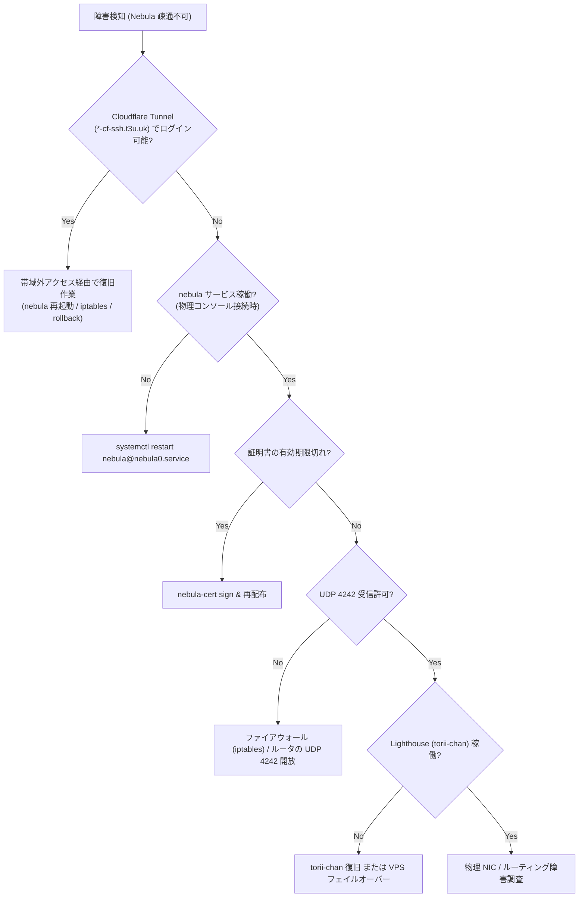
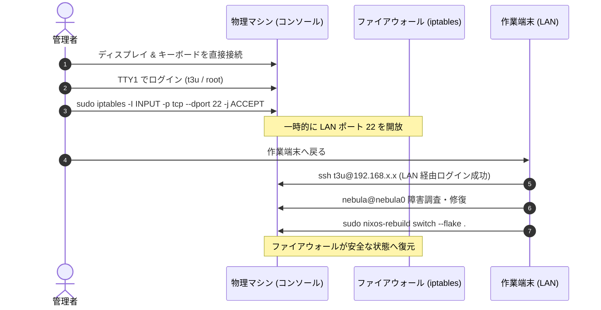

# ネットワーク障害トラブルシューティング

Nebula メッシュ VPN 不通，物理 LAN からの SSH 遮断，同一ルータ同居時の NAT loopback 障害の切り分けと復旧手順．

| 障害種別 | エラー兆候 | 影響ホスト | 初動対応 |
| :--- | :--- | :--- | :--- |
| Nebula メッシュ不通 | `ssh: connect to host 10.0.0.X port 22: Connection timed out`, `Destination Host Unreachable` | 全ホスト | Cloudflare Tunnel 経由の帯域外アクセス，`nebula@nebula0` の再起動 |
| 物理 LAN からの SSH 遮断 | `ssh: connect to host 192.168.x.x port 22: Connection refused` | `shosoin-tan`, `kagutsuchi-sama`, `sando-kun`, `torii-chan` | Cloudflare Tunnel 経由の復旧，または物理コンソールでの `iptables -I` 一時開放 |
| 同一 LAN からの FQDN 接続不通 | `Handshake timed out`，`ping` が WAN IP を返して応答なし | 拠点T の LAN 内クライアント | `my.networking.local-network.enable = true` による LAN IP 直接解決 |

---

## 1. Nebula メッシュ不通

### 現象

```text
$ ssh t3u@10.0.0.X
ssh: connect to host 10.0.0.X port 22: Connection timed out

$ ping 10.0.0.X
From 10.0.0.1 icmp_seq=1 Destination Host Unreachable
```

### 原因

Nebula デーモンの停止，ノード証明書の期限切れ，Lighthouse (`torii-chan`) の停止のいずれかでメッシュ通信が途絶する．

### 切り分け・復旧手順



#### 対策 1: Cloudflare Tunnel 経由の帯域外復旧

各サーバーは Cloudflare エッジに対して独立したアウトバウンドトンネルを確立しているため，Nebula メッシュやルータのインバウンドポート開放状態に依存せず到達できる．

1. PC の CLI から接続する．

   ```bash
   ssh -o ProxyCommand="cloudflared access ssh --hostname <hostname>-cf-ssh.t3u.uk" t3u@<hostname>-cf-ssh.t3u.uk
   ```

2. スマートフォンや出先端末からは `https://<hostname>-cf-ssh.t3u.uk` を開き，Cloudflare Access 認証 (OTP / SSO) を経て xterm.js ターミナルを操作する．
3. Nebula デーモンの状態を確認し，必要に応じて再起動する．

   ```bash
   sudo systemctl status nebula@nebula0.service
   sudo systemctl restart nebula@nebula0.service
   sudo journalctl -u nebula@nebula0.service -e --no-pager
   ```

4. ファイアウォールを一時的に開放し，LAN 側ポート 22 を暫定許可する．

   ```bash
   sudo iptables -I INPUT -p tcp --dport 22 -j ACCEPT
   ```

5. 直前の健全な世代へロールバックするか，設定を修正して再適用する．

   ```bash
   sudo nixos-rebuild switch --rollback
   sudo nixos-rebuild switch --flake .#<hostname>
   ```

対象ホスト一覧と認証仕様は [非常用 SSH アクセス運用マニュアル (Cloudflare Tunnel)](../operations/emergency-cf-ssh.md) を参照する．

#### 対策 2: 物理コンソールからのサービス・証明書調査

Cloudflare Tunnel 経由の接続も不可能な場合は，実機に物理ディスプレイとキーボードを接続して調査する．

1. Nebula systemd ユニットの状態とログを確認する．

   ```bash
   sudo systemctl status nebula@nebula0.service
   sudo journalctl -u nebula@nebula0.service -e --no-pager
   ```

2. ノード証明書の有効期限 (`Not After`) と不整合を確認する．

   ```bash
   nebula-cert print -path hosts/<hostname>/nebula.crt
   ```

3. ファイアウォールとルータで UDP 4242 の受信許可を確認する．
4. Lighthouse (`torii-chan`) の稼働を確認し，停止している場合は [VPS フェイルオーバー手順](../operations/vps-failover.md) を実施する．

#### 対策 3: ノード証明書の再発行

証明書の期限切れや鍵の不整合が確認された場合は，[Nebula ノード証明書の発行と秘密鍵の登録](../operations/secret-management.md#step-7-nebula-ノード証明書の発行と秘密鍵の登録) の手順で再発行する．ノード秘密鍵は平文ステージング領域へ配置し，[平文ステージングの取り込み](../operations/secret-management.md#step-3-平文ステージングの取り込み) の手順で暗号化してから `just secret rekey` を実行する．公開証明書 `hosts/<hostname>/nebula.crt` は平文でコミットする．

---

## 2. 物理 LAN からの SSH 接続拒否

### 現象

```text
$ ssh t3u@192.168.x.x
ssh: connect to host 192.168.x.x port 22: Connection refused
```

### 原因

| 対象 | 設定ファイル | 遮断条件 |
| :--- | :--- | :--- |
| `shosoin-tan`, `kagutsuchi-sama`, `sando-kun` (`tower-server` プロファイル) | [nixos/profiles/tower-server/security.nix](../../nixos/profiles/tower-server/security.nix) | `services.openssh.openFirewall = false`．ポート 22 は Nebula インターフェース (`nebula0`, `trustedInterfaces`) 経由でのみ許可される |
| `torii-chan` (ゲートウェイ) | [nixos/services/gateway/ssh.nix](../../nixos/services/gateway/ssh.nix) | `my.services.gateway.restrictAccess = true` のとき `openFirewall = !cfg.restrictAccess` により物理ポート 22 を遮断する (`false` なら全インターフェースで許可) |

Nebula が停止すると，物理 LAN 経由の SSH 接続は一切不可となる．

> [!TIP]
> 物理ディスプレイとキーボードを接続する前に，[対策 1](#対策-1-cloudflare-tunnel-経由の帯域外復旧) の Cloudflare Tunnel 経由の復旧を試行する．アウトバウンドトンネルが稼働していれば物理作業なしで復旧できる．

### 切り分け・復旧手順



#### 対策 1: 物理コンソール (TTY) へのログイン

1. 対象マシンに物理ディスプレイ (HDMI/DP) と USB キーボードを接続する．
2. ローカルコンソール (TTY) を表示し，初期セットアップ時に設定したパスワードで `t3u` または `root` としてログインする．画面が暗い場合は `Ctrl+Alt+F1` または `Ctrl+Alt+F2` を押す．

#### 対策 2: ポート 22 の一時開放

```bash
sudo iptables -I INPUT -p tcp --dport 22 -j ACCEPT
```

メモリ上のみの変更であり，再起動または `switch` でリセットされる．

#### 対策 3: 作業端末からのサービス復旧

```bash
# 作業端末から実行
ssh t3u@192.168.x.x
sudo systemctl restart nebula@nebula0.service
sudo journalctl -u nebula@nebula0.service -e
```

#### 対策 4: 恒久設定の再適用

原因を解消した後，設定を switch してファイアウォールを元の状態に戻す．

```bash
sudo nixos-rebuild switch --flake .#<hostname>
```

---

## 3. 同一ルータ同居時の名前解決障害と NAT loopback 回避

### 現象

```text
$ getent hosts torii-chan.t3u.uk
<WAN IP>  torii-chan.t3u.uk

$ ping -c 1 torii-chan.t3u.uk
# 応答なし (同一 LAN 内から WAN IP 宛てのパケットがルータで破棄される)

$ journalctl -u nebula@nebula0.service | grep -i handshake
Handshake timed out
```

### 原因

多くの民生用ルータは，LAN 内端末が外部 WAN IP 宛てに送信したトラフィックを再び LAN 内の特定ホストへ折り返すヘアピン NAT (NAT Loopback) に対応しないか，初期設定で無効化されている．この場合，同一 LAN 内の端末が公開 FQDN (`torii-chan.t3u.uk`) を解決してルータの外部 WAN IP へアクセスすると，パケットがルータ側で破棄される．

デュアルスタック環境では IPv6 アドレス解決や glibc のアドレスソート規則 (RFC 3484/6724) により IPv6 宛先が優先され，不通となる場合もある．

### 切り分け・復旧手順

#### 対策 1: `my.networking.local-network` の有効化

[nixos/networking/local-network.nix](../../nixos/networking/local-network.nix) のローカルネットワーク最適化モジュールを有効化し，`/etc/hosts` 上でドメインを LAN 内プライベート IP へ直接解決させる．同一ルータ内に同居するホストの `hosts/<hostname>/default.nix` に追記する．

```nix
my.networking.local-network = {
  enable = true;
  # torii-chan の LAN IP (既定値: 192.168.0.128)
  toriiChanIp = "192.168.0.128";
};
```

| 設定項目 | 内容と効果 |
| :--- | :--- |
| `/etc/hosts` 上書き | `torii-chan.t3u.uk` を LAN IP (`192.168.0.128`) に紐付け，ルータの外部 WAN IP を経由せず直接通信する |
| `gai.conf` による IPv4 優先化 | `/etc/gai.conf` に `precedence ::ffff:0:0/96 100` を注入し，glibc の名前解決で IPv4 を優先する |

#### 対策 2: 設定の適用と検証

```bash
sudo nixos-rebuild switch --flake .#<hostname>

# 名前解決の確認 (192.168.0.128 が返ることを確認)
getent hosts torii-chan.t3u.uk
```

名前解決が LAN IP に切り替わった後，Nebula の疎通または対象ポートへの通信を確認する．

---

## 関連ドキュメント
- [目次](../README.md) — 全ドキュメントの索引
- [非常用 SSH アクセス運用マニュアル (Cloudflare Tunnel)](../operations/emergency-cf-ssh.md) — Cloudflare Tunnel を用いた非常用帯域外 SSH アクセス
- [ネットワークアーキテクチャ設計](../architecture/network-topology.md) — Nebula メッシュネットワーク，IP 体系，DNS 設計
- [VPS フェイルオーバー手順](../operations/vps-failover.md) — ConoHa VPS プロビジョニング & フェイルオーバー切替手順
- [シークレット & 鍵ライフサイクル管理](../operations/secret-management.md) — agenix-rekey, age, Bitwarden による鍵・暗号化管理方針
- [Nebula モジュール実装](../../nixos/networking/nebula.nix) — 本リポジトリの Nebula メッシュ VPN 定義
- [ローカルネットワーク最適化モジュール](../../nixos/networking/local-network.nix) — NAT loopback 回避と hosts / gai.conf 最適化
- [タワーサーバー セキュリティ設定](../../nixos/profiles/tower-server/security.nix) — tower-server プロファイルのファイアウォール・SSH 制限
- [ゲートウェイ ファイアウォール設定](../../nixos/services/gateway/firewall.nix) — ゲートウェイロールの restrictAccess およびポート転送定義
