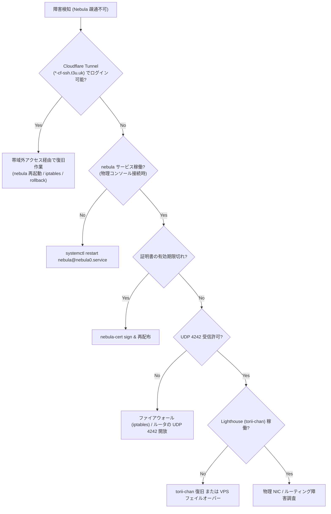
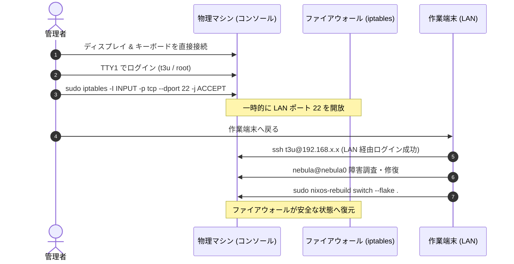

# ネットワーク障害トラブルシューティング

Nebula メッシュ VPN 不通，物理 LAN からの SSH 遮断，同一ルータ同居時の NAT loopback 障害の切り分けと復旧手順．

| 障害現象 | 主な原因 | 推奨復旧アプローチ |
| :--- | :--- | :--- |
| クラスター間通信不通 (`10.0.0.X`) | Nebula デーモン停止，証明書期限切れ，Lighthouse 停止 | Cloudflare Tunnel 帯域外アクセス，証明書再署名，VPS フェイルオーバー |
| 物理 LAN からの SSH 接続拒否 | `tower-server` プロファイルによるポート 22 遮断 | Cloudflare Tunnel 経由復旧，または物理コンソールで `iptables -I` 一時開放 |
| 同一 LAN からの FQDN 接続不通 | ルータのヘアピン NAT (NAT Loopback) 未対応，IPv6 優先 | `my.networking.local-network.enable = true` による LAN IP 直接解決 |

---

## 1. Nebula メッシュ不通時の調査と復旧

### 現象・エラーメッセージ
- クラスター内ホストへの SSH 接続がタイムアウトする (例: `ssh t3u@10.0.0.X` で反応がない)．
- ping 疎通が通らない (`ping 10.0.0.X` で `Destination Host Unreachable`)．

### 原因
Nebula デーモンの停止，ノード証明書の期限切れ，または Lighthouse (`torii-chan`) の障害・停止によってメッシュ通信が途絶する．

### 切り分け・復旧手順



#### 復旧手順 A: 非常用帯域外アクセス (Cloudflare Tunnel) によるリモート復旧

Nebula メッシュのダウン時や Lighthouse (`torii-chan`) 停止時，LAN 側のポート 22 遮断時でも，Cloudflare Tunnel 経由で各サーバーへ直接ログインして復旧作業を行える．各サーバーは独立したアウトバウンドトンネルを Cloudflare エッジに対して確立しているため，Nebula メッシュやルータのインバウンドポート開放状態に依存せず安全に到達できる．

##### 接続方法

- PC CLI からの接続:
  ```bash
  ssh -o ProxyCommand="cloudflared access ssh --hostname <hostname>-cf-ssh.t3u.uk" t3u@<hostname>-cf-ssh.t3u.uk
  ```
- Web ブラウザ (スマートフォン / 出先端末) からの接続:
  ブラウザで `https://<hostname>-cf-ssh.t3u.uk` を開き，Cloudflare Access 認証 (OTP / SSO) を経て xterm.js ターミナルから操作する．

##### 復旧操作

1. Nebula デーモンの状態を確認し，必要に応じて再起動する．
   ```bash
   sudo systemctl status nebula@nebula0.service
   sudo systemctl restart nebula@nebula0.service
   sudo journalctl -u nebula@nebula0.service -e --no-pager
   ```
2. ファイアウォールを一時的に開放し，LAN 側ポート 22 を暫定許可する．
   ```bash
   sudo iptables -I INPUT -p tcp --dport 22 -j ACCEPT
   ```
3. 直前の健全な世代へロールバックするか，設定を修正して再適用する．
   ```bash
   # 直前の健全な世代へロールバック
   sudo nixos-rebuild switch --rollback

   # または設定修正後に適用
   sudo nixos-rebuild switch --flake .#<hostname>
   ```

※ 対象ホスト一覧や詳細な認証仕様は [非常用 SSH アクセス運用マニュアル (Cloudflare Tunnel)](../operations/emergency-cf-ssh.md) を参照．

#### 復旧手順 B: 物理コンソール接続時の調査・復旧手順

Cloudflare Tunnel 経由での接続も不可能な場合，実機に物理ディスプレイとキーボードを接続して以下の手順で調査・修復を行う．

##### Step 1: サービス稼働状況の確認
対象ホストで Nebula systemd ユニットの状態とログを確認する:
```bash
sudo systemctl status nebula@nebula0.service
sudo journalctl -u nebula@nebula0.service -e --no-pager
```

##### Step 2: 証明書有効期限・妥当性の検証
Nebula ノード証明書の有効期限切れや不整合によるハンドシェイク拒否を確認する:
```bash
# 証明書の詳細確認 (有効期限 Not After を検証)
nebula-cert print \
  -path hosts/<hostname>/nebula.crt
```
再署名が必要な場合は，管理端末で証明書を再発行してシークレットを更新する:
```bash
CA_DIR="${CA_DIR:-$HOME/.nebula-ca-10-0-0}"

# ノード証明書の再発行 (-networks オプションを使用)
nebula-cert sign \
  -name "<hostname>" \
  -networks "10.0.0.X/24" \
  -groups "mgmt,..." \
  -ca-crt "$CA_DIR/ca.crt" \
  -ca-key "$CA_DIR/ca.key" \
  -out-crt "hosts/<hostname>/nebula.crt" \
  -out-key "$CA_DIR/<hostname>.key"

# 秘密鍵をステージング領域に配置して暗号化・rekey
mkdir -p .secrets-staging/hosts/<hostname>
mv "$CA_DIR/<hostname>.key" .secrets-staging/hosts/<hostname>/nebula_key
just secret-apply-staging

git add hosts/<hostname>/nebula.crt secrets/
git commit -m "fix(nebula): refresh certificate for <hostname>"
```

---

## 2. SSH 接続が拒否された場合の物理コンソール・ローカル接続手順

### 現象・エラーメッセージ
物理 LAN 内の別端末から SSH 接続を試行した際，以下のエラーとなり接続できない:
```text
ssh: connect to host 192.168.x.x port 22: Connection refused
```

### 原因
本リポジトリのタワーサーバー群 (`tower-server` プロファイル) およびゲートウェイ (`torii-chan`) では，セキュリティ強化のため物理 LAN 側からの SSH 接続が制限されている．

#### タワーサーバー群 (`shosoin-tan`, `kagutsuchi-sama`, `sando-kun`)
[nixos/profiles/tower-server/security.nix](../../nixos/profiles/tower-server/security.nix) において以下の設定が行われている．
```nix
networking.firewall.allowedTCPPorts = lib.mkForce [ ];
```
SSH ポート 22 は Nebula インターフェース (`nebula0`, `trustedInterfaces`) 経由でのみ許可されており，LAN 側の物理インターフェースからはポート 22 へのアクセスがファイアウォールで遮断されている．

#### ゲートウェイ (`torii-chan`)
[nixos/services/gateway/firewall.nix](../../nixos/services/gateway/firewall.nix) において `my.services.gateway.restrictAccess = true` が設定されている場合，以下の条件分岐により物理ポート 22 が遮断される (`restrictAccess` が `false` の場合は LAN からの SSH が許可される)．
```nix
allowedTCPPorts = if cfg.restrictAccess then lib.mkForce [ ] else [ 22 ];
```

このため，Nebula が停止すると (あるいはゲートウェイで `restrictAccess = true` が有効な場合)，物理 LAN 経由での SSH 接続は一切不可となる．

> [!TIP]
> 物理ディスプレイやキーボードをマシンに接続する前に，まず [非常用帯域外アクセス (Cloudflare Tunnel)](#復旧手順-a-非常用帯域外アクセス-cloudflare-tunnel-によるリモート復旧) によるリモート復旧を試行すること．アウトバウンドトンネルが稼働していれば，物理作業なしで安全に復旧できる．

### 切り分け・復旧手順



#### Step 1: 物理コンソール (TTY) の接続とログイン
1. 対象マシンに物理ディスプレイ (HDMI/DP) と USB キーボードを接続する．
2. 画面にローカルコンソール (TTY) を表示し，初期セットアップ時に設定したパスワードでログインする:
   - ユーザー: `t3u` または `root`
   - ※画面が真っ暗な場合は `Ctrl+Alt+F1` または `Ctrl+Alt+F2` を押す．

#### Step 2: 一時的なファイアウォール開放
作業端末から操作するため，メモリ上のみで一時的にポート 22 を許可する (再起動や `switch` でリセットされる):
```bash
sudo iptables -I INPUT -p tcp --dport 22 -j ACCEPT
```

#### Step 3: 作業端末からのリモート復旧
作業端末から LAN IP (`192.168.x.x`) 宛てに SSH 接続し，Nebula サービスを修復する:
```bash
# 作業端末から実行
ssh t3u@192.168.x.x

# Nebula ログ確認と再起動
sudo systemctl restart nebula@nebula0.service
sudo journalctl -u nebula@nebula0.service -e
```

#### Step 4: 恒久設定の再適用
原因を解消した後，通常通り設定を switch してファイアウォールを元のセキュアな状態に戻す:
```bash
sudo nixos-rebuild switch --flake .#<hostname>
```

---

## 3. 同一ルータ同居時の名前解決障害と NAT loopback 回避

### 現象・エラーメッセージ
Lighthouse である `torii-chan` と同一ルータ (拠点T の LAN 内) に配置されたクライアント端末から，Lighthouse 宛ての通信や公開ドメイン解決で以下の障害が発生する:
- `torii-chan.t3u.uk:4242` 宛ての Nebula パケットが届かず，`Handshake timed out` が記録されて P2P トンネルが確立できない．
- 同一 LAN 内から公開ドメイン (`torii-chan.t3u.uk`, `mc.t3u.uk` 等) へのアクセス (SSH, Minecraft 接続等) がタイムアウトまたは Connection refused になる．
- `ping torii-chan.t3u.uk` では外部グローバル IP (WAN IP) が返るが，応答が得られない．

### 原因
多くの民生用ルータは，LAN 内端末が外部 WAN IP 宛てに送信したトラフィックを再び LAN 内の特定ホストへ折り返すヘアピン NAT (NAT Loopback) に対応していないか，初期設定で無効化されている．この場合，同一 LAN 内の端末が公開 FQDN (`torii-chan.t3u.uk`) を解決してルータの外部 WAN IP へアクセスすると，パケットがルータ側で破棄される．

デュアルスタック環境では IPv6 アドレス解決や glibc のアドレスソートルール (RFC 3484/6724) の影響で IPv6 宛先が優先され，不通となるケースもある．

### 切り分け・復旧手順

[nixos/networking/local-network.nix](../../nixos/networking/local-network.nix) に用意されているローカルネットワーク最適化モジュールを有効化し，`/etc/hosts` 上でドメインを LAN 内プライベート IP へ直接解決させる．

#### Step 1: ホスト設定でのオプション有効化
同一ルータ内に同居するホストの `hosts/<hostname>/default.nix` において，`my.networking.local-network.enable` を有効化する:

```nix
my.networking.local-network = {
  enable = true;
  # torii-chan の LAN IP (既定値: 192.168.0.128)
  toriiChanIp = "192.168.0.128";
};
```

このオプションにより以下の設定が適用される．

| 設定項目 | 内容と効果 |
| :--- | :--- |
| `/etc/hosts` 上書き | `torii-chan.t3u.uk` が LAN IP (`192.168.0.128`) に直接紐付けられ，ルータの外部 WAN IP を経由しない直接通信が行われる |
| `gai.conf` による IPv4 優先化 | `/etc/gai.conf` に `precedence ::ffff:0:0/96 100` が注入され，glibc の名前解決において IPv4 が優先される |

#### Step 2: 設定の適用と検証
設定を反映し，名前解決が LAN IP に上書きされていることを確認する:

```bash
sudo nixos-rebuild switch --flake .#<hostname>

# 名前解決の確認 (192.168.0.128 が返ることを確認)
getent hosts torii-chan.t3u.uk
```

名前解決が LAN IP に切り替わった後，Nebula の疎通 (または対象ポートへの通信) が正常に行われることを確認する．

---

## 関連ドキュメント
- [非常用 SSH アクセス運用マニュアル (Cloudflare Tunnel)](../operations/emergency-cf-ssh.md) — Cloudflare Tunnel を用いた非常用帯域外 SSH アクセス
- [ネットワークアーキテクチャ設計](../architecture/network-topology.md) — Nebula メッシュネットワーク，IP 体系，DNS 設計
- [VPS フェイルオーバー手順](../operations/vps-failover.md) — ConoHa VPS プロビジョニング & フェイルオーバー切替手順
- [シークレット & 鍵ライフサイクル管理](../operations/secret-management.md) — agenix-rekey, age, Bitwarden による鍵・暗号化管理方針
- [Nebula モジュール実装](../../nixos/networking/nebula.nix) — 本リポジトリの Nebula メッシュ VPN 定義
- [ローカルネットワーク最適化モジュール](../../nixos/networking/local-network.nix) — NAT loopback 回避と hosts / gai.conf 最適化
- [タワーサーバー セキュリティ設定](../../nixos/profiles/tower-server/security.nix) — tower-server プロファイルのファイアウォール・SSH 制限
- [ゲートウェイ ファイアウォール設定](../../nixos/services/gateway/firewall.nix) — ゲートウェイロールの restrictAccess およびポート転送定義
