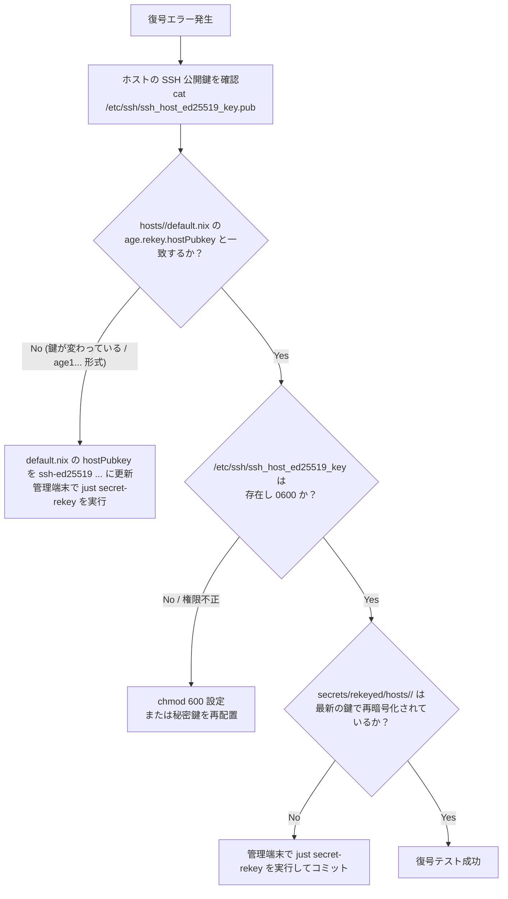

# シークレット・認証トラブルシューティング

agenix (agenix-rekey) 復号エラー，プライベートリポジトリ (`nix-config-private`) 認証失敗，activation 失敗による emergency mode 突入時の切り分けと脱出手順．

| 障害現象 | 主な原因 | 推奨復旧アプローチ |
| :--- | :--- | :--- |
| agenix 復号エラー (`failed to decrypt` / `no identity matched`) | ホスト SSH 鍵の不一致，`age.rekey.hostPubkey` 未登録・誤記 (`age1...` 指定等)，rekey 漏れ | `cat /etc/ssh/ssh_host_ed25519_key.pub` で SSH 公開鍵突合，`hosts/<hostname>/default.nix` 更新，`just secret-rekey` |
| `home-manager` の `agenix.service` 復号失敗 (`~/.ssh/id_ed25519 not present`) | 作業端末の `~/.ssh/id_ed25519` 欠落，または旧 `sops-nix` のリンク切れ (`/run/secrets/...`) | `just secret-doctor` で状態確認，`just secret-ssh-restore` で Bitwarden から復元 |
| private flake input フェッチ失敗 | SSH エイリアス `github-nix-config-private` 未設定 (初回時) | `/root/.ssh/config` とデプロイキーの一時配備 (ブートストラップ) |
| activation 失敗で emergency mode | シークレット復号失敗，`users.mutableUsers = false` によるパスワード不能 | GRUB から健全世代選択ブート，または `init=/bin/sh` で前世代 boot 復旧 |

---

## 1. agenix 復号失敗時の原因切り分け

### 現象・エラーメッセージ
- `[agenix] decrypting ... failed`
- `age: error: no identity matched any of the recipients`
- `Error decrypting file: None of the keys could decrypt the message`
- システムの activation 時に `agenix.service` または `activationScripts` が失敗する．
- `/run/agenix/` 配下にシークレットファイルが生成されない．
- ユーザーのログイン時にパスワードが認識されない (`hashedPasswordFile` の読み込み失敗)．
- 作業端末上でユーザー systemd の `agenix.service` が `~/.ssh/id_ed25519 not present` でスキップまたは失敗し，GPG 鍵等の `home-manager` シークレットが復号されない．

### 原因

| 原因 | 内容と影響 |
| :--- | :--- |
| SSH ホスト秘密鍵の欠落・権限不正 | `/etc/ssh/ssh_host_ed25519_key` が存在しない，空である，または権限が `0600` 以外になっている． |
| ユーザー SSH 鍵の欠落・リンク切れ | `~/.ssh/id_ed25519` が未配置，または旧 `sops-nix` 時代のシンボリックリンク (`~/.ssh/id_ed25519 -> /run/secrets/...`) が残存しており，`home-manager` の `agenix.service` が復号鍵を参照できない． |
| SSH ホスト公開鍵の不一致・形式誤り | マシンの再インストールやストレージ換装により `/etc/ssh/ssh_host_ed25519_key.pub` が再生成され，`hosts/<hostname>/default.nix` の `age.rekey.hostPubkey` と乖離している，または `ssh-ed25519 ...` ではなく `age1...` 形式で指定されている (`agenix` は復号時に SSH 秘密鍵を直接 `age -i` に渡すため，SSH 公開鍵そのものを指定する必要がある)． |
| 再暗号化 (rekey) 漏れ | 新規シークレットの追加やホスト公開鍵の変更後に `just secret-rekey` を実行しておらず，`secrets/rekeyed/hosts/<hostname>/` の暗号化ファイルが更新されていない． |

### 切り分け・復旧手順



#### Step 1: ホストの SSH 公開鍵を確認
対象マシン上で SSH ホスト公開鍵を確認する:
```bash
cat /etc/ssh/ssh_host_ed25519_key.pub
# 出力例: ssh-ed25519 AAAAC3NzaC1lZDI1NTE5...
```

#### Step 2: `hosts/<hostname>/default.nix` の登録情報と突合
`hosts/<hostname>/default.nix` を開き，`age.rekey.hostPubkey` が Step 1 で確認した SSH 公開鍵 (`ssh-ed25519 ...`) と一致しているか確認する．
鍵が異なる場合 (再インストール等) や `age1...` になっている場合は，`age.rekey.hostPubkey` の記述を SSH 公開鍵へ更新する:
```nix
age.rekey.hostPubkey = "ssh-ed25519 AAAAC3NzaC1lZDI1NTE5...";
```

#### Step 3: `/etc/ssh/ssh_host_ed25519_key` の確認・権限修正
ホスト秘密鍵が存在し，パーミッションが `0600` に設定されているか確認する:
```bash
sudo ls -la /etc/ssh/ssh_host_ed25519_key
sudo chmod 600 /etc/ssh/ssh_host_ed25519_key
```

#### Step 4: 管理端末での再暗号化 (`just secret-rekey`)
管理端末で Bitwarden をアンロックし，全ホスト向けシークレットを再暗号化する:
```bash
just secret-rekey

# 再暗号化差分の確認 (対象ホストの暗号化ファイルが更新されていることを確認)
git diff secrets/rekeyed/hosts/<hostname>/

# 変更をコミット
git add hosts/<hostname>/default.nix secrets/rekeyed/hosts/<hostname>/
git commit -m "fix(secrets): update rekeyed secrets for <hostname>"
```

#### Step 5: 復号テスト
対象ホスト上で復号できることを確認する:
```bash
# 対象ホストに設定を適用
sudo nixos-rebuild switch --flake .#<hostname>

# /run/agenix/ 配下に平文が展開されているか確認
sudo ls -la /run/agenix/
```

#### Step 6: ユーザー SSH 鍵の復旧 (`home-manager` `agenix.service` 失敗時)
作業端末で `~/.ssh/id_ed25519` の欠落や旧 `sops-nix` のシンボリックリンク残存により `home-manager` の `agenix.service` が復号できない場合は，診断のうえ Bitwarden (`nix-config/ssh/<hostname>`) から復元する:
```bash
# シンボリックリンク残存・パーミッション・公開鍵整合性を検査
just secret-doctor

# Bitwarden から ~/.ssh/id_ed25519 (0600) と .pub (0644) を配置し，
# ユーザーの agenix.service と import-gpg-key.service を再起動
just secret-ssh-restore
```

---

## 2. nix-config-private リポジトリ取得エラー

### 現象・エラーメッセージ
```text
ssh: Could not resolve hostname github-nix-config-private: No address associated with hostname
error: Failed to fetch git repository 'ssh://git@github-nix-config-private/t3u-tsu/nix-config-private'
```

### 原因
本リポジトリの [flake.nix](../../flake.nix) は，非公開の秘密 flake input として `git+ssh://git@github-nix-config-private/t3u-tsu/nix-config-private` を参照している．SSH エイリアス `github-nix-config-private` は [nixos/base/private-config.nix](../../nixos/base/private-config.nix) によって `/etc/ssh/ssh_config` に定義されるが，初回インストール時や未適用マシンでは root の SSH 設定にエイリアスが存在しないため，Flake 評価自体が失敗する (ブートストラップ時の鶏と卵の問題)．

### 切り分け・復旧手順

新規インストール時は [scripts/install/setup-deploy-key.sh](../../scripts/install/setup-deploy-key.sh) が Step 1〜3 をまとめて実行する．以下は手動で復旧する場合の手順である．

#### Step 1: root の SSH 環境の準備
Flake の評価および Git フェッチは root 権限で実行されるため，root の SSH 設定を初期化する:
```bash
sudo install -d -m 700 /root/.ssh
sudo ssh-keyscan -t ed25519 github.com 2>/dev/null | sudo tee -a /root/.ssh/known_hosts >/dev/null
```

#### Step 2: デプロイキーの配備
再暗号化済みシークレットから読み取り専用デプロイキーを復号して配置する (対象ホストの SSH ホスト秘密鍵または作業端末の SSH 鍵を使用):
```bash
# 対象ホスト上で SSH ホスト秘密鍵を用いて復号する場合 (Live USB レスキュー時は /mnt/etc/ssh/... を指定)
sudo age -d -i /etc/ssh/ssh_host_ed25519_key \
  secrets/rekeyed/hosts/<hostname>/*-deploy_key.age \
  | sudo tee /root/.ssh/nix-config-private_deploy_key >/dev/null
sudo chmod 600 /root/.ssh/nix-config-private_deploy_key
```
> [!TIP]
> 作業端末から直接セットアップする場合は，作業機の SSH 秘密鍵 (`~/.ssh/id_ed25519`) を一時的に `/root/.ssh/nix-config-private_deploy_key` へコピーして代用してもよい．また Master 秘密鍵がある場合は `secrets/master/common/deploy_key.age` を直接復号できる．

#### Step 3: 一時 SSH エイリアスの設定
```bash
sudo tee /root/.ssh/config >/dev/null <<'EOF'
Host github-nix-config-private
  HostName github.com
  User git
  IdentityFile /root/.ssh/nix-config-private_deploy_key
  IdentitiesOnly yes
EOF
```

#### Step 4: 疎通確認とシステム適用
```bash
sudo ssh -T git@github-nix-config-private   # "Hi t3u-tsu!" と表示されれば成功
sudo nixos-rebuild switch --flake .#<hostname>
```

#### Step 5: 一時設定のクリーンアップ
正常に世代が適用されると，[nixos/base/private-config.nix](../../nixos/base/private-config.nix) によりシステム全体 (`/etc/ssh/ssh_config`) にエイリアスが恒久設定されるため，root の一時設定を削除する:
```bash
sudo rm /root/.ssh/config
```

---

## 3. activation スクリプト失敗で emergency mode に入った場合の脱出手順

### 現象・エラーメッセージ
システムの起動時や `nixos-rebuild switch` 実行時に activation スクリプトが非ゼロで終了し，ブートプロセスが中断して以下が表示される:
```text
You are in emergency mode. After logging in, type "journalctl -xb" to view system logs...
Give root password for maintenance (or press Control-D to continue):
```

### 原因
システムの activation スクリプト (シークレット復号，ユーザー・グループ作成，ファイル配置等) が非ゼロ終了すると，systemd のブートプロセスが中断して emergency mode へ突入する．本リポジトリでは [nixos/base/user.nix](../../nixos/base/user.nix) で root パスワードは未設定 (アカウントロック) となっており，パスワードによるコンソールメンテナンスログインは行えないため，ブートパラメータによるレスキューシェル起動が必要となる．

### 切り分け・復旧手順

#### パターン A: GRUB レスキューシェルによる復旧
1. 再起動時に GRUB メニューで対象世代を選択し，`e` キーを押してカーネルパラメータ末尾に `init=/bin/sh` を追記してブートする．
2. 失敗ユニットとエラーログを特定する:
   ```bash
   systemctl --failed
   journalctl -xb -p 3
   ```
3. 直前の健全な世代へロールバックする:
   ```bash
   # 世代一覧を確認し，直前の健全な世代リンク (例: system-35-link) を指定して切り替える
   ls -d /nix/var/nix/profiles/system-*-link
   /nix/var/nix/profiles/system-<世代番号>-link/bin/switch-to-configuration switch
   ```

#### パターン B: パスワード入力が通らずログイン不能な場合

##### 正常世代での起動 (GRUB メニュー)
マシンを再起動してブートローダー (GRUB) メニューを表示し，「NixOS - All configurations」から直前の正常世代を選択して起動する．正常世代でのログイン後，設定を修正またはロールバックする．

##### 代替手段: `init=/bin/sh` 緊急シェルによる世代切り替え
GRUB メニューからの通常起動で解決しない場合，カーネルパラメータを変更して緊急シェルから前世代をブート既定に設定する:

1. マシンを強制再起動し，ブートローダー (GRUB) メニューを表示する．
2. 起動エントリを選択した状態で `e` キーを押し，エントリ編集画面に入る．
3. `linux /nix/store/.../bzImage` で始まる行の末尾に以下を追記する:
   ```text
   init=/bin/sh
   ```
   (または `systemd.unit=rescue.target`)
4. `Ctrl+X` (または `F10`) を押して直接ルートシェルを起動する．
5. ルートファイルシステムを書き込み可能で再マウントする:
   ```bash
   mount -o remount,rw /
   ```
6. 健全な過去の世代へ手動で切り替える:
   ```bash
   # 直前の世代リンクを確認
   ls -l /nix/var/nix/profiles/system-*-link
   # 前世代のブートスクリプトを実行 (init=/bin/sh 環境には systemd がないため boot サブコマンドを指定)
   /nix/var/nix/profiles/system-<前世代番号>-link/bin/switch-to-configuration boot
   reboot -f
   ```

---

## 関連ドキュメント
- [シークレット & 鍵ライフサイクル管理](../operations/secret-management.md) — agenix-rekey, age, Bitwarden による鍵・暗号化管理方針
- [新規ホスト追加手順](../operations/adding-a-host.md) — 新規マシンの追加・初期セットアップ手順
- [緊急時システム復旧・レスキューガイド](emergency-recovery.md) — 世代ロールバック，インストーラ USB レスキュー手順
- [シークレット設計リファレンス](../../secrets/README.md) — 鍵階層，シークレット暗号化モデル，ファイル構成
- [agenix モジュール実装](../../nixos/security/agenix.nix) — 本リポジトリの agenix 共通モジュール定義
- [プライベートリポジトリ認証モジュール](../../nixos/base/private-config.nix) — nix-config-private フェッチ用 SSH エイリアス設定
