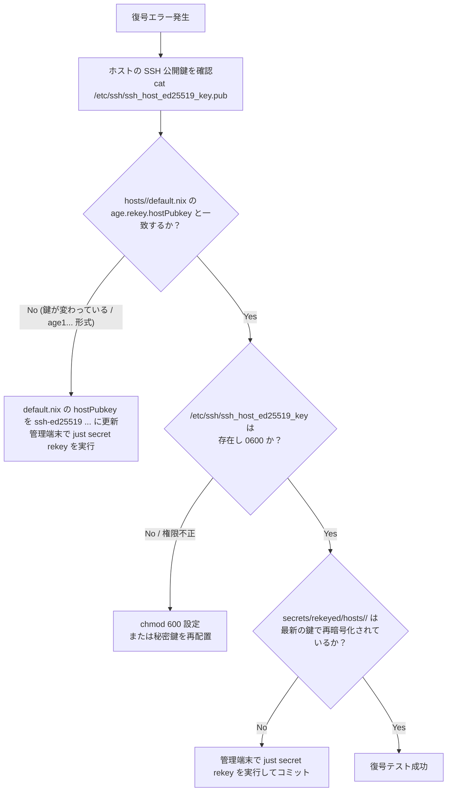

# シークレット・認証トラブルシューティング

agenix (agenix-rekey) 復号エラー，プライベートリポジトリ (`nix-config-private`) 認証失敗，activation 失敗による emergency mode の切り分けと脱出手順．

| 障害種別 | エラー兆候 | 影響ホスト | 初動対応 |
| :--- | :--- | :--- | :--- |
| agenix 復号失敗 | `age: error: no identity matched any of the recipients`, `failed to decrypt` | 全ホスト | `cat /etc/ssh/ssh_host_ed25519_key.pub` と `age.rekey.hostPubkey` の突合，`just secret rekey` |
| `home-manager` の `agenix.service` 復号失敗 | `~/.ssh/id_ed25519 not present` | 作業端末 | `just secret doctor`，`just secret ssh-restore` |
| private flake input フェッチ失敗 | `Could not resolve hostname github-nix-config-private` | 新規インストール機，未適用機 | `/root/.ssh/config` とデプロイキーの一時配備 |
| activation 失敗による emergency mode | `You are in emergency mode.` | 全ホスト | `init=/bin/sh` 緊急シェルからの前世代 boot 復旧 |
| GNOME Keyring 解錠失敗 | `failed to unlock login keyring on startup` | デスクトップ機 (`BrokenPC`, `x1c7`) | `login.keyring` の退避と正規パスワードでの再作成 |

---

## 1. agenix 復号失敗

### 現象

```text
[agenix] decrypting /run/agenix/<secret> ...
age: error: no identity matched any of the recipients
Error decrypting file: None of the keys could decrypt the message
```

`/run/agenix/` 配下にシークレットファイルが生成されず，`hashedPasswordFile` の読み込みに失敗してログインパスワードが認識されない．作業端末ではユーザー systemd の `agenix.service` が `~/.ssh/id_ed25519 not present` で失敗し，GPG 鍵などの `home-manager` シークレットが復号されない．

### 原因

| 原因 | 内容と影響 |
| :--- | :--- |
| SSH ホスト秘密鍵の欠落・権限不正 | `/etc/ssh/ssh_host_ed25519_key` が存在しない，空である，または権限が `0600` 以外になっている． |
| ユーザー SSH 鍵の欠落・リンク切れ | `~/.ssh/id_ed25519` が未配置，または旧 `sops-nix` 時代のシンボリックリンク (`~/.ssh/id_ed25519 -> /run/secrets/...`) が残存しており，`home-manager` の `agenix.service` が復号鍵を参照できない． |
| SSH ホスト公開鍵の不一致・形式誤り | 再インストールやストレージ換装で `/etc/ssh/ssh_host_ed25519_key.pub` が再生成され，`hosts/<hostname>/default.nix` の `age.rekey.hostPubkey` と乖離している．`ssh-ed25519 ...` ではなく `age1...` 形式で指定されている場合も復号に失敗する (agenix は復号時に SSH 秘密鍵を直接 `age -i` へ渡すため，公開鍵は SSH 形式で指定する)． |
| 再暗号化 (rekey) 漏れ | 新規シークレットの追加やホスト公開鍵の変更後に `just secret rekey` を実行しておらず，`secrets/rekeyed/hosts/<hostname>/` の暗号化ファイルが更新されていない． |

### 切り分け・復旧手順



#### 対策 1: ホストの SSH 公開鍵の確認

```bash
cat /etc/ssh/ssh_host_ed25519_key.pub
# 出力例: ssh-ed25519 AAAAC3NzaC1lZDI1NTE5...
```

#### 対策 2: `age.rekey.hostPubkey` との突合

`hosts/<hostname>/default.nix` の `age.rekey.hostPubkey` が対策 1 で確認した SSH 公開鍵 (`ssh-ed25519 ...`) と一致するか確認する．鍵が異なる場合 (再インストール等) や `age1...` 形式になっている場合は，SSH 公開鍵へ更新する．

```nix
age.rekey.hostPubkey = "ssh-ed25519 AAAAC3NzaC1lZDI1NTE5...";
```

#### 対策 3: `/etc/ssh/ssh_host_ed25519_key` の確認と権限修正

```bash
sudo ls -la /etc/ssh/ssh_host_ed25519_key
sudo chmod 600 /etc/ssh/ssh_host_ed25519_key
```

#### 対策 4: 管理端末での再暗号化

Bitwarden をアンロックし，[ホストシークレットの再暗号化](../operations/secret-management.md#step-4-ホストシークレットの再暗号化) の手順で全ホスト向けシークレットを再暗号化する．

```bash
just secret rekey

# 対象ホストの暗号化ファイルが更新されたことを確認
git diff secrets/rekeyed/hosts/<hostname>/

git add hosts/<hostname>/default.nix secrets/rekeyed/hosts/<hostname>/
git commit -m "fix(secrets): update rekeyed secrets for <hostname>"
```

#### 対策 5: 復号テスト

```bash
sudo nixos-rebuild switch --flake .#<hostname>

# /run/agenix/ 配下に平文が展開されているか確認
sudo ls -la /run/agenix/
```

#### 対策 6: ユーザー SSH 鍵の復旧

`~/.ssh/id_ed25519` の欠落や旧 `sops-nix` のシンボリックリンク残存で `home-manager` の `agenix.service` が復号できない場合は，診断のうえ Bitwarden (`nix-config/ssh/<hostname>`) から復元する．手順は [ユーザー SSH 鍵の復元とバックアップ](../operations/secret-management.md#step-6-ユーザー-ssh-鍵の復元とバックアップ) を参照する．

```bash
# シンボリックリンク残存・パーミッション・公開鍵整合性を検査
just secret doctor

# Bitwarden から ~/.ssh/id_ed25519 (0600) と .pub (0644) を配置し，
# ユーザーの agenix.service と import-gpg-key.service を再起動
just secret ssh-restore
```

---

## 2. nix-config-private リポジトリ取得エラー

### 現象

```text
ssh: Could not resolve hostname github-nix-config-private: No address associated with hostname
error: Failed to fetch git repository 'ssh://git@github-nix-config-private/t3u-tsu/nix-config-private'
```

### 原因

[flake.nix](../../flake.nix) は非公開の秘密 flake input として `git+ssh://git@github-nix-config-private/t3u-tsu/nix-config-private` を参照する．SSH エイリアス `github-nix-config-private` は [nixos/base/private-config.nix](../../nixos/base/private-config.nix) が `/etc/ssh/ssh_config` に定義するが，初回インストール時や未適用マシンでは root の SSH 設定にエイリアスが存在しないため，Flake 評価自体が失敗する (ブートストラップ時の鶏と卵の問題)．

### 切り分け・復旧手順

新規インストール時は [scripts/install/setup-deploy-key.sh](../../scripts/install/setup-deploy-key.sh) が対策 1〜3 をまとめて実行する．スクリプトを使えない場合は，[新規ホスト追加手順](../operations/adding-a-host.md#deploy-key-の設定) の deploy key 設定を手動で実施する．

#### 対策 1: root の SSH 環境の準備

Flake の評価と Git フェッチは root 権限で実行されるため，root の SSH 設定を初期化する．

```bash
sudo install -d -m 700 /root/.ssh
sudo ssh-keyscan -t ed25519 github.com 2>/dev/null | sudo tee -a /root/.ssh/known_hosts >/dev/null
```

#### 対策 2: デプロイキーの配備

再暗号化済みシークレットから読み取り専用デプロイキーを復号して配置する．復号には対象ホストの SSH ホスト秘密鍵または作業端末の SSH 鍵を使用する．

```bash
# 対象ホスト上で SSH ホスト秘密鍵を用いて復号する場合 (Live USB レスキュー時は /mnt/etc/ssh/... を指定)
sudo age -d -i /etc/ssh/ssh_host_ed25519_key \
  secrets/rekeyed/hosts/<hostname>/*-deploy_key.age \
  | sudo tee /root/.ssh/nix-config-private_deploy_key >/dev/null
sudo chmod 600 /root/.ssh/nix-config-private_deploy_key
```

> [!TIP]
> 作業端末から直接セットアップする場合は，作業機の SSH 秘密鍵 (`~/.ssh/id_ed25519`) を一時的に `/root/.ssh/nix-config-private_deploy_key` へコピーして代用できる．Master 秘密鍵がある場合は [secrets/master/common/deploy_key.age](../../secrets/master/common/deploy_key.age) を直接復号できる．

#### 対策 3: 一時 SSH エイリアスの設定

```bash
sudo tee /root/.ssh/config >/dev/null <<'EOF'
Host github-nix-config-private
  HostName github.com
  User git
  IdentityFile /root/.ssh/nix-config-private_deploy_key
  IdentitiesOnly yes
EOF
```

#### 対策 4: 疎通確認とシステム適用

```bash
sudo ssh -T git@github-nix-config-private   # "Hi t3u-tsu!" と表示されれば成功
sudo nixos-rebuild switch --flake .#<hostname>
```

#### 対策 5: 一時設定のクリーンアップ

世代の適用後は [nixos/base/private-config.nix](../../nixos/base/private-config.nix) がシステム全体 (`/etc/ssh/ssh_config`) にエイリアスを恒久設定するため，root の一時設定を削除する．

```bash
sudo rm /root/.ssh/config
```

---

## 3. activation スクリプト失敗で emergency mode に入った場合

### 現象

```text
You are in emergency mode. After logging in, type "journalctl -xb" to view system logs...
Give root password for maintenance (or press Control-D to continue):
```

### 原因

activation スクリプト (シークレット復号，ユーザー・グループ作成，ファイル配置等) が非ゼロ終了すると，systemd のブートプロセスが中断して emergency mode へ移行する．[nixos/base/user.nix](../../nixos/base/user.nix) で root パスワードは未設定 (アカウントロック) であるため，パスワードによるコンソールメンテナンスログインは行えない．

### 切り分け・復旧手順

#### 対策 1: 失敗ユニットの特定

`init=/bin/sh` 緊急シェルを起動し，失敗ユニットとエラーログを確認する．起動方法と操作は [init=/bin/sh 緊急シェルによる復旧](emergency-recovery.md#2-initbinsh-緊急シェルによる復旧) を参照する．

```bash
systemctl --failed
journalctl -xb -p 3
```

#### 対策 2: 健全世代での起動

再起動してブートローダーメニューを表示し，「NixOS - All configurations」から直前の正常世代を選択して起動する．メニュー操作は [世代ロールバック](emergency-recovery.md#1-世代ロールバック) の対策 2 と対策 3 を参照する．正常世代でのログイン後に設定を修正するか，ロールバックする．

#### 対策 3: 前世代の boot 設定への切り替え

通常起動で解決しない場合は，`init=/bin/sh` 緊急シェルから前世代の boot 設定を適用する．手順は [init=/bin/sh 緊急シェルによる復旧](emergency-recovery.md#2-initbinsh-緊急シェルによる復旧) を参照する．

---

## 4. greetd / fprintd 併用環境における GNOME Keyring 解錠失敗

### 現象

```text
failed to unlock login keyring on startup
fixed login keyring password to match login password
```

アプリケーション起動時やシークレット参照時にパスワードプロンプト (`gcr-prompter`) が表示され，正規のログインパスワードを入力しても `The password was incorrect` と判定されて解錠できない．上記のログは `journalctl --user -u gnome-keyring-daemon` で確認できる．

### 原因

1. `greetd` のログイン画面でパスワード入力を誤ると，`pam_unix.so` の認証が失敗する．
2. 前段の `pam_gnome_keyring.so` は `pam_unix` の成否を検査せず，入力された未検証の誤パスワード文字列 (`PAM_AUTHTOK`) を保持する．
3. 続けて `pam_fprintd.so` による指紋認証が成功すると，PAM スタック全体の `sufficient` 評価により認証が成立してセッションが開始される．
4. セッション開始時 (`pam_sm_open_session`) に `pam_gnome_keyring` が保持していた誤文字列を `gnome-keyring-daemon` へ渡すが，既存の `login.keyring` の解錠に失敗する (`failed to unlock login keyring on startup`)．
5. デスクトップ起動後，GUI プロンプトで正規パスワードを入力して解錠した瞬間，デーモンのパスワード自動同期機能 (`fixed login keyring password to match login password`) が動作し，先に保持された誤文字列で `~/.local/share/keyrings/login.keyring` を再暗号化してディスクへ書き込む．
6. 次回以降のログインでは，正規パスワードを入力してもキーリングが誤文字列で暗号化されているため解錠できない．

### 切り分け・復旧手順

#### 対策 1: 破損したキーリングの退避

```bash
mv ~/.local/share/keyrings/login.keyring ~/.local/share/keyrings/login.keyring.bak
```

#### 対策 2: キーリングデーモンの再起動

実行中のデーモンを停止し，Secret Service コンポーネントを再起動する．

```bash
killall gnome-keyring-daemon
gnome-keyring-daemon --replace --daemonize --components=secrets
```

#### 対策 3: 正規パスワードでの再作成

シークレット参照時または次回ログイン時に表示されるプロンプトで正規のログインパスワードを入力し，`login.keyring` を再生成する．

---

## 関連ドキュメント
- [目次](../README.md) — 全ドキュメントの索引
- [シークレット & 鍵ライフサイクル管理](../operations/secret-management.md) — agenix-rekey, age, Bitwarden による鍵・暗号化管理方針
- [新規ホスト追加手順](../operations/adding-a-host.md) — 新規マシンの追加・初期セットアップ手順
- [緊急時システム復旧・レスキューガイド](emergency-recovery.md) — 世代ロールバック，`init=/bin/sh` 緊急シェル，インストーラ USB レスキュー手順
- [シークレット設計リファレンス](../../secrets/README.md) — 鍵階層，シークレット暗号化モデル，ファイル構成
- [agenix モジュール実装](../../nixos/security/agenix.nix) — 本リポジトリの agenix 共通モジュール定義
- [プライベートリポジトリ認証モジュール](../../nixos/base/private-config.nix) — nix-config-private フェッチ用 SSH エイリアス設定
